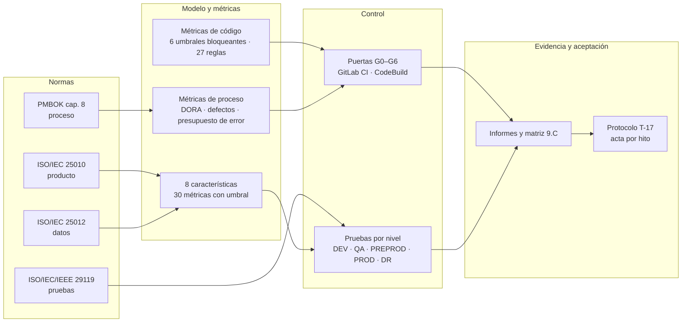
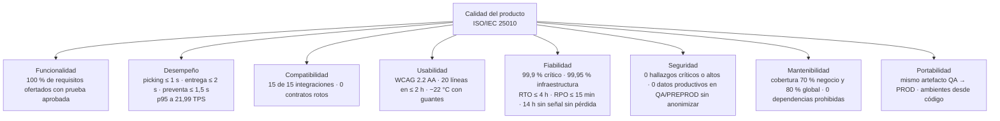
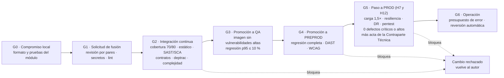
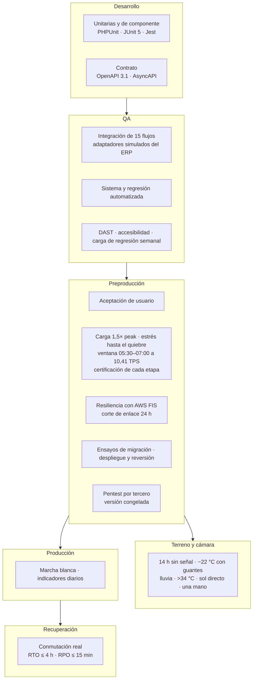
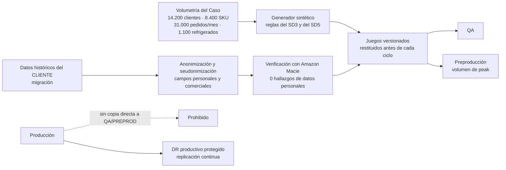
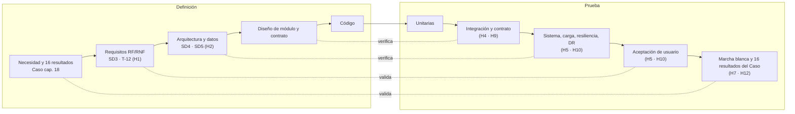
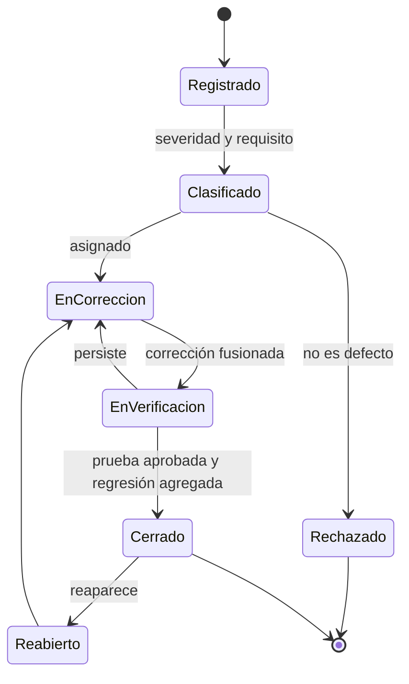
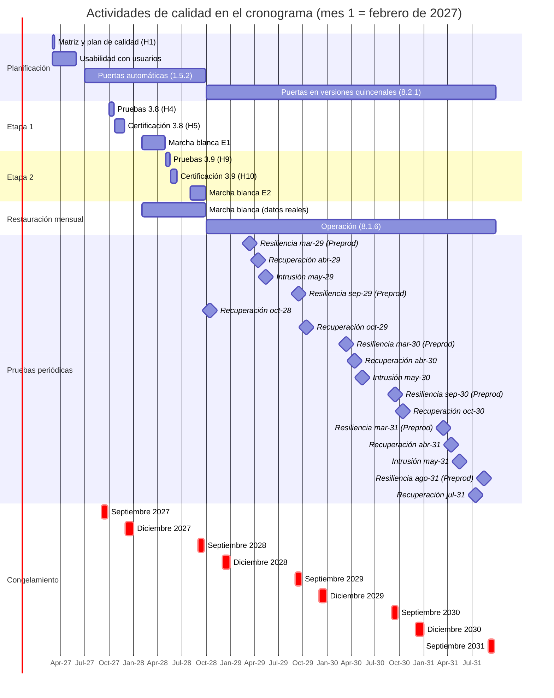
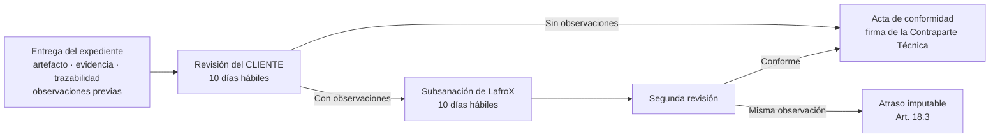

# Propuesta Técnica — Subdocumento 9: Plan de calidad

**Licitación:** TFEP-01/2026  
**Proyecto:** Plataforma Digital de Misión Crítica — Caso 02: Logística  
**Mandante:** Distribuidora Puelche S.A.  
**Proponente:** LafroX SpA — RUT 77.418.902-K  
**Representante legal:** Alex Aravena, Jefe de Proyecto y Apoderado  
**Fecha de emisión:** 9 de octubre de 2026  
**Formularios:** T-13 y T-17

## Índice

- [Introducción al Plan de calidad](#introducción-al-plan-de-calidad)
  - [9.1 Plan de Calidad](#91-plan-de-calidad)
    - [9.1.1 Marco de aseguramiento y gobierno de la calidad](#911-marco-de-aseguramiento-y-gobierno-de-la-calidad)
    - [9.1.2 Modelos de madurez](#912-modelos-de-madurez)
    - [9.1.3 Modelo de calidad del producto según ISO/IEC 25010](#913-modelo-de-calidad-del-producto-según-isoiec-25010)
    - [9.1.4 Métricas de código con umbral bloqueante](#914-métricas-de-código-con-umbral-bloqueante)
    - [9.1.5 Métricas de proceso](#915-métricas-de-proceso)
  - [9.2 Estrategia de Aseguramiento de Calidad](#92-estrategia-de-aseguramiento-de-calidad)
    - [9.2.1 Puertas de calidad](#921-puertas-de-calidad)
    - [9.2.2 Revisión por pares y análisis estático y dinámico](#922-revisión-por-pares-y-análisis-estático-y-dinámico)
    - [9.2.3 Estrategia de pruebas conforme a ISO/IEC/IEEE 29119](#923-estrategia-de-pruebas-conforme-a-isoiecieee-29119)
    - [9.2.4 Datos de prueba](#924-datos-de-prueba)
    - [9.2.5 Verificación, validación y trazabilidad](#925-verificación-validación-y-trazabilidad)
    - [9.2.6 Gestión de defectos](#926-gestión-de-defectos)
  - [9.3 Alineación con Plan de Trabajo](#93-alineación-con-plan-de-trabajo)
    - [9.3.1 Actividades de calidad en la EDT](#931-actividades-de-calidad-en-la-edt)
    - [9.3.2 Calidad en el cronograma y en los hitos](#932-calidad-en-el-cronograma-y-en-los-hitos)
    - [9.3.3 Pruebas periódicas durante la Operación](#933-pruebas-periódicas-durante-la-operación)
- [Referencias](#referencias)
- [Declaración de uso de IA](#declaración-de-uso-de-ia)

# Introducción al Plan de calidad

Este capítulo establece cómo LafroX asegura y demuestra que la plataforma de Distribuidora Puelche cumple lo comprometido. La exigencia es concreta: confirmar una línea de picking en un segundo bajo el peak de septiembre, operar un turno de 14 horas sin señal sin perder ni duplicar un registro, despachar 96 camiones entre las 05:30 y las 07:00 sin indisponibilidad, y entregar al CLIENTE, ante un retiro sanitario, la lista de clientes afectados en menos de dos horas (Distribuidora Puelche S.A., 2026c, caps. 15 y 18). El plan convierte esas exigencias en umbrales medibles, en controles automáticos que bloquean un cambio que no los cumple y en pruebas con fecha, ambiente, datos y criterio de salida.

La sección 9.1 fija el marco: ISO/IEC 25010 para el producto, ISO/IEC 25012 para los datos, ISO/IEC/IEEE 29119 para las pruebas y el PMBOK para el proceso, junto con los modelos de madurez y las métricas de código y de proceso. La sección 9.2 describe la estrategia: puertas de calidad, revisión por pares, análisis estático y dinámico, niveles y tipos de prueba en los cinco ambientes del Subdocumento 4 (en adelante, SD4; la sigla SD seguida de un número designa cada subdocumento de esta propuesta), datos de prueba, trazabilidad y gestión de defectos. La sección 9.3 ubica cada actividad de calidad en la EDT y en el cronograma del SD7.

El capítulo toma los requisitos del catálogo del SD3 y del Formulario T-12, los umbrales de desempeño, los ambientes y la cadena de entrega del SD4, sección 4.2, las reglas de calidad de datos y de migración del SD5, las compuertas y la definición de terminado del SD6, sección 6.2, los paquetes y los hitos del SD7 y de los Formularios T-14 y T-15, los riesgos de calidad del registro del SD8, cuyos códigos R8-nn identifican cada riesgo (R8-18, marcha blanca que no cumple las seis condiciones; R8-31, observaciones que obligan a repetir una certificación; R8-32, evaluadores subcontratados no disponibles), y la innovación INN-02 del SD13, reproducción de incidentes de terreno. El detalle se entrega por separado. El Formulario T-13 contiene el plan de pruebas y validación, con criterios de entrada y salida y calendario. El Formulario T-17 contiene el protocolo de aceptación de cada hito y del producto final. Los Anexos 9.A a 9.D contienen los umbrales completos por subcaracterística, el catálogo de reglas de análisis estático, la matriz de trazabilidad entre pruebas y requisitos y la especificación de los datos de prueba.

Las siglas del capítulo y de sus anexos son las siguientes. BA y BTT designan las Bases Administrativas y las Bases Técnicas Transversales. CAL, DES, IMP, SEG, SRE y DAT son los roles del Formulario T-15 para calidad y pruebas, desarrollo, implantación, seguridad, operación y confiabilidad, y datos. SAST, SCA y DAST son el análisis de seguridad estático del código, el análisis de composición de las dependencias y el análisis dinámico de la aplicación en ejecución. SLSA (Supply-chain Levels for Software Artifacts) es el marco que clasifica la procedencia de las construcciones; PCOV es la extensión de PHP que mide la cobertura. El p95 es el valor bajo el cual queda el 95 % de los tiempos de respuesta, TPS son las transacciones por segundo y MTTR es el tiempo medio de restauración. JD-nn designa un juego de datos del Anexo 9.D; 9A-nn y 9B-nn, una métrica del Anexo 9.A y una regla del Anexo 9.B; y R18-nn, uno de los 16 resultados de aceptación del Caso, capítulo 18.

## 9.1 Plan de Calidad

Esta sección define con qué normas se juzga la calidad, quién decide sobre ella, qué nivel de madurez sustenta los procesos, y qué métricas y umbrales hacen exigible cada característica del producto, del código y del proceso.

### 9.1.1 Marco de aseguramiento y gobierno de la calidad

La Figura 9.1 presenta el marco completo, de las normas a la aceptación. En ella, G0 a G6 son las siete puertas de calidad de la sección 9.2.1; DORA designa las cuatro métricas de entrega del programa DevOps Research and Assessment que describen Forsgren, Humble y Kim (2018), descritas en la sección 9.1.5. Cada norma gobierna un objeto distinto, y ninguna se cita sin el mecanismo que la hace verificable, como exige el Art. 4.3 de las Bases Administrativas (Distribuidora Puelche S.A., 2026a).

**Figura 9.1 — Marco de aseguramiento de la calidad del proyecto. Fuente: elaboración propia.**

La figura muestra que el marco tiene una sola salida: la evidencia que el CLIENTE revisa para firmar el acta de cada hito (Distribuidora Puelche S.A., 2026a, art. 18.2). Las normas de producto y de datos definen qué se mide; la de pruebas define cómo se prueba; el PMBOK define cómo se planifica, se asegura y se controla la calidad del proyecto (Project Management Institute [PMI], 2017, pp. 271–306). Las métricas de código y de proceso no llegan al CLIENTE como declaraciones: se aplican en las puertas automáticas y sus resultados quedan en la matriz de trazabilidad del Anexo 9.C.

El gobierno distingue aseguramiento de control (PMI, 2017, p. 290). El aseguramiento, es decir, que el proceso produzca calidad, está a cargo del Líder de Calidad del proyecto, Maximiliano Miño, con dedicación entre los meses 1 y 56 (SD1, sección 1.5). Lo apoya el Comité de Calidad y Procesos de LafroX, que sesiona mensualmente y analiza la adherencia metodológica y las métricas de defectos (SD1, sección 1.3.1). El control, es decir, que cada entregable cumpla, lo ejecutan las puertas automáticas y el equipo de pruebas (rol CAL del Formulario T-15). La aceptación la decide el CLIENTE por medio de la Contraparte Técnica (Distribuidora Puelche S.A., 2026a, art. 70.2), con el Líder Funcional, Patricio Henríquez, como responsable de LafroX en las pruebas de aceptación de usuario. El Líder de Calidad no responde ante el equipo de desarrollo. Escala al Jefe de Proyecto y, en desacuerdo, al Comité Ejecutivo, para que la presión del plazo no relaje un umbral.

La calidad de datos es parte del marco y no un apéndice. El SD5, sección 5.2.5, usa ISO/IEC 25012 (ISO & IEC, 2008) como modelo de dimensiones —completitud, exactitud, consistencia, unicidad, validez, oportunidad y credibilidad— y define reglas de captura, rechazo y tablero en sus anexos. El plan toma esas reglas como base y agrega en el Anexo 9.A los criterios medibles de completitud, exactitud y consistencia que se verifican en migración, marcha blanca y operación.

#### Guía de control y evidencia

La Tabla 9.1 asigna cada decisión de calidad a su responsable, a la sección que la desarrolla y a la evidencia que permite comprobarla.

**Tabla 9.1 — Guía de control y evidencia. Fuente: elaboración propia.**

| Decisión que se necesita | Responsable | Dónde se desarrolla | Evidencia para comprobarla |
| --- | --- | --- | --- |
| Definir y vigilar calidad del proceso | Líder de Calidad y Comité de Calidad | 9.1.1 y 9.1.5 | Métricas mensuales, auditorías y acciones de mejora |
| Autorizar la promoción de una versión | Responsables de puertas y Contraparte Técnica | 9.2.1; T-13, sección 5 | Resultados de pipeline y expediente; acta adicional en G5 |
| Preparar y ejecutar las pruebas | CAL y especialistas de T-13, sección 9 | 9.2.3–9.2.4; T-13 | Informes, datos versionados y defectos con evidencia |
| Confirmar cobertura y documentación | CAL y dueño del entregable | 9.2.5 y control documental | Matriz 9.C y lista de verificación del expediente |
| Corregir y comprobar eficacia | Dueño de la acción y Comité de Calidad | 9.2.6 | Prueba de regresión o medición posterior frente al criterio existente |
| Aceptar un hito o cerrar una etapa | Contraparte Técnica del CLIENTE | 9.3.2; T-17, secciones 1–3 | Acta y evidencia de los criterios aplicables |

La verificación de los controles de riesgo se consulta en el SD8, Anexo 8.G.

### 9.1.2 Modelos de madurez

El plan usa tres referentes con funciones distintas. ISO 9001:2015 (ISO, 2015) es el sistema de gestión de calidad de LafroX: no mide madurez, sino que da el marco de auditoría de los registros del proyecto. CMMI-DEV v2.0 (CMMI Institute, 2018) es el modelo de madurez del proceso de desarrollo y de pruebas. OWASP SAMM es el marco de madurez del desarrollo seguro que pide el RT-11.28 (Distribuidora Puelche S.A., 2026b), y que el SD4, Anexo 4-R, aplica con una evaluación inicial y una reevaluación anual.

De CMMI-DEV, el nivel 3 significa procesos definidos para la organización y adaptados al proyecto (SD1, secciones 1.3.1 y 1.4). Para este contrato, eso se traduce en tres áreas de práctica que el plan mide y mejora: verificación y validación, que es el proceso de pruebas de la sección 9.2.3; revisión entre pares, de la sección 9.2.2; y aseguramiento de la calidad del proceso, ejercido por las auditorías trimestrales de trazabilidad entre requisito, código y prueba que exige la política de LafroX. Cada área se evalúa con sus prácticas de nivel 3 y con la evidencia que el proyecto ya produce: los informes de prueba y la matriz del Anexo 9.C, las solicitudes de fusión aprobadas y los registros de auditoría.

El modelo se usa para mejorar el proceso durante el contrato. El Líder de Calidad hace una autoevaluación inicial de las tres áreas al aprobar el plan, en el H1, y la repite cada seis meses con la evidencia acumulada. Cada brecha entra como acción del ciclo de mejora de la Tabla 9.9, con dueño y plazo, y se cierra sólo con la comprobación de su eficacia. El Encargado de Seguridad hace lo mismo con SAMM al inicio del desarrollo y cada año. Los resultados de ambos modelos son una entrada del Comité de Calidad mensual de la sección 9.1.1.

La renovación de la evaluación SCAMPI A de CMMI-DEV, que el SD1 declara con vigencia hasta noviembre de 2026, se presenta a la Contraparte Técnica junto con la línea base del H1, el primero de los doce hitos contractuales H1 a H12 del Formulario E-25 (Distribuidora Puelche S.A., 2026a, art. 18.1), que la sección 9.3.2 relaciona con las pruebas. Las tres áreas de práctica se aplican y se auditan en el proyecto desde el primer mes, con independencia de esa fecha.

### 9.1.3 Modelo de calidad del producto según ISO/IEC 25010

El Art. 24 de las Bases Administrativas exige criterios de calidad conforme a ISO/IEC 25010 con umbrales numéricos para ocho características: funcionalidad, desempeño, compatibilidad, usabilidad, fiabilidad, seguridad, mantenibilidad y portabilidad (Distribuidora Puelche S.A., 2026a). Son las ocho del modelo de calidad del producto de la norma (International Organization for Standardization [ISO] & International Electrotechnical Commission [IEC], 2011). La revisión de 2023 renombra usabilidad como capacidad de interacción, portabilidad como flexibilidad, y agrega la seguridad física (ISO & IEC, 2023). El plan conserva los nombres que usan las Bases para no crear una nomenclatura distinta de la del contrato. La Figura 9.2 presenta las ocho características con la métrica que las vuelve exigibles para Puelche.

**Figura 9.2 — Modelo de calidad del producto aplicado a la solución. Fuente: elaboración propia a partir de ISO & IEC (2011) y de los umbrales de las Bases y del SD4.**

En la figura, cada característica tiene al menos una métrica que nace de la operación de Puelche y no de un valor genérico. La Tabla 9.2 resume la métrica principal de cada característica, su umbral y su origen. El Anexo 9.A detalla las 30 métricas por subcaracterística, con método, ambiente y paquete de la EDT, y agrega los indicadores de calidad de datos que el RT-05.04 exige para completitud, exactitud y consistencia.

**Tabla 9.2 — Umbral principal por característica de ISO/IEC 25010. Fuente: elaboración propia a partir de las Bases, del SD3 y del SD4.**

| Característica | Métrica principal | Umbral | Origen |
| --- | --- | --- | --- |
| Funcionalidad | Requisitos ofertados del T-12 con prueba aprobada | 100 % | Caso, sección 17.1 |
| Desempeño | p95 de la transacción crítica a 1,5 × el peak | Picking ≤ 1 s; entrega ≤ 2 s; preventa ≤ 1,5 s; stock y crédito ≤ 2 s | Caso, RT-09.01; SD4 Tabla 31 |
| Compatibilidad | Flujos de integración ejecutados sin error | 15 de 15 | BTT §20.1; SD4 sección 4.1 |
| Usabilidad | Conformidad de accesibilidad | WCAG 2.2 AA sin incumplimientos | BTT RT-13.01 |
| Fiabilidad | Disponibilidad mensual de servicios críticos y de cada componente de la infraestructura | ≥ 99,9 % y 0 min entre 05:30 y 07:00; ≥ 99,95 % por componente | BTT RT-10.01 y cap. 7, sección 7.2; Caso RT-10.05 |
| Seguridad | Hallazgos críticos o altos abiertos | 0 | BTT RT-04.05 y RT-11.20 |
| Mantenibilidad | Cobertura de lógica de negocio y global | ≥ 70 % y ≥ 80 % | BA Art. 24; SD1 sección 1.3.1 |
| Portabilidad | Despliegues que promueven el mismo artefacto | 100 % | BTT RT-04.08 |

De la tabla se concluye que siete de los ocho umbrales vienen fijados por las Bases o por el Caso. El octavo, el de mantenibilidad, combina el mínimo del Art. 24 (70 % en lógica de negocio) con el 80 % de cobertura global, un compromiso de LafroX que ya figura en el SD1. Todos son criterios de salida que se verifican con la prueba y en el ambiente que indica el Anexo 9.A. El desempeño, con seis métricas, y la fiabilidad, con cinco, concentran el modelo porque la operación de Puelche depende de transacciones de segundos en la ventana de despacho y de que el despacho siga sin enlace y sin señal (Distribuidora Puelche S.A., 2026c, cap. 15, RT-03.10 y RT-03.13).

### 9.1.4 Métricas de código con umbral bloqueante

La mantenibilidad se juzga sobre el código mientras se escribe, no al final. La Tabla 9.3 fija los umbrales que bloquean una fusión o una promoción en los tres lenguajes de la solución: PHP 8.5 con Laravel 13 en el monolito modular de 12 módulos, Kotlin en la aplicación Android y TypeScript con Angular en las consolas y los portales (SD4, sección 4.1.1).

**Tabla 9.3 — Métricas de código con umbral bloqueante. Fuente: elaboración propia a partir de las Bases Administrativas, Art. 24, del SD1 y del SD6.**

| Métrica | Umbral bloqueante | Herramienta (PHP · Kotlin · TypeScript) | Puerta |
| --- | --- | --- | --- |
| Cobertura de lógica de negocio | ≥ 70 % | PHPUnit con PCOV · Kover · Jest | G2 |
| Cobertura unitaria global | ≥ 80 % | PHPUnit con PCOV · Kover · Jest | G2 |
| Complejidad ciclomática por método | ≤ 10 | PHPMD · detekt · ESLint | G2 |
| Acoplamiento entre módulos | 0 dependencias prohibidas; en PHP, además, inestabilidad de los módulos núcleo ≤ 0,5 | deptrac y PhpMetrics · detekt (importaciones prohibidas) · ESLint (importaciones prohibidas y cíclicas) | G2 |
| Deuda técnica clasificada como bloqueante | 0 | PhpMetrics y registro de deuda | G2 |
| Duplicación de código | ≤ 3 % de las líneas | PHPCPD · jscpd | G2 |

La cobertura usa dos umbrales distintos, ambos bloqueantes. El 70 % sobre la lógica de negocio es el mínimo del Art. 24 y del RT-04.11 (Distribuidora Puelche S.A., 2026b, cap. 4), y se mide sobre las clases de dominio y de casos de uso de cada módulo en PHP y Kotlin, y sobre los servicios, los almacenes de estado, los validadores y las guardas en Angular. El 80 % sobre todo el código es la política corporativa de LafroX (SD1, sección 1.3.1) y la compuerta del SD6, sección 6.2.2. Que se exijan ambos evita un efecto conocido: una cobertura global alta lograda con pruebas sobre controladores y vistas mientras la regla de asignación de stock o de excursión térmica queda sin probar.

El límite de complejidad ciclomática de 10 por método es el valor propuesto por McCabe (1976) como cota de un módulo comprobable. Acota el número de caminos independientes; los casos cubren las reglas y los caminos pertinentes, y su ejecución se verifica junto con la cobertura. El acoplamiento se controla en la frontera que importa a esta arquitectura: la regla del RT-02.02 exige módulos con límites de contexto explícitos y acoplamiento débil (Distribuidora Puelche S.A., 2026b). En PHP, deptrac verifica en cada fusión que ningún módulo invoque clases internas de otro fuera de su contrato, y PhpMetrics mide la inestabilidad Ce/(Ca+Ce) de los módulos núcleo, que no puede superar 0,5 (Martin, 2003). En Kotlin, detekt prohíbe las importaciones de paquetes internos de otro módulo; en TypeScript, ESLint prohíbe esas importaciones y los ciclos entre módulos. Una violación detiene la integración y no se descubre en una revisión de arquitectura meses después. La deuda que el análisis estático clasifica como bloqueante impide el despliegue, como establece el Formulario T-10; la duplicación se mide en cada integración y una fusión que la lleve sobre el 3 % de las líneas queda bloqueada. El 3 % es el umbral propuesto por LafroX: ni las Bases ni el Caso lo fijan. El Comité de Calidad puede endurecer los umbrales con datos del proyecto, pero no relajarlos más allá de la cota de la Tabla 9.3 sin acta del Comité de Arquitectura. El catálogo completo de reglas está en el Anexo 9.B.

### 9.1.5 Métricas de proceso

El código puede cumplir sus umbrales y el proceso puede seguir dejando escapar defectos. La Tabla 9.4 fija las métricas con que el Comité de Calidad juzga el proceso cada mes. Las de defectos y observaciones se miden desde el mes 2. Las de entrega se miden hacia QA y Preproducción desde que opera la cadena de integración, en el H3 (mes 6), y hacia Producción desde el primer despliegue de la marcha blanca, en el mes 13. Las de servicio, MTTR y presupuesto de error, rigen desde que existe un servicio en Producción.

**Tabla 9.4 — Métricas de proceso y su meta. Fuente: elaboración propia a partir del SD4, sección 4.2.4.1.4, de las Bases Administrativas, arts. 17.3, 18.3, 78 y 79, y de Forsgren, Humble y Kim (2018).**

| Métrica | Fórmula | Meta | Origen de la meta |
| --- | --- | --- | --- |
| Tasa de aprobación de la regresión | Casos aprobados / casos ejecutados en cada ejecución de la batería | 100 % para promover | Tabla 9.5, G2 y G4 |
| Defectos críticos o altos abiertos | Conteo en el registro de defectos al evaluar cada puerta de promoción | 0 | Art. 17.3; sección 9.2.6 |
| Defectos escapados | Defectos críticos o altos hallados en un ambiente posterior al que debió detectarlos / defectos críticos o altos hallados | 0 en Producción durante la marcha blanca; cada escape con su caso de regresión | Art. 17.3; sección 9.2.6 |
| Reapertura de defectos | Defectos reabiertos / defectos cerrados del mes | Ninguno reabierto dos veces por la misma causa sin análisis de causa raíz | Sección 9.2.6 |
| Densidad de defectos | Defectos confirmados / casos ejecutados, por módulo | Medida y registrada cada mes para priorizar; no bloquea | Elaboración propia |
| Observaciones del CLIENTE por entregable | Observaciones formales por hito y las repetidas en la segunda presentación | 0 observaciones de la misma naturaleza en la segunda presentación | Art. 18.3 |
| Tasa de cambios fallidos | Despliegues que requieren reversión o corrección / despliegues | ≤ 5 % mensual | SD4; RT-04.12 |
| Frecuencia de despliegue | Despliegues a producción por período habilitado | Cadencia quincenal | SD4; RT-04.12 |
| Tiempo del commit a producción | Mediana de días hábiles habilitados | ≤ 5 días | SD4; RT-04.12 |
| Tiempo medio de restauración de incidentes críticos (MTTR) | Suma de tiempos desde detección hasta restitución verificada / incidentes críticos restaurados del mes | ≤ 4 h mensual | BA art. 78.3 |
| Consumo del presupuesto de error crítico | Minutos de indisponibilidad computable / presupuesto del mes calendario | ≤ 100 % | BA art. 78.2 y 79.4; RT-10.09 |

Las cuatro métricas de entrega de la Tabla 9.4 (frecuencia de despliegue, tasa de cambios fallidos, tiempo del commit a producción y tiempo de restauración) se basan en Forsgren, Humble y Kim (2018) y en el RT-04.12 del SD4. Para el servicio crítico, la Tabla 9.4 aplica el tiempo medio mensual contractual del Art. 78.3, no una mediana: un indicador agregado del tablero no sustituye ese promedio ni los tiempos máximos de resolución por incidente del Art. 78.2 (4, 8, 24 y 48 horas para severidad crítica, alta, media y baja). El MTTR se calcula sobre los incidentes críticos restaurados del mes, desde su detección hasta la restitución verificada; el informe conserva también los incidentes todavía abiertos y su antigüedad, sin excluirlos del control de los plazos individuales. Si no hay incidentes restaurados, el indicador se informa como no aplicable, no como una meta alcanzada. La frecuencia de despliegue se mide sólo sobre los períodos habilitados por las ventanas del Caso, RT-10.05, y del SD4, sección 4.2.4.1.4.

El presupuesto de error crítico se calcula para el mes calendario real: (1 − 0,999) × días del mes × 1.440 minutos. Un mes de 30 días da 43,2 minutos; los de 28, 29 y 31 días dan 40,32, 41,76 y 44,64 minutos, respectivamente. Para los niveles alto, medio y bajo se aplica la misma fórmula con sus disponibilidades mínimas de 99,5 %, 99,0 % y 98,0 % (Distribuidora Puelche S.A., 2026a, art. 78.2). El numerador contiene los minutos de indisponibilidad computable: las ventanas de mantenimiento programadas y aprobadas no computan como indisponibilidad; las no aprobadas o excedidas sí (art. 79.4). Esa exclusión no resta por sí misma minutos al mes calendario usado como denominador. Ningún presupuesto autoriza indisponibilidad en la ventana de despacho de 05:30 a 07:00 de lunes a sábado, cuyo límite sigue siendo cero (Distribuidora Puelche S.A., 2026c, RT-10.05). Al agotarse el presupuesto crítico del mes se suspenden los despliegues no correctivos hasta el mes siguiente (SD4, sección 4.2.4.1.4).

## 9.2 Estrategia de Aseguramiento de Calidad

Esta sección describe cómo se aplican los umbrales de la sección 9.1: en qué puertas se verifican, cómo se revisa y analiza el código, qué pruebas se ejecutan en cada ambiente y con qué datos, cómo se mantiene la trazabilidad y cómo se gestionan los defectos.

### 9.2.1 Puertas de calidad

Una puerta de calidad es un punto del recorrido de un cambio donde un criterio objetivo decide si avanza. La Figura 9.3 presenta las siete puertas, del computador del desarrollador a la operación, sobre la cadena de entrega del SD4, sección 4.2.4.1: GitLab CI orquesta, AWS CodeBuild construye con procedencia SLSA nivel 3, y la imagen firmada se promueve por su digest desde Elastic Container Registry.

**Figura 9.3 — Puertas de calidad en la cadena de entrega. Fuente: elaboración propia a partir del SD4, sección 4.2.4.1, y del Formulario T-10, sección 6.2.2.**

La figura muestra que el control es más barato cuanto antes ocurre. G0 a G2 se ejecutan en minutos y en cada cambio; G5 se ejecuta pocas veces y exige semanas de prueba. Las compuertas bloqueantes que define el Formulario T-10, sección 6.2.2, que acompaña al SD6, viven en G2 y G3: hallazgo crítico o alto, contrato roto, cobertura de negocio bajo 70 %, cobertura global bajo 80 %, duplicación sobre 3 % y deuda bloqueante o prueba en falla. Este plan agrega a G2 los límites de complejidad y de acoplamiento de la Tabla 9.3 y agrega las puertas de promoción G4 y G5, que el SD6 no detalla, y la de operación G6, que conecta la calidad con el presupuesto de error. La Tabla 9.5 resume lo que bloquea cada puerta y quién puede levantarla.

**Tabla 9.5 — Criterios de bloqueo y autoridad por puerta. Fuente: elaboración propia.**

| Puerta | Momento | Bloquea si | Autoridad para levantar |
| --- | --- | --- | --- |
| G0–G1 | Cada compromiso y cada solicitud de fusión | Falta aprobación de un par, hay secreto o error de lint | Nadie; se corrige |
| G2 | Cada ejecución del pipeline | Falla un umbral de la Tabla 9.3, hay hallazgo crítico o alto, contrato roto o prueba en falla | Nadie; se corrige |
| G3 | Promoción a QA | Imagen con vulnerabilidad crítica o alta, o p95 empeora más de 10 % | Nadie para la vulnerabilidad; Líder de Calidad para la regresión de desempeño, con registro de deuda |
| G4 | Promoción a PREPROD | Regresión con fallas, alerta alta de DAST, incumplimiento WCAG AA o defecto crítico o alto abierto | Nadie; se corrige |
| G5 | Paso a producción contractual (H7 y H12) | Prueba de la Tabla 9.6 no aprobada, defecto crítico o alto abierto, o falta el acta de la Contraparte Técnica | Nadie; se corrige. El acta de la Contraparte Técnica es una condición adicional de G5 y no levanta una prueba fallida ni un defecto crítico o alto |
| G0–G4 y G6, con repetición de la prueba afectada | Cada corrección durante la marcha blanca, incluidas las de septiembre de 2028 (sección 9.3.2) | Falla una puerta de G0 a G4; la prueba de certificación afectada, repetida sobre la versión corregida, no se aprueba; hay defecto crítico o alto abierto | Nadie; se corrige |
| G6 | Cada despliegue en Producción y cada mes de Operación | Canario con un p95 sobre su umbral o con más errores que la entrega estable; presupuesto de error crítico del mes agotado | Nadie; la reversión del canario es automática y los despliegues no correctivos quedan suspendidos hasta el mes siguiente |

Se concluye que ningún hallazgo de seguridad crítico o alto admite excepción en ninguna puerta, conforme al Formulario T-10, sección 6.2.2, y al RT-04.05, que exige bloqueo automático (Distribuidora Puelche S.A., 2026b, cap. 4). La única excepción que el plan admite es la regresión de desempeño de G3: el Líder de Calidad puede aceptarla con registro de deuda y fecha de cierre cuando la causa está identificada y no afecta un umbral p95 de la Tabla 9.2. G5 sólo se supera con el acta de la Contraparte Técnica, porque es la condición del paso a producción del Art. 18.1 (Distribuidora Puelche S.A., 2026a). Durante el desarrollo, el paso a producción ocurre sólo en los hitos aprobados (Formulario T-10, sección 6.2.2), de modo que G5 rige únicamente los pasos H7 y H12. Las correcciones de la marcha blanca no son un paso a producción contractual: pasan por G0 a G4 y por G6, con regresión completa, DAST y la prueba de carga de regresión, y con la repetición de la prueba de certificación que su cambio afecta (sección 9.3.2). No exigen la Tabla 9.6 completa ni el acta de la Contraparte Técnica. En la Operación, cada versión de la cadencia quincenal pasa por G0 a G4 y por G6, y las pruebas de carga, resiliencia, recuperación e intrusión siguen el calendario de la Tabla 9.9. El acta se suma a las pruebas aprobadas y no las reemplaza: no levanta una prueba de la Tabla 9.6 no aprobada ni un defecto crítico o alto abierto, que el Art. 17.3 tampoco admite al cierre de la marcha blanca. G6 aplica en Producción las dos reglas del SD4: la reversión automática del canario (sección 4.2.4.1.2) y la suspensión de los despliegues no correctivos al agotarse el presupuesto de error (sección 4.2.4.1.4). La regresión de desempeño de G3 se apoya en la prueba de carga automática que el SD4, sección 4.2.4.1.4, ejecuta en QA sobre cada versión candidata y al menos una vez por semana. El 10 % es la tolerancia de LafroX al ruido de medición antes de declarar una regresión.

### 9.2.2 Revisión por pares y análisis estático y dinámico

Toda modificación entra a la rama principal por una solicitud de fusión. La rama principal está protegida y la escritura directa está prohibida (RT-04.03; Distribuidora Puelche S.A., 2026b, cap. 4, p. 10). La fusión requiere la aprobación de al menos un par que no haya escrito el cambio. Los cambios en módulos de criticidad alta del SD4, Tabla 16, requieren además la aprobación del arquitecto del frente: emisión de guía, bloqueo por excursión térmica, reserva de stock y sincronización. Los cambios en autenticación, cifrado o datos personales requieren la del Encargado de Seguridad. El revisor verifica tres cosas que una herramienta no ve: que el cambio implemente el requisito citado, que las pruebas prueben la regla y no sólo recorran líneas, y que el nombre de los componentes sea el del SD3 y del SD4.

El análisis estático se ejecuta en G1 y G2 sobre cada cambio. En PHP, PHPStan con Larastan en nivel 8 y Laravel Pint, ya incorporados al pipeline del SD4, se complementan con PHPMD para complejidad ciclomática, PhpMetrics para inestabilidad y deuda técnica, PHPCPD para duplicación y deptrac para dependencias entre módulos. En Kotlin, detekt y ktlint cumplen esa misma función, y en TypeScript, ESLint; jscpd mide la duplicación en TypeScript y Kotlin. El análisis de seguridad estático usa el analizador SAST de GitLab, la auditoría de dependencias (`composer audit` y `npm audit`), la detección de secretos y el escaneo de imágenes de Amazon Inspector, que cubren los cinco análisis mínimos del RT-04.05 (Distribuidora Puelche S.A., 2026b, cap. 4, p. 10). La aplicación Android tiene su propio análisis de seguridad: MobSF revisa el paquete contra los requisitos de OWASP MASVS, de forma estática en G2 y de forma dinámica sobre un dispositivo en QA antes de G4. Los contratos OpenAPI 3.1 y AsyncAPI se validan con Spectral y se prueban con Pact, que ejecuta las expectativas de cada consumidor contra el proveedor en G2.

El análisis dinámico ejecuta el software. En QA, OWASP ZAP recorre los portales y las API publicadas con la definición OpenAPI 3.1 de cada contrato. Una alerta alta detiene G4. La herramienta axe-core evalúa automáticamente las vistas de los portales y de la aplicación contra WCAG 2.2 AA (World Wide Web Consortium [W3C], 2023). La revisión manual complementa la herramienta con navegación por teclado, lector de pantalla y contraste bajo sol directo, porque el RT-13.01 exige ambas verificaciones (Distribuidora Puelche S.A., 2026b). Las consolas y los portales de Angular se prueban de extremo a extremo con Playwright en QA, sobre los flujos del SD3 por perfil; Jest cubre sólo las pruebas unitarias. La inyección de fallas, la carga y el estrés son también análisis dinámico y se describen en la sección siguiente.

### 9.2.3 Estrategia de pruebas conforme a ISO/IEC/IEEE 29119

La estrategia sigue el modelo de procesos de pruebas de ISO/IEC/IEEE 29119-2. En el nivel organizacional rige la política de pruebas de LafroX. En el nivel de gestión, el plan de pruebas del proyecto, que es el Formulario T-13, se monitorea y se cierra en cada hito. En el nivel dinámico se diseñan, preparan y ejecutan las pruebas y se informan sus resultados (ISO, IEC & Institute of Electrical and Electronics Engineers [IEEE], 2021a). Como organiza la parte 1 de la norma, la intensidad de la prueba sigue el riesgo del producto (ISO, IEC & IEEE, 2022). Las técnicas de diseño se eligen por tipo de regla, conforme a la parte 4 (ISO, IEC & IEEE, 2021b):

- partición de equivalencia y valores límite para los umbrales térmicos y de crédito;
- tablas de decisión para la asignación de stock y el tratamiento de la entrega con local cerrado;
- transición de estados para el ciclo del pedido y de la guía;
- casos de uso para los flujos del SD3.

La Figura 9.4 ubica cada nivel y tipo de prueba en el ambiente donde se ejecuta.

**Figura 9.4 — Niveles y tipos de prueba por ambiente. Fuente: elaboración propia a partir del SD4, Tabla 12.**

La figura sigue la regla del SD4, Tabla 12: el software se prueba en un ambiente cada vez más parecido a producción, y lo que se promueve es la misma imagen. Desarrollo concentra las pruebas rápidas y aisladas. QA concentra las de integración y regresión con datos controlados. Preproducción, equivalente a producción en topología y configuración (RT-04.02), concentra las pruebas que dependen de la escala y de las fallas. Las pruebas propias del caso, como el turno sin señal y la cámara de congelado, no caben en un ambiente de nube. Se ejecutan en terreno con dispositivos reales y una unidad de cada tipo de equipo, antes de la compra masiva (RT-08.15). La Tabla 9.6 sintetiza las pruebas que habilitan un paso a producción. El Formulario T-13 contiene su especificación completa, con criterios de entrada y salida.

**Tabla 9.6 — Pruebas que habilitan cada paso a producción. Fuente: elaboración propia a partir de las Bases Técnicas Transversales, sección 20.1, y del Caso, capítulo 15.**

| Prueba | Ambiente | Carga o escenario | Criterio de salida |
| --- | --- | --- | --- |
| Integración y regresión | QA | 15 integraciones y batería completa | 0 fallas y 0 regresiones |
| Aceptación de usuario | PREPROD | Casos del SD3 con preventistas, conductores, bodega y Comercial | Casos firmados por la Contraparte Técnica |
| Carga | PREPROD | 21,99 TPS, 1.163 usuarios y 237 dispositivos | Todos los p95 de la Tabla 9.2 |
| Ventana de despacho | PREPROD | 10,41 TPS (1,5 × 6,94 TPS) durante los 90 minutos de 05:30 a 07:00, con la emisión de guías concentrada | 0 minutos de indisponibilidad y todos los p95 de la Tabla 9.2 |
| Estrés | PREPROD | Escalones de 2×, 3× (43,98 TPS) y 4× | Punto de quiebre registrado, degradación controlada, sin pérdida |
| Resiliencia | PREPROD | Caída de instancia, zona, dependencia, latencia y disco | Recuperación sin intervención |
| Perfil operacional | Terreno y PREPROD | 14 h sin señal, 24 h sin enlace, −22 °C con guantes, lluvia, >34 °C, sol directo y operación a una mano | 0 pérdidas y 0 duplicados; sincronización ≤ 10 min y ≤ 2 h; RT-13.04 y RT-13.08 medidos por perfil |
| Recuperación ante desastres | DR | Conmutación regional real | RTO ≤ 4 h y RPO ≤ 15 min |
| Seguridad ofensiva | PREPROD | Tercero independiente | 0 hallazgos críticos o altos abiertos |
| Accesibilidad | QA y PREPROD | axe-core y revisión manual | Conformidad WCAG 2.2 AA documentada |
| Migración | PREPROD | Dos ensayos completos, 32,11 GB | 0 diferencias no explicadas |

La carga de la prueba se deriva del dimensionamiento y no se elige. El peak de septiembre del SD4, Tabla 33, es de 14,66 TPS; por 1,5 da 21,99 TPS (RT-09.06; Distribuidora Puelche S.A., 2026b, cap. 9, p. 21). Con el mismo factor, los 775,33 usuarios concurrentes de la cota extrema pasan a 1.163, y los 158 dispositivos de terreno simultáneos pasan a 237. El escalón de 3× (43,98 TPS) verifica el crecimiento de tres veces sin rediseño del RT-09.03. El de 4× busca el punto de quiebre y comprueba que, al superarse la capacidad, la solución encola y avisa en vez de perder transacciones (RT-09.08). La prueba se ejecuta con k6, distribuyendo la carga por lugar de proceso según el perfil horario del SD4. Además de la prueba de septiembre, se reproduce la ventana de despacho de 05:30 a 07:00 a 1,5 × 6,94 TPS = 10,41 TPS, con la emisión de guías concentrada en 90 minutos. Su criterio no es sólo el tiempo de respuesta: no puede haber un minuto de indisponibilidad. La resiliencia usa AWS Fault Injection Service en la nube y desconexiones controladas en el sitio emulado de Preproducción. La prueba de terreno usa Espresso para automatizar los flujos repetibles de la aplicación y personas del CLIENTE en las condiciones físicas que el RT-13.08 exige: cámara de −22 °C con guantes, lluvia, temperatura superior a 34 °C, lectura bajo sol directo, operación a una mano y turno sin señal. Las pruebas moderadas miden por perfil el tiempo, los pasos, la tasa de error y el aprendizaje del RT-13.04.

La automatización es el criterio por defecto, y LafroX se compromete a que al menos el 80 % de los casos esté automatizado en el informe de integración y regresión de cada etapa (paquetes 3.8.1 y 3.9.1). Una prueba es manual sólo si exige el juicio de una persona usuaria, una condición física o un tercero. Con la estimación del Anexo 9.C, el catálogo inicial tiene unos 1.308 casos:

- 849 casos para los 260 requisitos funcionales y no funcionales ofertados del T-12 que se prueban directamente (56 críticos, 161 altos y 43 medios según su prioridad en el SD3), a razón de cinco por requisito crítico, tres por alto y dos por medio. Los nueve absorbidos por otra fila se prueban con ella. Las 271 filas RF y RNF del T-12 se concilian así: 260 con prueba propia, 9 absorbidas y 2 en «No cumple» (RNF-21.02 y RNF-21.07), que no se prueban;
- 354 casos para los RT en estado «Cumple» o «Cumple parcialmente»;
- 105 casos de contrato para las 15 integraciones, siete por integración: éxito, dependencia que no responde, respuesta con error, respuesta con lentitud, duplicado, orden y versión. Los tres casos de falla son los que distingue el RT-10.08 (Distribuidora Puelche S.A., 2026b, cap. 10).

El total es 849 + 354 + 105 = 1.308 casos. Con el 80 % automatizado, la regresión automática ejecuta 0,8 × 1.308 ≈ 1.046 casos. Para dimensionar su duración se usan dos supuestos de planificación: 0,5 minutos de ejecución por caso automatizado, como promedio de casos de API, que son rápidos, y de interfaz con Playwright y Espresso, que son más lentos; y 15 minutos por caso manual, que incluyen restituir el juego de datos, ejecutar el caso y registrar el resultado. Con el primero, la regresión tarda 1.046 × 0,5 / 60 ≈ 8,7 horas en un ejecutor y 4,36 horas repartida en dos ejecutores paralelos, y cabe en una ejecución nocturna antes de cada promoción a Preproducción. Con el segundo, los 262 casos manuales requieren 262 × 15 / 60 ≈ 65,5 HH por ciclo, que se planifican con los evaluadores en los meses de certificación. Ambos supuestos se miden en la primera regresión de QA y se reemplazan por el promedio real. Si el promedio automatizado fuera de un minuto, la regresión tardaría 17,4 horas en un ejecutor, y cuatro ejecutores paralelos la devolverían a 4,36 horas sin cambiar el número de casos.

#### Intensidad de la prueba según el riesgo

La prioridad del requisito en el SD3 fija el mínimo de casos: cinco, tres o dos (Anexo 9.C.1). Los riesgos técnicos del registro del SD8 agregan pruebas de otro tipo sobre los componentes que nombran y fijan el hito en que se repiten. La Tabla 9.7 relaciona los riesgos de mayor puntaje con la prueba que los controla.

**Tabla 9.7 — Riesgos técnicos del SD8 y la prueba que los controla. Fuente: elaboración propia a partir del Formulario T-16 y de los Formularios T-13 y T-15.**

| Riesgo (SD8) | Prueba que lo controla | Ambiente | Cuándo se ejecuta y se repite |
| --- | --- | --- | --- |
| R8-01 ERP indisponible o guía invalidada | Ensayo de caída del ERP con 96 camiones: preemisión nocturna y conciliación entre carga y guía | PREPROD | Antes del H6; se repite antes del H11 |
| R8-02 Doble reserva o custodia | Concurrencia, UUID, idempotencia y época de autoridad sobre el mismo stock | QA | Antes del H4; regresión en el H9 |
| R8-03 CD sin 24 horas de enlace | Corte de enlace de 24 h con procesos completos y reconciliación en Talca y Concepción | PREPROD | Antes del H5; se repite antes del H10 |
| R8-04 Pérdida o duplicación tras 14 h sin señal | 14 h sin señal, reinicio, UUID y reconciliación | Terreno | Antes del H5 y con cada versión móvil |
| R8-05 Pérdida del sitio supera el RPO | Conmutación regional real con RPO medido | DR | Por certificación y semestral |
| R8-06 Carga y cola de reservas exceden la capacidad | Carga a 1,5× el peak, crecimiento y drenaje de la cola | PREPROD | Paquetes 3.8.4 y 3.9.3 |
| R8-07 Ataque o exposición de datos críticos | Prueba de intrusión por tercero, DAST, SAST y SCA | QA y PREPROD | Antes del H5 y del H10; anual |
| R8-16 Migración altera saldos o pierde lotes | Dos ensayos y conciliación por SKU, lote y ubicación | PREPROD | Antes del corte y del H6 |
| R8-23 Frío o sensores sin evidencia íntegra | Autonomía, calibración y asociación entre sensor, lote y tiempo | Terreno y cámara | Antes de la ola 1 y de la ola de reparto |
| R8-27 Estimación insegura de vida remanente | Validación con Calidad y regla conservadora | QA y PREPROD | Antes del uso, en los meses 11 a 15 |

### 9.2.4 Datos de prueba

Ningún ambiente no productivo de prueba contiene datos productivos reales sin anonimización verificable (SD3, Anexo 3.B; SD4, sección 4.2.4.1). La regla se aplica a Desarrollo, QA, Preproducción y Terreno. El ambiente de Recuperación ante Desastres no se usa como ambiente funcional de prueba: es una réplica productiva protegida, con acceso restringido y auditado, para ejecutar la conmutación real que exigen las Bases. La regla se funda en la Ley N.º 21.719, que protege los datos personales de los clientes, de los conductores de terceros y la geolocalización de los trabajadores (Ley N.º 21.719, 2024). La Figura 9.5 muestra de dónde vienen los datos de cada ambiente.

**Figura 9.5 — Origen y control de los datos de prueba. Fuente: elaboración propia a partir del SD4, sección 4.2.4.1, y del SD5, sección 5.3.**

La figura muestra dos fuentes para los ambientes de prueba y separa el sitio de recuperación como continuidad productiva. Los datos sintéticos se generan desde la volumetría del caso (Distribuidora Puelche S.A., 2026c, sección 14.1) y respetan las reglas de negocio: lotes con fecha de vencimiento, productos refrigerados con su rango térmico y clientes con crédito y comportamiento de pago. Así, la prueba de carga de Preproducción opera sobre un volumen comparable al de peak. Los datos históricos sólo se usan en los ensayos de migración, después de anonimizar los campos personales y comerciales que el Caso, RT-11.10, exige cifrar. Amazon Macie verifica que no queden datos personales antes de que el juego de datos llegue a QA o Preproducción, y una prueba de reidentificación documentada revisa una muestra de seudónimos, trazas y antecedentes comerciales antes de liberar el juego. QA trabaja con juegos versionados que se restituyen a un estado conocido antes de cada ciclo, para que un fallo sea reproducible. Esa misma propiedad usa INN-02 para convertir un incidente de terreno en una prueba de regresión permanente (SD13, sección 13.2). El Anexo 9.D especifica cada juego de datos, su volumen y su regla de anonimización.

### 9.2.5 Verificación, validación y trazabilidad

La verificación comprueba que cada producto cumpla su especificación; la validación comprueba que la solución resuelva el problema de Puelche. La Figura 9.6 empareja cada artefacto de diseño con el nivel de prueba que lo verifica y con el hito que lo acepta.

**Figura 9.6 — Verificación y validación por nivel y por hito. Fuente: elaboración propia a partir del Formulario E-25.**

La figura relaciona la certificación técnica inicial de cada etapa (H5 y H10) con el cierre contractual de su marcha blanca (H7 y H12). No son el término de la verificación ni de la validación: la primera se repite sobre los cambios y las pruebas operativas; la segunda incluye las pruebas tempranas con personas usuarias y la comprobación posterior de las necesidades de Puelche. Con usuarios y volumen reales se verifica, además, que la lista de un retiro sanitario se obtenga en menos de dos horas y que el indicador de entregas completas y a tiempo se mida de una sola forma. Los 16 resultados del Caso, capítulo 18, que el SD3 y el Formulario T-17 identifican como R18-01 a R18-16, se aceptan con el protocolo del Formulario T-17, en el mes que fija el SD3, Anexo 3.J, Tabla 3.A.13, y no se dan por aceptados por la sola certificación técnica. La aceptación no libera de responsabilidad por defectos posteriores (Distribuidora Puelche S.A., 2026a, art. 18.4).

La trazabilidad es la cadena que pide el Caso, sección 17.1: origen, requisito, componente, paquete de la EDT, prueba de verificación y criterio de aceptación. El RT-04.04 le agrega el cambio de código y el despliegue (Distribuidora Puelche S.A., 2026b, cap. 4, p. 10). La Figura 9.7 presenta la cadena con los identificadores que la sostienen: M1 a M12 son los doce módulos del monolito modular y INT-01 a INT-15, las quince integraciones de la solución (SD4, sección 4.1).

```mermaid
flowchart LR
    O["Origen<br/>párrafo del Caso · RT<br/><i>Caso cap. 18, resultado 1:<br/>retiro en menos de 2 h</i>"] --> R["Requisito<br/>RF · RNF · RT del T-12 (645 ID)<br/><i>RF-09.01 trazabilidad<br/>hacia adelante</i>"]
    R --> C["Componente<br/>M1–M12 · INT-01–15<br/><i>M9 Calidad y trazabilidad</i>"]
    C --> E["Paquete EDT<br/>T-14<br/><i>3.4.4 Cadena de frío, retención<br/>de lotes y retiro sanitario</i>"]
    E --> K["Caso de prueba<br/>CP-ID requisito-nn<br/><i>CP-RF-09.01-01 a -05<br/>en 3.8.1 y 3.8.2</i>"]
    K --> G["Cambio<br/>solicitud de fusión con ID<br/><i>aprobada por un par</i>"]
    G --> D["Despliegue<br/>digest de imagen<br/><i>imagen firmada en PROD</i>"]
    D --> A["Aceptación<br/>acta T-17<br/><i>resultado R18-01: simulacro<br/>de retiro, H7</i>"]
```

**Figura 9.7 — Cadena de trazabilidad de extremo a extremo. Fuente: elaboración propia a partir del Caso, sección 17.1, y de las Bases Técnicas Transversales, RT-04.04.**

La figura muestra que cada eslabón se apoya en un identificador que ya existe en la propuesta, y la recorre en cursiva con un requisito crítico: la lista de clientes afectados por un lote en menos de dos horas. Los 645 ID del Formulario T-12 enlazan los requisitos con sus componentes y con la sección que los desarrolla. Cada caso de prueba lleva el ID del requisito en su nombre y, en el código, en una anotación de grupo de PHPUnit o en una etiqueta de JUnit. Así, el informe de cada ejecución del pipeline se agrupa por requisito sin trabajo manual. Cada solicitud de fusión cita el requisito o la incidencia que atiende, y cada despliegue registra el digest de la imagen que llevó. Con esos cuatro enlaces, la matriz del Anexo 9.C se genera desde el repositorio y el historial del pipeline, y no se mantiene a mano. La meta es que el 100 % de los ID con estado «Cumple» o «Cumple parcialmente» tenga al menos una prueba aprobada antes de su hito. Los 22 ID en estado «No cumple» (2 RNF y 20 RT, sin RF en esa condición) quedan en la matriz sin prueba, para que la Contraparte vea la brecha en vez de un vacío. Los nueve ID absorbidos o alias se verifican con la prueba de la fila que los contiene y no suman casos propios. Así, los 31 ID sin prueba propia se concilian como 22 no ofertados más nueve absorbidos, y los 645 ID se distribuyen en 614 con prueba propia y 31 sin ella.

#### Control documental de entregables

Antes de presentar un entregable al CLIENTE, CAL revisa con su dueño la lista siguiente y conserva el resultado en el expediente previsto por el T-17. Cada comprobación registra conforme, observación o no aplicable con justificación, referencia a la sección y evidencia; el dueño corrige y CAL verifica la corrección. La Tabla 9.8 lista las comprobaciones.

**Tabla 9.8 — Lista de control documental de los entregables al CLIENTE. Fuente: elaboración propia.**

| Comprobación | Evidencia o criterio de revisión |
| --- | --- |
| Correspondencia con las Bases y el alcance ofertado | Fuente identificada, requisito y criterio de aceptación trazables; excepciones y dependencias visibles |
| Cifras, unidades y cálculos | Fuente o cálculo mostrado; mismos valores en tablas, texto y formularios relacionados |
| Trazabilidad | Requisito, diseño, paquete, prueba y criterio vinculados; estados de cumplimiento y de prueba consistentes |
| Tablas, figuras y remisiones | Cada objeto con su número y su referencia; enlaces al destino correcto; legibilidad en el soporte de entrega |
| Evidencia y estado real | Compromiso, supuesto, prueba prevista, resultado obtenido y aceptación distinguidos; ninguna aprobación atribuida sin su acta |
| Fuentes | Cada cita localizable, con su página cuando la fuente la tiene |

Una observación se registra con responsable y plazo en el mismo expediente o registro de defectos, según corresponda. La lista complementa, sin cambiar, los criterios y plazos de aceptación del T-17.

### 9.2.6 Gestión de defectos

Un defecto es toda diferencia entre el resultado esperado de una prueba y el obtenido. Se registra en GitLab con el caso de prueba, el requisito, el ambiente, la versión y la evidencia. La Figura 9.8 presenta su ciclo de vida.

**Figura 9.8 — Ciclo de vida del defecto. Fuente: elaboración propia.**

En la figura, un defecto sólo se cierra cuando la prueba que lo detectó pasa y queda incorporada a la regresión. La regresión detecta la recurrencia en los escenarios y las aserciones que cubre; si una variante del defecto escapa, se amplían los casos y se revisa su causa. La severidad usa las cuatro clases de los niveles de servicio del SD4, Tabla 16, para que un defecto y un incidente se midan con la misma vara. Un defecto es crítico si impide la preparación, el despacho o la emisión de la guía en la ventana de 05:30 a 07:00, si compromete la seguridad o la integridad de datos, o si impide el bloqueo por excursión térmica. Es alto si afecta un servicio de nivel alto, que sólo tiene una alternativa costosa, como la captura sin conexión de la toma de pedido, la entrega o la consulta de stock y crédito. Es medio si el servicio afectado dispone de una alternativa operativa, y bajo si no impide operar. Ningún defecto crítico o alto abierto pasa la puerta G4. Ninguna marcha blanca se cierra con incidentes críticos o altos abiertos atribuibles a la solución (Distribuidora Puelche S.A., 2026a, art. 17.3). Un defecto reabierto dos veces por la misma causa pasa a análisis de causa raíz en el Comité de Calidad, con el mismo formato que el Art. 25 de las Bases Administrativas exige para los incidentes críticos.

#### Mejora continua y comprobación de eficacia

El Comité de Calidad mensual de 9.1.1 usa las métricas de 9.1.5, los defectos escapados o recurrentes, las auditorías y las observaciones de las personas usuarias para decidir mejoras. Cada acción conserva en el registro de defectos o de deuda técnica su causa, dueño, plazo, criterio vigente que debe recuperar y evidencia con la que se comprobará. No se abre un registro paralelo ni se cambia un umbral de aceptación mediante una acción de mejora.

La Tabla 9.9 resume los pasos del ciclo de mejora y el resultado que se verifica en cada uno.

**Tabla 9.9 — Ciclo de mejora y comprobación de eficacia. Fuente: elaboración propia.**

| Paso | Resultado verificable |
| --- | --- |
| Detectar y analizar | Desviación documentada frente al criterio existente y análisis de su causa; el defecto reabierto mantiene la regla de causa raíz de esta sección |
| Acordar y ejecutar | Dueño y plazo asignados; corrección del proceso, capacitación o ajuste de control/prueba según la causa |
| Prevenir repetición | Defecto escapado incorporado a la regresión; actualización del control y de la ficha R8 asociada cuando corresponda |
| Comprobar eficacia | En el siguiente Comité de Calidad mensual, resultado de reejecución o medición posterior frente al mismo criterio y comparación con la desviación inicial |
| Cerrar o escalar | Cierre sólo con evidencia de eficacia; si falla o falta evidencia, mantener abierta, corregir la acción y escalar según el gobierno de 9.1.1 |

Una acción se cierra cuando su eficacia está comprobada. Si la verificación depende de una prueba todavía no programada para ese período, el comité registra el impedimento y su fecha aplicable y mantiene la acción abierta. Una amenaza inmediata a seguridad, continuidad o hito se escala sin esperar el comité mensual por el ciclo del SD8. El cierre de mejora tampoco sustituye el cierre del defecto, la comprobación de riesgo residual ni la aceptación contractual.

## 9.3 Alineación con Plan de Trabajo

Esta sección muestra dónde quedan las actividades de calidad en la EDT y en el cronograma del SD7, con sus horas, sus meses, los hitos que habilitan y las pruebas periódicas de la Operación.

### 9.3.1 Actividades de calidad en la EDT

La EDT del Formulario T-14 no tiene una rama de calidad aislada. Las actividades de calidad están en las cuentas donde se produce lo que verifican, como muestran la matriz de cobertura del SD7, Tabla 7.2, y su Figura 7.16. La Tabla 9.10 agrupa esos paquetes por cuenta, con sus horas del Formulario T-15.

**Tabla 9.10 — Paquetes de calidad de la EDT por cuenta. Fuente: elaboración propia a partir de los Formularios T-14 y T-15.**

| Cuenta | Paquetes | Contenido | Meses | HH |
| --- | --- | --- | --- | --- |
| 1.2 y 1.5 | 1.2.4, 1.5.1, 1.5.2 | Matriz de trazabilidad, plan de calidad y pruebas, puertas automáticas | 2; 6–20 | 240 |
| 2.6 | 2.6.1–2.6.3 | Investigación con usuarios, prototipos, pruebas e indicadores de usabilidad | 2–4 | 720 |
| 3.8 | 3.8.1–3.8.8 | Pruebas y certificación de la Etapa 1 | 9–10 | 2.080 |
| 3.9 | 3.9.1–3.9.7 | Pruebas y certificación de la Etapa 2 | 16–17 | 1.760 |
| 3.10.2 | 3.10.2.1–3.10.2.4 | INN-02: reproducción de incidentes de terreno | 2–15 | 960 |
| 4.1, 7.3 | 4.1.2, 7.3.1, 7.3.2 | Ensayo de reversión y certificación de usuarios | 11–18 | 400 |
| 8.1–8.3 | 8.1.3, 8.1.6, 8.2.2, 8.2.4, 8.3.1 | DR, restauraciones, pentest, inyección de fallas, deuda técnica y regresión de INN-02 | 21–56 | 4.688 |

La tabla suma 10.848 HH, el 5,0 % de las 216.935 HH de la línea base. Esa proporción no se fijó de antemano: resulta de sumar los paquetes, cada uno estimado con la clase del Formulario T-15, sección 4.1, que fija 320 HH para una prueba y 160 HH para una integración o un cierre de certificación, y 80 HH para una actividad de gestión; la prueba de intrusión de la Etapa 1 se estima en 160 HH. Así, los ocho paquetes de la cuenta 3.8 suman 160 + 4 × 320 + 160 + 160 + 320 = 2.080 HH, y los siete de la 3.9, 160 + 4 × 320 + 160 + 160 = 1.760 HH. De las 10.848 HH, 4.656 son del rol CAL: a 128 HH efectivas por persona y mes (Formulario T-15, sección 4.1), equivalen a 36,4 personas-mes repartidas en 56 meses y concentradas en los bloques de certificación, donde las refuerzan los evaluadores subcontratados de la sección 9.3.2. El resto corresponde a Seguridad, SRE, Implantación y Desarrollo, que ejecutan las pruebas de su especialidad bajo los criterios de este plan. Las pruebas de las etapas se concentran en dos bloques de dos meses: 3.8 en los meses 9 y 10, y 3.9 en los meses 16 y 17. Esa concentración no es casual: las pruebas empiezan cuando los módulos están integrados, y terminan con margen para que la revisión del CLIENTE de 10 días hábiles y una eventual subsanación de otros 10 quepan antes de la fecha del hito (Distribuidora Puelche S.A., 2026a, art. 18.3). Las 4.688 HH de la Operación muestran que la calidad no termina con la aceptación final. En los 36 meses siguientes se sostiene con las pruebas periódicas de la sección 9.3.3 y con la gestión de deuda técnica que exige el Art. 24. Desde el mes 21, cada versión quincenal pasa por las puertas G0 a G4 y G6 dentro del paquete 8.2.1, que programa una actividad por quincena, 72 en total (Formulario T-15, sección 6.2); el pipeline ejecuta las puertas sin horas adicionales, y las reglas y herramientas que aplican se mantienen con los paquetes 8.2.4, de deuda técnica, y 8.2.5, de actualización anual de los componentes de base.

### 9.3.2 Calidad en el cronograma y en los hitos

La Figura 9.9 ubica las actividades de calidad en los 56 meses del contrato, junto con los hitos del Formulario E-25 y las ventanas de congelamiento.

**Figura 9.9 — Actividades de calidad en el cronograma del contrato. Fuente: elaboración propia a partir del Formulario T-15, sección 6.1.**

La figura muestra que ninguna prueba de certificación ni ninguna prueba periódica productiva de la Operación cae en un congelamiento. Las resiliencias semestrales de la Operación se ejecutan en Preproducción o sitio emulado; por eso las de septiembre, en los meses 32 y 44, no intervienen Producción ni el sitio de recuperación. Las pruebas de la Etapa 1 terminan en noviembre de 2027, antes de diciembre, y las de la Etapa 2 en junio de 2028. Producción opera con datos reales desde el mes 13, de modo que la restauración de respaldos es mensual desde ese mes (RT-07.12) y no desde el mes 21: en la marcha blanca la ejecuta el SRE con el procedimiento del paquete 8.1.6, y su informe mensual entra al expediente del H7 y del H12.

La marcha blanca de la Etapa 2 coincide con el peak de septiembre de 2028 y con el congelamiento del 1 al 25 de septiembre: es operación supervisada, y su medición diaria con el volumen de peak es la exigencia más dura sobre la solución (Distribuidora Puelche S.A., 2026c, cap. 13). Durante ese congelamiento rige una regla de correcciones:

- Se corrige sólo un defecto crítico o alto atribuible a la solución, es decir, el que impediría cumplir el Art. 17.3 en el H12. Los defectos medios y bajos se programan para después del 25 de septiembre.
- La corrección entra por el cambio de emergencia del SD4, sección 4.2.4.1.4. El NOC/SOC lo solicita al CLIENTE el mismo día en que se detecta el defecto, con la evidencia del plazo y de la contención aplicada, y lo autoriza por escrito la Contraparte Técnica. Se ejecuta por el mismo pipeline, con reversión preparada y fuera de la ventana de 05:30 a 07:00.
- Antes de pedir la autorización, la versión corregida pasa por G0 a G4 y por la repetición de la prueba afectada en Preproducción, que el congelamiento no alcanza. El CLIENTE decide con esa evidencia a la vista.
- Si el CLIENTE no autoriza el cambio, LafroX mantiene la contención, el CLIENTE acepta el riesgo y la corrección se ejecuta en la primera fecha habilitada, el 26 de septiembre.

Así se protege el H12, que es en el mes 21, octubre de 2028. El cierre exige 0 defectos críticos o altos abiertos (Art. 17.3), y un defecto diferido al 26 de septiembre llega a ese cierre con su corrección promovida y su prueba repetida.

El refuerzo de evaluadores subcontratados, de hasta 16 por día (SD6, sección 6.1.3), cubre los meses 9 a 12 y 16 a 18. Con las 128 HH efectivas por persona y mes del Formulario T-15, sección 4.1, el techo aritmético es 16 × 128 = 2.048 HH mensuales; es el máximo de capacidad, y el Líder de Calidad ajusta la asignación cada mes. Antes de autorizar cada campaña, el Líder de Calidad comprueba los días hábiles efectivos, la asignación por especialidad, la disponibilidad del tercero independiente y de los ambientes y la compatibilidad de las ventanas de prueba. La capacidad para subsanar observaciones de los meses 11, 12 y 18 se comprueba con esa asignación, no con el máximo agregado. Las 153,6 HH esperadas de R8-31 (SD8, Anexo 8.A) cuantifican el riesgo de una certificación repetida. Los evaluadores reciben antes de su primer turno una inducción en las herramientas, los datos de prueba y los criterios de este plan, registrada en el expediente de la campaña.

Las Bases exigen antes de cada paso a producción las pruebas aplicables de carga y estrés, resiliencia, recuperación ante desastres con conmutación real, seguridad ofensiva y accesibilidad de la Tabla 9.6 (Distribuidora Puelche S.A., 2026b, sección 20.1, RT-10.07 y RT-11.20). También se demuestra en Preproducción el despliegue sin interrupción y su reversión (Distribuidora Puelche S.A., 2026a, art. 24). En el Formulario T-14, esas pruebas son los paquetes 3.8.2 a 3.8.6 y 3.8.8 de la Etapa 1 y 3.9.2 a 3.9.5 y 3.9.7 de la Etapa 2, que cierran con las actas de certificación de H5 y H10. En el Formulario E-25, los pasos a producción contractuales son H7 para la Etapa 1 y H12 para la Etapa 2. H6 y H11 habilitan el inicio de la marcha blanca: operan con datos y usuarios reales, pero siguen siendo operación supervisada con condiciones de entrada, no el cierre contractual de producción. Las pruebas de certificación de los paquetes 3.8 y 3.9 se ejecutan después de la integración y regresión de su alcance y antes de H6/H11. El paso a producción se acepta con las seis condiciones del Art. 17.3 y el acta del paquete 4.2.3 (H7) o 4.3.3 (H12) del Formulario T-14 (Formulario T-18).

Varias campañas de certificación coinciden en las ventanas del Formulario T-15, y no todas pueden compartir el mismo ambiente: la resiliencia necesita carga sostenida en curso, la prueba de intrusión exige una versión congelada, la migración carga datos históricos y la aceptación de usuario necesita datos estables. Por eso cada campaña que altera el estado del ambiente o que exige una versión congelada usa su propia instancia de Preproducción, reconstruida desde el mismo código y con la misma topología y configuración (RT-04.02 y RT-04.14; Anexo 9.A, 9A-29). Siguen siendo Preproducción, no un sexto ambiente. La Tabla 9.11 asigna cada campaña a su instancia con la ventana de su paquete.

**Tabla 9.11 — Campañas de certificación en Preproducción, por instancia. Fuente: elaboración propia a partir del Formulario T-15, sección 6.1, y del Formulario T-13, Tabla T13.3.**

| Etapa | Campaña (paquete, HH del T-15) | Instancia | Ventana | Condición de la separación |
| --- | --- | --- | --- | --- |
| 1 | Ensayos de migración (3.7.2) | PRE-M | 04-10 a 03-11-2027 | Carga el juego JD-08 de datos históricos anonimizados, que se elimina al cerrar cada ensayo |
| 1 | Carga y estrés, a continuación resiliencia bajo carga sostenida, y despliegue sin interrupción (3.8.4, 320 HH; 3.8.8, 320 HH) | PRE-C | 21-10 a 09-11-2027 | La resiliencia y el despliegue se ejecutan bajo la carga que mantiene la campaña; van en secuencia, no en paralelo |
| 1 | Prueba de intrusión (3.8.6, 160 HH) | PRE-S | 21-10 a 09-11-2027 | Exige versión congelada y no admite la inyección de fallas en la misma instancia |
| 1 | Aceptación y accesibilidad (3.8.2, 320 HH) | PRE-A | 21-10 a 17-11-2027 | Las personas usuarias necesitan datos estables mientras ejecutan sus casos |
| 2 | Carga con ambas etapas, resiliencia y despliegue sin interrupción (3.9.3, 320 HH; 3.9.7, 160 HH) | PRE-C | 19 a 26-05-2028 | Misma secuencia que en la Etapa 1 |
| 2 | Prueba de intrusión (3.9.5, 320 HH) | PRE-S | 19 a 26-05-2028 | Versión congelada de la Etapa 2; su alcance es la superficie nueva más la de la Etapa 1 |
| 2 | Aceptación y accesibilidad (3.9.2, 320 HH) | PRE-A | 27 a 31-05-2028 | Los casos son los nuevos de la Etapa 2 y los de convivencia con la Etapa 1 |

La recuperación ante desastres (3.8.5 y 3.9.4) se ejecuta en el ambiente de recuperación, no en Preproducción, y la prueba de terreno (3.8.3), con dispositivos reales. La duración de cada campaña es la de su paquete en el Formulario T-15. La aceptación de la Etapa 2 cabe en su ventana breve porque verifica el alcance incremental: los flujos de la Etapa 1 ya fueron certificados en el H5 y se comprueban de nuevo con la regresión del paquete 3.9.1, que corre antes y no ocupa esa ventana.

Cada corrección de marcha blanca pasa por las puertas G0 a G4 y G6, con regresión completa, DAST y la prueba de carga de regresión semanal; no pasa por G5 (sección 9.2.1). Si la corrección modifica la superficie expuesta o un componente que cubrió una prueba de certificación, el Líder de Calidad repite la prueba afectada sobre la versión corregida antes de promoverla. La Tabla 9.12 fija, para cada etapa, el paquete que se repite, su ventana, su responsable y las horas con que se financia.

**Tabla 9.12 — Repetición de una prueba de certificación tras una corrección. Fuente: elaboración propia a partir de los Formularios T-14 y T-15, sección 4.5, y del SD8, Anexo 8.A.**

| Etapa | Prueba que se repite (paquete de origen) | Ventana | Responsable | HH máximas por repetición | Financiamiento |
| --- | --- | --- | --- | --- | --- |
| 1 | Aceptación, perfil operacional, carga y resiliencia, recuperación o despliegue (3.8.2 a 3.8.5 y 3.8.8) | Entre la corrección y su promoción, en la marcha blanca de los meses 13 a 16 | CAL; SRE para el despliegue | 320 | Reserva protegida de la Etapa 1 (128 HH de CAL por mes, meses 13 a 20); el exceso, reserva de contingencia (R8-18) |
| 1 | Prueba de intrusión (3.8.6) | Igual | SEG | 160 | Reserva de contingencia (R8-18) |
| 2 | Aceptación, carga y resiliencia, recuperación o despliegue (3.9.2 a 3.9.4 y 3.9.7) | Entre la corrección y su promoción, en la marcha blanca de los meses 19 a 21 | CAL; SRE para el despliegue | 320 (160 el despliegue) | Reserva de contingencia (R8-18); la reserva protegida de la Etapa 1 no se presta a la Etapa 2 |
| 2 | Prueba de intrusión (3.9.5) | Igual | SEG | 320 | Reserva de contingencia (R8-18) |

Las horas máximas son las del paquete original en el Formulario T-15: una repetición no supera lo que costó la prueba que repite. La reserva de contingencia se consume sólo cuando el riesgo se materializa y el comité competente autoriza el cargo (Formulario T-15, sección 4.5).

La promoción permanece bloqueada hasta que el expediente de G5 reúna las pruebas aprobadas y el acta requerida, sin desplazar los hitos contractuales (Distribuidora Puelche S.A., 2026a, arts. 17 y 18; 2026b, sección 20.1). Antes de autorizar una repetición, el Líder de Calidad comprueba la programación y los recursos disponibles.

Cada hito de la Tabla 9.13 se acepta con el protocolo del Formulario T-17. El entregable se presenta con su evidencia objetiva y la trazabilidad a los requisitos que satisface (Distribuidora Puelche S.A., 2026a, art. 18.2), al menos 10 días hábiles antes del último día hábil del mes del hito (Formulario T-15, sección 5.5). La tabla compara, para todos los hitos con fecha de entrega programada, la reserva del Formulario T-15, Tabla 5.2, con los días de una subsanación: 10 días hábiles (Art. 18.3) y, en el H1 y el H8, los 5 y los 4 días que fijan el Formulario T-15, sección 5.5, y el riesgo R8-12 del SD8.

**Tabla 9.13 — Hitos con entrega programada, reserva y holgura tras una subsanación. Fuente: elaboración propia a partir del Formulario E-25 y del Formulario T-15, Tabla 5.2 y sección 5.5.**

| Hito (mes) | Prueba o entregable que lo habilita | Entrega programada | Reserva (días háb.) | Subsanación (días háb.) | Holgura (días háb.) |
| --- | --- | --- | --- | --- | --- |
| H1 (2) | Matriz de trazabilidad 1.2.4 | 09-03-2027 | 6 | 5 | 1 |
| H2 (4) | Informe de usabilidad 2.6.2 | 29-04-2027 | 12 | 10 | 2 |
| H3 (6) | Pipeline con las puertas G0 a G3 | 21-06-2027 | 19 | 10 | 9 |
| H4 (10) | Integración y regresión 3.8.1 | 20-10-2027 | 19 | 10 | 9 |
| H5 (12) | Certificación 3.8.7 | 29-11-2027 | 35 | 10 | 25 |
| H8 (14) | Diseño detallado E2 | 13-03-2028 | 4 | 4 | 0 |
| H9 (17) | Integración y regresión 3.9.1 | 18-05-2028 | 21 | 10 | 11 |
| H10 (18) | Certificación 3.9.6 | 12-06-2028 | 25 | 10 | 15 |

La holgura es la reserva menos los días de subsanación. La subsanación se mide sobre el expediente que se presenta: la segunda revisión del CLIENTE (Figura 9.10) no cabe en la reserva de ningún hito, y por eso el plan reduce la probabilidad de que haya que usarla. El H4 y el H9 se presentan por incrementos: el informe de cada módulo se entrega al terminarlo y la revisión final cubre sólo el último incremento (Formulario T-15, sección 5.5). El H1 y el H8 se presentan primero como borrador a la Contraparte Técnica, una semana antes de la entrega formal, para resolver las observaciones de fondo antes de que empiece el plazo formal; las que subsisten y no impiden la aceptación se cierran después del acta con un plazo acordado (Formulario T-17, sección 1.3). El H8 tiene la menor holgura de la tabla (0 días) y su control es el borrador anticipado, con el escalamiento del Formulario T-15, sección 5.4, cuando la desviación proyectada supera la mitad de la reserva. Ningún hito tiene holgura negativa. La tabla repite el cómputo del Formulario T-15, que no descuenta feriados; al descontarlos, el límite del H2 pasa a 14-05-2027 y el del H3 a 15-07-2027, y sus holguras bajan a 1 y 8 días hábiles, sin volverse negativas. Los hitos H6 y H11 habilitan el inicio de la operación supervisada y se aceptan con condiciones de entrada: reversión ensayada, capacitación y conciliación de datos. Los hitos H7 y H12 cierran la marcha blanca y se aceptan con las seis condiciones copulativas del Art. 17.3, medidas con los indicadores diarios del SD7, Tabla 7.9.

La Figura 9.10 presenta el procedimiento de aceptación que el Formulario T-17 aplica a cada hito.

**Figura 9.10 — Procedimiento de aceptación de un hito. Fuente: elaboración propia a partir de las Bases Administrativas, Art. 18.**

La figura muestra que el plan sólo dispone de una oportunidad de subsanación: una segunda presentación con observaciones de la misma naturaleza es atraso imputable (Distribuidora Puelche S.A., 2026a, art. 18.3). Por eso el Líder de Calidad revisa el expediente con los criterios del Formulario T-17 antes de entregarlo, y toda observación del CLIENTE se registra con su causa para no repetirla en otro entregable.

### 9.3.3 Pruebas periódicas durante la Operación

Durante los 36 meses de Operación, las Bases exigen pruebas con frecuencia mínima. Este plan fija fuera del congelamiento del 1 al 25 de septiembre, de diciembre y de los tres primeros días hábiles de cada mes toda prueba que interviene Producción o el sitio de recuperación; las de Preproducción pueden ejecutarse en esos períodos porque no tocan Producción (Distribuidora Puelche S.A., 2026c, cap. 15, RT-10.05). La Tabla 9.14 resume el calendario. El Formulario T-13 lo detalla mes a mes.

**Tabla 9.14 — Pruebas periódicas de la Operación (meses 21 a 56). Fuente: elaboración propia a partir de las Bases y del Formulario T-14.**

| Prueba | Frecuencia exigida | Meses propuestos | Cantidad | Paquete |
| --- | --- | --- | --- | --- |
| Recuperación ante desastres con conmutación real | Al menos dos veces al año (RT-07.07); LafroX fija una separación máxima de seis meses | 21, 27, 33, 39, 45, 51, 54 | 7 | 8.1.3 |
| Resiliencia por inyección de fallas | Al menos una vez por semestre (RT-10.07); LafroX fija una separación máxima de seis meses | 26, 32, 38, 44, 50, 55 | 6 | 8.2.2 |
| Prueba de intrusión por tercero | Anual (RT-11.20) | 28, 40, 52 | 3 | 8.2.2 |
| Restauración de respaldos | Al menos mensual (RT-07.12); desde el mes 13 en la marcha blanca | 21 a 56 | 36 | 8.1.6 |

Las cantidades y los meses coinciden con los entregables de los paquetes 8.1.3, 8.1.6 y 8.2.2 del Formulario T-14: siete pruebas de recuperación ante desastres, seis de resiliencia, tres de intrusión y 36 informes de restauración. La primera recuperación ante desastres es el mes 21, el mes del H12 y del inicio de la Operación, cinco meses después de la de la certificación de la Etapa 2, y desde ahí cada tipo se repite con una separación máxima de seis meses: la primera resiliencia es el mes 26. En 2028 hay así dos recuperaciones, la de mayo y la de octubre, como exige el RT-07.07. Antes de la Operación, la resiliencia, la recuperación y la carga se ejecutan en la certificación de cada etapa (paquetes 3.8.4, 3.8.5, 3.9.3 y 3.9.4) y en la repetición de la prueba afectada tras cada corrección de la marcha blanca (Tabla 9.12). La restauración de respaldos de los meses 13 a 20 se informa con el procedimiento del paquete 8.1.6. Las resiliencias de los meses 32 y 44 caen en septiembre, por lo que se ejecutan en Preproducción. La recuperación del mes 54 es la última del contrato y la resiliencia del mes 55 es posterior a ella porque cada tipo cumple por separado su separación máxima de seis meses. Ninguna prueba que interviene Producción cae en septiembre ni en diciembre ni en los tres primeros días hábiles. Cada prueba produce un informe con el resultado medido, la comparación con su umbral y el plan de corrección de las brechas, conforme al RT-07.07. Las brechas entran al registro de deuda técnica del paquete 8.2.4 y a la gestión de la capacidad del paquete 8.4.1 del Formulario T-14, cuya proyección trimestral propone el ajuste que corresponda.

## Referencias

Las fuentes citadas en este documento se listan en formato APA 7.ª edición. Las Bases se citan en el texto con su documento y el artículo, capítulo, sección o código del requisito.

- CMMI Institute. (2018). *CMMI Development V2.0*. CMMI Institute.
- Distribuidora Puelche S.A. (2026a). *Bases Administrativas de Licitación N.º TFEP-01/2026: Contratación de Solución Integral de Software y Servicios de Operación*.
- Distribuidora Puelche S.A. (2026b). *Bases Técnicas Transversales de Licitación N.º TFEP-01/2026*.
- Distribuidora Puelche S.A. (2026c). *Caso 02: Logística. Especificaciones del problema y operación de Distribuidora Puelche S.A.*
- Forsgren, N., Humble, J., & Kim, G. (2018). *Accelerate: The science of lean software and DevOps*. IT Revolution Press.
- International Organization for Standardization. (2015). *ISO 9001:2015 Quality management systems — Requirements*. ISO.
- International Organization for Standardization & International Electrotechnical Commission. (2011). *ISO/IEC 25010:2011 Systems and software engineering — Systems and software Quality Requirements and Evaluation (SQuaRE) — System and software quality models*. ISO.
- International Organization for Standardization & International Electrotechnical Commission. (2008). *ISO/IEC 25012:2008 Software engineering — Software product Quality Requirements and Evaluation (SQuaRE) — Data quality model*. ISO.
- International Organization for Standardization & International Electrotechnical Commission. (2023). *ISO/IEC 25010:2023 Systems and software engineering — Systems and software Quality Requirements and Evaluation (SQuaRE) — Product quality model*. ISO.
- International Organization for Standardization, International Electrotechnical Commission, & Institute of Electrical and Electronics Engineers. (2021a). *ISO/IEC/IEEE 29119-2:2021 Software and systems engineering — Software testing — Part 2: Test processes*. ISO.
- International Organization for Standardization, International Electrotechnical Commission, & Institute of Electrical and Electronics Engineers. (2021b). *ISO/IEC/IEEE 29119-4:2021 Software and systems engineering — Software testing — Part 4: Test techniques*. ISO.
- International Organization for Standardization, International Electrotechnical Commission, & Institute of Electrical and Electronics Engineers. (2022). *ISO/IEC/IEEE 29119-1:2022 Software and systems engineering — Software testing — Part 1: General concepts*. ISO.
- Ley N.º 21.719. (2024). *Regula la protección y el tratamiento de los datos personales y crea la Agencia de Protección de Datos Personales*. Diario Oficial de la República de Chile.
- Martin, R. C. (2003). *Agile software development: Principles, patterns, and practices*. Prentice Hall.
- McCabe, T. J. (1976). A complexity measure. *IEEE Transactions on Software Engineering, SE-2*(4), 308–320.
- Project Management Institute. (2017). *La guía de los fundamentos para la dirección de proyectos (Guía del PMBOK®)* (6.ª ed.), capítulo 8. Project Management Institute.
- World Wide Web Consortium. (2023). *Web Content Accessibility Guidelines (WCAG) 2.2*. W3C.

## Declaración de uso de IA

La tabla declara el apoyo de IA conforme a las Aclaraciones, §7.2. La revisión humana identifica quién verificó efectivamente cada parte y se consolida en el Formulario A-6.

| Sección | Herramienta | Finalidad del uso | Nivel en texto | Nivel en diagramas | Revisión humana (quién y qué verificó) |
| --- | --- | --- | --- | --- | --- |
| Introducción | Claude Code | Conexión con los subdocumentos, anexos y formularios | Alto | Ninguno | [[REVISIÓN HUMANA]] |
| 9.1 Plan de Calidad | Claude Code; Codex | Marco, madurez, umbrales ISO/IEC 25010, métricas de proceso | Alto | Medio | [[REVISIÓN HUMANA]] |
| 9.2 Estrategia de Aseguramiento de Calidad | Claude Code; Codex | Puertas, análisis, estrategia de pruebas, datos, trazabilidad y defectos | Alto | Medio | [[REVISIÓN HUMANA]] |
| 9.3 Alineación con Plan de Trabajo | Claude Code | Paquetes, horas, hitos y calendario de pruebas | Alto | Medio | [[REVISIÓN HUMANA]] |
| Anexo 9.A | Claude Code | Métricas y umbrales por subcaracterística; ver declaración propia de los anexos | Alto | Ninguno | [[REVISIÓN HUMANA]] |
| Anexo 9.B | Claude Code | Reglas y configuración de análisis; ver declaración propia de los anexos | Alto | Ninguno | [[REVISIÓN HUMANA]] |
| Anexo 9.C | Claude Code | Matriz de trazabilidad desde el T-12 y el SD3; ver declaración propia de los anexos | Alto | Ninguno | [[REVISIÓN HUMANA]] |
| Anexo 9.D | Claude Code | Juegos de datos y reglas de anonimización; ver declaración propia de los anexos | Alto | Ninguno | [[REVISIÓN HUMANA]] |
| Formulario T-13 | Claude Code | Ver declaración propia del formulario | Alto | Ninguno | [[REVISIÓN HUMANA]] |
| Formulario T-17 | Claude Code | Ver declaración propia del formulario | Alto | Ninguno | [[REVISIÓN HUMANA]] |
