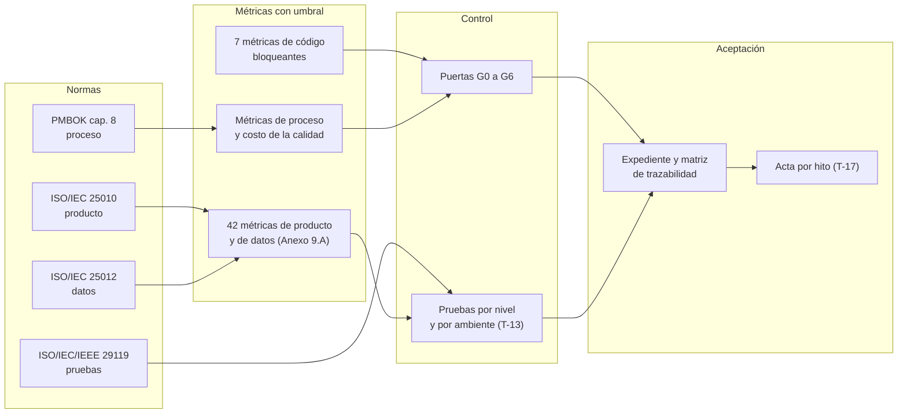
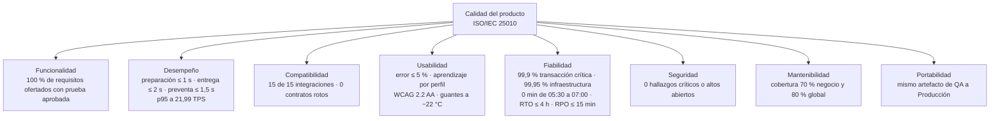
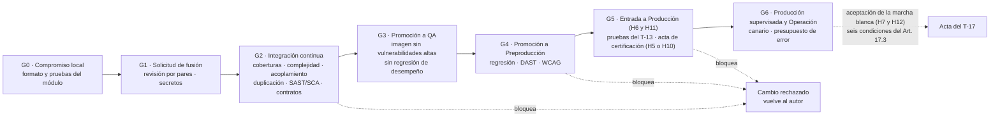
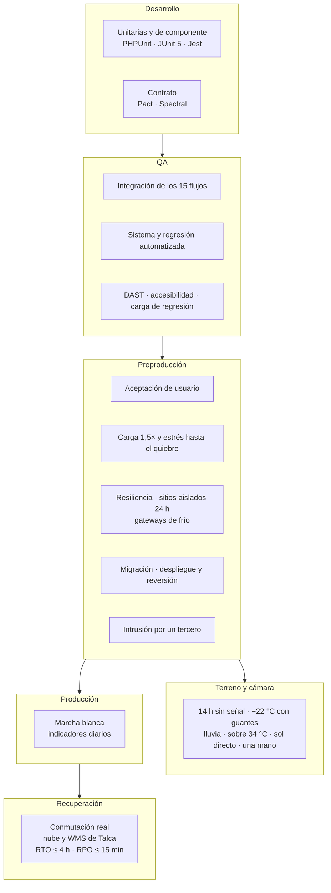
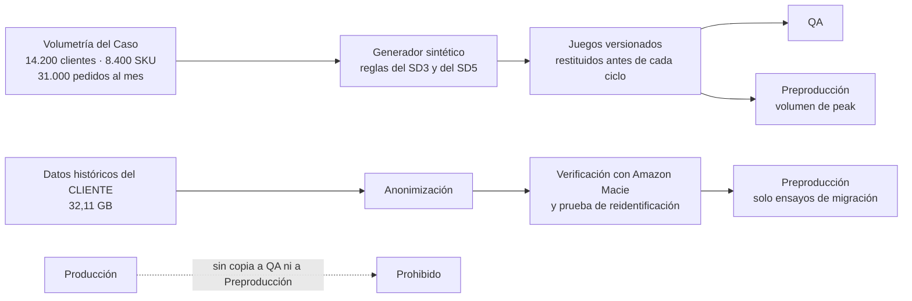
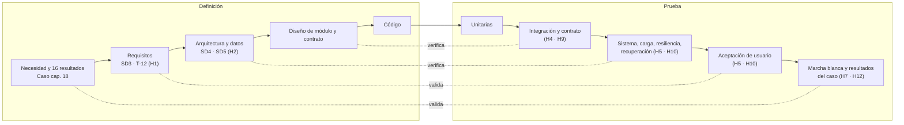
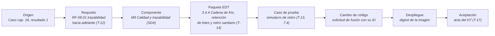
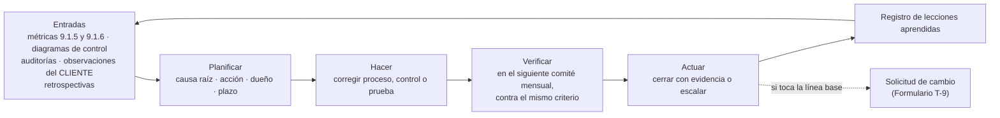
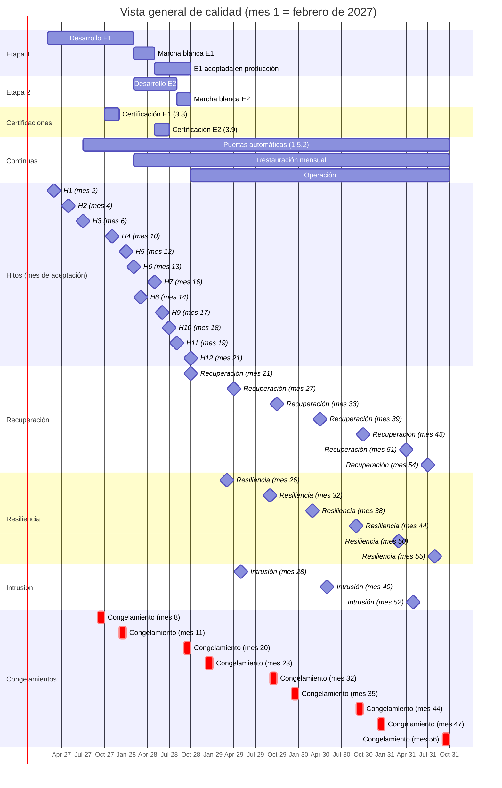

# LafroX — Propuesta Técnica

## Subdocumento 9: Plan de calidad

Licitación TFEP-01/2026 · Caso 02 — Logística · Distribuidora Puelche S.A.

---

## Índice

- [Introducción al Plan de calidad](#introducción-al-plan-de-calidad)
- [9.1 Plan de Calidad](#91-plan-de-calidad)
  - [9.1.1 Objetivos y gobierno de la calidad](#911-objetivos-y-gobierno-de-la-calidad)
  - [9.1.2 Estándares aplicados y forma de acreditarlos](#912-estándares-aplicados-y-forma-de-acreditarlos)
  - [9.1.3 Modelo de calidad del producto según ISO/IEC 25010](#913-modelo-de-calidad-del-producto-según-isoiec-25010)
  - [9.1.4 Modelos de madurez](#914-modelos-de-madurez)
  - [9.1.5 Métricas de código con umbral bloqueante](#915-métricas-de-código-con-umbral-bloqueante)
  - [9.1.6 Métricas de proceso y costo de la calidad](#916-métricas-de-proceso-y-costo-de-la-calidad)
- [9.2 Estrategia de Aseguramiento de Calidad](#92-estrategia-de-aseguramiento-de-calidad)
  - [9.2.1 Puertas de calidad](#921-puertas-de-calidad)
  - [9.2.2 Revisión por pares y análisis estático y dinámico](#922-revisión-por-pares-y-análisis-estático-y-dinámico)
  - [9.2.3 Estrategia de pruebas conforme a ISO/IEC/IEEE 29119](#923-estrategia-de-pruebas-conforme-a-isoiecieee-29119)
  - [9.2.4 Datos de prueba](#924-datos-de-prueba)
  - [9.2.5 Verificación, validación y trazabilidad](#925-verificación-validación-y-trazabilidad)
  - [9.2.6 Control de la calidad y mejora continua](#926-control-de-la-calidad-y-mejora-continua)
- [9.3 Alineación con Plan de Trabajo](#93-alineación-con-plan-de-trabajo)
  - [9.3.1 Actividades de calidad en la EDT](#931-actividades-de-calidad-en-la-edt)
  - [9.3.2 Calidad en el cronograma y en los hitos](#932-calidad-en-el-cronograma-y-en-los-hitos)
  - [9.3.3 Pruebas periódicas durante la Operación](#933-pruebas-periódicas-durante-la-operación)
- [Referencias](#referencias)
- [Declaración de uso de IA](#declaración-de-uso-de-ia)

---

## Introducción al Plan de calidad

Distribuidora Puelche tardó nueve días en identificar a los clientes afectados por un retiro sanitario y entregó una estimación, no una lista (Distribuidora Puelche S.A., 2026c, cap. 1 y cap. 7.3). Su Jefa de Calidad pidió en la entrevista de levantamiento algo más exigente que un sistema que registre: que bloquee el despacho ante una excursión de temperatura fuera de rango (2026c, cap. 8). Ese es el nivel de exigencia de este plan. La solución opera alimentos bajo fiscalización sanitaria, y en industrias reguladas el control de calidad es más estricto que en otras (Project Management Institute [PMI], 2017, p. 300).

El capítulo responde tres preguntas. La sección 9.1 define con qué se juzga la calidad: los objetivos, las normas, el modelo de calidad del producto, los modelos de madurez, las métricas con umbral y el costo de la calidad. La sección 9.2 describe cómo se asegura y se controla: las puertas de calidad, la revisión y el análisis del código, la estrategia de pruebas, los datos de prueba, la trazabilidad y el ciclo de mejora. La sección 9.3 muestra dónde quedan esas actividades en la EDT y en el cronograma.

El plan se conecta con el resto de la propuesta. Toma los requisitos y criterios de aceptación del Subdocumento 3 (SD3) y del Formulario T-12; los ambientes, la cadena de entrega, los umbrales de respuesta y el dimensionamiento del Subdocumento 4 (SD4); las reglas de calidad de datos y de migración del Subdocumento 5 (SD5); las compuertas y herramientas del Subdocumento 6 (SD6) y su Formulario T-10; los paquetes, fechas y horas del Subdocumento 7 (SD7) y sus Formularios T-14 y T-15; y la coordinación con la gestión de riesgos. El detalle se entrega por separado. El **Formulario T-13** contiene el plan de pruebas y validación. El **Formulario T-17** contiene el protocolo de aceptación de cada hito y del producto final. Los **Anexos 9.A a 9.D** contienen las métricas por subcaracterística, las reglas de las puertas, el cálculo del costo de la calidad y la trazabilidad de los resultados del caso.

En este capítulo, BA, BTT y Caso designan las Bases Administrativas (Distribuidora Puelche S.A., 2026a), las Bases Técnicas Transversales (2026b) y las Bases Técnicas del Caso 02 (2026c). El mes 1 del contrato es febrero de 2027.

---

## 9.1 Plan de Calidad

Esta sección fija qué significa calidad para este proyecto y cómo se mide. Sigue los componentes que el PMBOK asigna al plan de gestión de la calidad: estándares, objetivos, roles, entregables sujetos a revisión, actividades, herramientas y tratamiento de las no conformidades (PMI, 2017, p. 286).

### 9.1.1 Objetivos y gobierno de la calidad

El plan parte de un principio del PMBOK: la prevención es preferible a la inspección, porque corregir un error cuesta menos cuanto antes se detecta (PMI, 2017, p. 274). Por eso la mayor parte del control ocurre mientras el código se escribe y no al final de cada etapa.

**Objetivos.** Los objetivos de calidad del proyecto se derivan de lo que el CLIENTE usará para juzgar el éxito: los dieciséis resultados del Caso, capítulo 18, y las condiciones de cierre de marcha blanca del Art. 17.3. La Tabla 9.1 los agrupa en cuatro objetivos medibles.

**Tabla 9.1 — Objetivos de calidad del proyecto. Fuente: elaboración a partir de las BA, Art. 17.3, y del Caso, caps. 15, 17 y 18.**

| Objetivo | Indicador | Meta | Origen |
|---|---|---|---|
| Entregar lo ofertado, probado | Requisitos ofertados del T-12 con prueba aprobada | 100 % antes de su hito | Caso, 17.1 |
| Llegar a producción sin defectos graves | Defectos críticos o altos abiertos al cierre de cada marcha blanca | 0 | BA, Art. 17.3 |
| Sostener la operación de Puelche | Indisponibilidad entre 05:30 y 07:00; p95 de las cuatro transacciones críticas | 0 minutos; dentro del umbral del Caso | Caso, RT-10.05 y RT-09.01 |
| Lograr los resultados del negocio | Resultados del Caso, cap. 18, aceptados en su momento | 16 de 16 | Caso, cap. 18 |

Los cuatro objetivos van de lo técnico a lo comercial. Los dos primeros los controla LafroX con sus puertas y sus pruebas. El tercero se mide en operación real durante la marcha blanca. El cuarto depende además de la adopción por las personas del CLIENTE, y por eso se acepta con medición en operación y no con una prueba de laboratorio (Formulario T-17, sección 5).

**Gobierno.** El gobierno separa el aseguramiento del control (PMI, 2017, p. 290). El aseguramiento comprueba que el proceso produzca calidad y está a cargo del Líder de Calidad y Pruebas, Maximiliano Miño, con dedicación en los meses 1 a 56 (SD1, sección 1.5). Lo apoya el Comité de Calidad y Procesos de LafroX, que sesiona mensualmente y analiza la adherencia metodológica y las métricas de defectos (SD1, sección 1.3.1). El control comprueba que cada entregable cumpla y lo ejecutan las puertas automáticas y el equipo de pruebas. La aceptación la decide el CLIENTE por medio de su Contraparte Técnica (BA, Art. 70.2).

El Líder de Calidad no responde ante el Líder de Desarrollo. Puede vetar una promoción y, si hay desacuerdo, el Comité de Calidad lo resuelve y escala a la Gerencia General de LafroX (SD1, sección 1.2). Esa independencia evita que la presión del plazo relaje un umbral.

La Figura 9.1 presenta el marco completo, desde las normas hasta la aceptación.

**Figura 9.1 — Marco de aseguramiento de la calidad. Fuente: elaboración a partir de las BA, Arts. 4.3 y 18.2, y de PMI (2017, pp. 271–306).**

Todo el marco converge en una sola salida: la evidencia que la Contraparte Técnica revisa para firmar cada acta (BA, Art. 18.2). Cada norma gobierna un objeto distinto y ninguna se queda en una mención: cada una se traduce en métricas con umbral, y esas métricas se aplican en una puerta o en una prueba. Las métricas no llegan al CLIENTE como declaraciones, sino como resultados de ejecución en el expediente. Las puertas G0 a G6 que aparecen en la figura son los siete puntos de control de la cadena de entrega, desde el computador del desarrollador hasta la operación; la sección 9.2.1 las describe una por una.

### 9.1.2 Estándares aplicados y forma de acreditarlos

El Art. 4.3 de las BA exige acreditar cada estándar y advierte que mencionarlo sin evidencia de cómo se satisface vale puntaje cero. La Tabla 9.2 indica, para cada estándar del ámbito de la calidad, cómo se aplica y dónde queda la evidencia.

**Tabla 9.2 — Estándares de calidad y su mecanismo de verificación. Fuente: elaboración a partir de las BA, Art. 4.3.**

| Estándar | Objeto | Mecanismo en este plan | Evidencia |
|---|---|---|---|
| ISO/IEC 25010 | Calidad del producto | Ocho características con métrica y umbral (9.1.3) | Anexo 9.A; informes del T-13 |
| ISO/IEC 25012 | Calidad de los datos | Completitud, exactitud, consistencia y actualidad medidas (9.1.3) | Anexo 9.A.9; conciliaciones |
| ISO/IEC/IEEE 29119 | Proceso, documentación y técnicas de prueba | Tres niveles de proceso; técnicas de diseño por tipo de regla (9.2.3) | T-13, secciones 2 y 3 |
| PMBOK (PMI, 2017) | Gestión de la calidad del proyecto | Planificar, gestionar y controlar la calidad; costo de la calidad (9.1.6) | Informes mensuales; Anexo 9.C |
| WCAG 2.2 AA (W3C, 2023) | Accesibilidad | Herramienta automática y revisión manual (9.2.2) | Informe de conformidad (RT-13.01) |
| OWASP ASVS, Top 10 y SAMM (OWASP Foundation, 2019, 2020, 2021) | Seguridad del software | Análisis estático y dinámico; evaluación de madurez (9.1.4, 9.2.2) | Informes de G2, G4 y de intrusión |

Con estos seis estándares el plan cubre la calidad del producto, la de los datos y la de las pruebas, y cada uno tiene un responsable de evidencia distinto. Los estándares de seguridad, continuidad y arquitectura se acreditan en el SD4; este plan solo verifica su cumplimiento mediante pruebas.

### 9.1.3 Modelo de calidad del producto según ISO/IEC 25010

El Art. 24 de las BA exige criterios de calidad conforme a ISO/IEC 25010, con umbrales numéricos para ocho características: funcionalidad, desempeño, compatibilidad, usabilidad, fiabilidad, seguridad, mantenibilidad y portabilidad. Son las características de la versión de 2011 de la norma (International Organization for Standardization [ISO] & International Electrotechnical Commission [IEC], 2011). La revisión de 2023 renombra usabilidad como capacidad de interacción y portabilidad como flexibilidad, y agrega la seguridad operacional (ISO & IEC, 2023). El plan usa los nombres de las Bases para que el contrato y el plan hablen el mismo idioma, y cubre la seguridad operacional dentro de la fiabilidad: el bloqueo del despacho ante una excursión térmica es un comportamiento seguro ante una falla del producto.

Cada umbral se escribe como un requisito verificable: ante un estímulo, en una condición de operación, la solución responde con una métrica y un valor. No se usan promedios para el desempeño. El p95 representa la experiencia de casi todas las personas usuarias, y un promedio esconde la cola lenta que sufre el preparador en la cámara o el conductor sin señal (BTT, cap. D, «Percentil 95»).

La Figura 9.2 presenta las ocho características con el umbral que las hace exigibles en Puelche.

**Figura 9.2 — Modelo de calidad del producto aplicado a la solución. Fuente: elaboración a partir de ISO & IEC (2011) y de los umbrales de las Bases y del SD4.**

Ninguna de las ocho características queda con un valor genérico: cada una tiene al menos una métrica que nace de la operación de Puelche. La Tabla 9.3 resume la métrica principal de cada una. El Anexo 9.A detalla las 42 métricas por subcaracterística, con método de verificación y paquete de la EDT, e incluye cuatro métricas de calidad de datos según ISO/IEC 25012 (ISO & IEC, 2008).

**Tabla 9.3 — Umbral principal por característica. Fuente: elaboración a partir de las BA, Arts. 24 y 78.2; las BTT, sección 7.2, sección 20.1 y RT-04.05, RT-04.08, RT-11.20, RT-13.01 y RT-13.04; el Caso, sección 17.1, RT-09.01 y RT-10.05; el SD1, sección 1.3.1; el SD3, Tabla 3.A.4a, y el SD4.**

| Característica | Métrica principal | Umbral | Origen |
|---|---|---|---|
| Funcionalidad | Requisitos ofertados con prueba aprobada | 100 % | Caso, 17.1 |
| Desempeño | p95 de las transacciones críticas a 1,5 × el peak | Preparación ≤ 1 s; entrega ≤ 2 s; preventa ≤ 1,5 s; stock y crédito ≤ 2 s | Caso, RT-09.01 |
| Compatibilidad | Integraciones sin error | 15 de 15 | BTT 20.1 |
| Usabilidad | Tasa de error y aprendizaje por perfil; accesibilidad | Error ≤ 5 %; aprendizaje ≤ 2 h en bodega, ≤ 4 h preventista, ≤ 30 min conductor; WCAG 2.2 AA sin incumplimientos | RT-13.04 (SD3, Tabla 3.A.4a); RT-13.01 |
| Fiabilidad | Disponibilidad mensual | Transacción crítica ≥ 99,9 %; infraestructura ≥ 99,95 %; 0 minutos entre 05:30 y 07:00 | BA, Art. 78.2; BTT 7.2; Caso, RT-10.05 |
| Seguridad | Hallazgos críticos o altos abiertos | 0 | RT-04.05; RT-11.20 |
| Mantenibilidad | Cobertura de lógica de negocio y global | ≥ 70 % y ≥ 80 % | BA, Art. 24; SD1, 1.3.1 |
| Portabilidad | Despliegues con el mismo artefacto | 100 % | RT-04.08 |

Seis de los ocho umbrales los fijan las Bases o el Caso. Los otros dos son compromisos de LafroX sobre una exigencia de las Bases: la usabilidad toma los indicadores por perfil que el SD3, Tabla 3.A.4a, compromete para el RT-13.04, y la mantenibilidad suma al 70 % exigido en la lógica de negocio el 80 % de cobertura global que es política de LafroX (SD1, sección 1.3.1). El desempeño y la fiabilidad concentran el modelo porque la operación de Puelche depende de transacciones de segundos en la ventana de despacho y de que el despacho continúe sin enlace y sin señal.

### 9.1.4 Modelos de madurez

El plan usa tres referentes con funciones distintas. ISO 9001:2015 es el sistema de gestión de calidad de LafroX y aporta el marco de auditoría de los registros del proyecto (ISO, 2015). CMMI-DEV es el modelo de madurez del proceso de desarrollo y de pruebas (CMMI Institute, 2018). LafroX renueva su evaluación SCAMPI A de nivel 3 antes de noviembre de 2026 y presenta la renovación a la Contraparte Técnica junto con el H1 (SD1, sección 1.4). Los procesos del proyecto se auditan, además, con el sistema de gestión ISO 9001, de modo que su control no depende de una sola certificación. OWASP SAMM es el modelo de madurez del desarrollo seguro que exige el Art. 4.3 de las BA.

El nivel 3 de CMMI-DEV significa procesos definidos para la organización y adaptados al proyecto. En este contrato se traduce en tres áreas de práctica que el plan mide: verificación y validación, que es el proceso de pruebas de 9.2.3; revisión entre pares, de 9.2.2; y aseguramiento de la calidad del proceso, ejercido por las auditorías trimestrales de trazabilidad entre requisito, código y prueba que exige la política de LafroX (SD1, sección 1.3.1). Esas auditorías siguen el criterio del PMBOK: las hace un equipo independiente del proyecto y buscan no conformidades, buenas prácticas y lecciones para otros proyectos (PMI, 2017, p. 294).

El modelo se usa para mejorar el proceso durante el contrato. El Líder de Calidad hace una autoevaluación de las tres áreas al aprobar el plan, en el H1, y la repite cada seis meses. El Encargado de Seguridad hace lo mismo con SAMM al iniciar el desarrollo y cada año. Cada brecha entra al ciclo de mejora de 9.2.6. La meta es el cuarto de los cinco niveles de gestión de la calidad que describe el PMBOK: incorporar la calidad en la planificación y el diseño, y no solo detectar defectos (PMI, 2017, p. 275).

### 9.1.5 Métricas de código con umbral bloqueante

La mantenibilidad se juzga sobre el código mientras se escribe. La columna «Puerta» de la Tabla 9.4 indica el punto de control donde se aplica cada umbral: G2 es la integración continua, que se ejecuta sobre cada cambio (sección 9.2.1). La Tabla 9.4 fija los umbrales que bloquean una fusión en los tres lenguajes de la solución: PHP con Laravel en el monolito modular, Kotlin en la aplicación Android y TypeScript con Angular en consolas y portales (SD4, sección 4.1.1).

**Tabla 9.4 — Métricas de código con umbral bloqueante. Fuente: elaboración a partir de las BA, Arts. 19 y 24; las BTT, RT-04.11; el SD1, sección 1.3.1; el Formulario T-10, y McCabe (1976).**

| Métrica | Umbral bloqueante | Puerta | Origen del umbral |
|---|---|---|---|
| Cobertura de lógica de negocio | ≥ 70 % | G2 | BA, Art. 24; RT-04.11 |
| Cobertura unitaria global | ≥ 80 % | G2 | Política de LafroX (SD1, 1.3.1) |
| Complejidad ciclomática por método | ≤ 10 | G2 | McCabe (1976) |
| Dependencias prohibidas entre módulos | 0 | G2 | BA, Art. 19 (acoplamiento débil) |
| Acoplamiento eferente por clase | ≤ 20 clases | G2 | Regla de LafroX sobre BA, Art. 19; Formulario T-10 |
| Duplicación de código | ≤ 3 % de las líneas | G2 | Formulario T-10 |
| Deuda técnica clasificada como bloqueante | 0 | G2 | BA, Art. 24; Formulario T-10 |

Las siete métricas bloquean en la misma puerta, la integración continua, porque ahí el costo de corregir es mínimo: el autor todavía tiene el cambio en la cabeza. Los dos umbrales de cobertura son independientes y se exigen ambos. Una cobertura global alta lograda con pruebas sobre controladores y vistas podría dejar sin probar la regla de asignación de stock o la de excursión térmica; el 70 % medido sobre las clases de dominio y de casos de uso lo impide. El límite de complejidad de 10 es la cota que McCabe (1976) propone para un módulo comprobable. El acoplamiento se controla en dos niveles. Entre módulos, ninguno invoca clases internas de otro fuera de su contrato. Dentro de cada módulo, ninguna clase depende de más de 20 clases distintas; ese límite, que PhpMetrics y detekt miden en cada ejecución, detecta una clase que concentra demasiadas responsabilidades antes de que se vuelva difícil de probar. Las herramientas por lenguaje están en el Anexo 9.B.

El Comité de Calidad puede endurecer estos umbrales con datos del proyecto, pero no relajarlos sin acta del Comité de Arquitectura.

### 9.1.6 Métricas de proceso y costo de la calidad

El código puede cumplir sus umbrales y el proceso puede seguir dejando escapar defectos. Por eso el plan mide también el proceso. La Tabla 9.5 fija las métricas con que el Comité de Calidad lo juzga cada mes.

**Tabla 9.5 — Métricas de proceso. Fuente: elaboración a partir de las BA, Arts. 17.3, 18.3 y 78.3; las BTT, RT-04.12, y el SD4, sección 4.2.4.1.4.**

| Métrica | Fórmula | Meta | Origen |
|---|---|---|---|
| Defectos escapados | Defectos críticos o altos hallados en un ambiente posterior al que debió detectarlos / total de críticos o altos | 0 en Producción durante la marcha blanca | BA, Art. 17.3 |
| Densidad de defectos | Defectos confirmados / casos ejecutados, por módulo | Un módulo sobre 1,5 veces la mediana del proyecto pasa a análisis de causa raíz | Regla de LafroX |
| Observaciones repetidas del CLIENTE | Observaciones de la misma naturaleza en una segunda presentación | 0 | BA, Art. 18.3 |
| Frecuencia de despliegue | Despliegues a producción por período habilitado | Quincenal | RT-04.12; SD4 |
| Tasa de cambios fallidos | Despliegues que requieren reversión o corrección / despliegues del mes | ≤ 5 % | BA, Art. 78.3; SD4 |
| Tiempo del cambio a producción | Días hábiles habilitados desde que se confirma el cambio | ≤ 5 días | RT-04.12; SD4 |
| Tiempo medio de restauración de incidentes críticos | Suma de tiempos de restauración / incidentes críticos del mes | ≤ 4 h | BA, Art. 78.3 |
| Reincidencia por la misma causa raíz | Incidentes con causa raíz repetida | ≤ 1 por trimestre | BA, Art. 78.3 |

Las cuatro métricas de entrega del RT-04.12 (frecuencia de despliegue, tiempo del cambio a producción, tasa de cambios fallidos y tiempo de restauración) se miden con las metas que declara el SD4; la frecuencia es quincenal y se mide solo en los períodos que las ventanas del Caso habilitan. Dos de esas metas (tasa de cambios fallidos y tiempo de restauración) vienen del Art. 78.3 y rigen en la Operación. La reincidencia también proviene del Art. 78.3, pero no es una métrica de entrega. Otras dos, la de defectos escapados y la de observaciones repetidas, protegen la aceptación de los hitos de la implementación.

**Costo de la calidad y subtotal de conformidad.** El PMBOK distingue el costo de conformidad, que se gasta para evitar fallas (prevención y evaluación), del costo de no conformidad, que se paga por las fallas (internas, si las encuentra el proyecto; externas, si las encuentra el cliente) (PMI, 2017, pp. 274 y 282–283). El plan lo calcula en horas-hombre, porque la Oferta Técnica no puede contener montos (BA, Art. 50.2). La Tabla 9.6 sintetiza el subtotal de conformidad del Anexo 9.C.1; el Anexo 9.C.2 estima separadamente el retrabajo interno y externo por evento y evita sumarlo dos veces a la línea base.

**Tabla 9.6 — Subtotal de conformidad en horas-hombre. Fuente: elaboración a partir de los Formularios T-14 y T-15, del cálculo del Anexo 9.C.**

| Categoría | HH | Proporción | Paquetes principales |
|---|---|---|---|
| Prevención | 4.224,00 | 37,9 % | 2.6, 3.10.2 y 8.2.4 |
| Evaluación | 6.912,00 | 62,1 % | Certificaciones, restauraciones puente y pruebas en Operación |
| **Total programado** | **11.136,00** | **100,0 %** | Sin importes esperados de fallas |

La conformidad programada suma 11.136 HH, el 5,1 % de las 217.543 HH de la línea base (11.136 / 217.543 = 0,0512). Incluye 128 HH de restauraciones anteriores a Operación y la reestimación por ocurrencia del T-15. La evaluación pesa más que la prevención por las certificaciones y pruebas periódicas exigidas. La no conformidad se estima por evento y por rol: los escenarios de referencia del Anexo 9.C.2 suman 93,8 HH por falla interna y 109,8 HH por falla externa, incluida una regresión manual completa. Son parámetros de planificación, no frecuencia prevista ni reserva garantizada. Para calcular el costo integral se añade el esfuerzo de fallas efectivamente previsto o consumido, descontando el trabajo ya incluido en la línea base. El mantenimiento correctivo comparte 8.2.1 con el evolutivo y los defectos escapados se siguen como métrica.

---

## 9.2 Estrategia de Aseguramiento de Calidad

Esta sección describe cómo se aplican los umbrales de 9.1. Las puertas y la revisión del código aseguran el proceso; las pruebas controlan el producto; la trazabilidad une ambos con la aceptación; y el ciclo de mejora corrige el proceso cuando los resultados lo piden.

### 9.2.1 Puertas de calidad

Una puerta de calidad es un punto del recorrido de un cambio donde un criterio objetivo decide si avanza. La Figura 9.3 presenta las siete puertas sobre la cadena de entrega del SD4, desde el computador del desarrollador hasta la operación.

**Figura 9.3 — Puertas de calidad en la cadena de entrega. Fuente: elaboración a partir del SD4, sección 4.2.4.1, y del Formulario T-10.**

G5 se aplica en el momento en que cada etapa entra a Producción, al iniciar su marcha blanca (H6 y H11), porque desde ese día la solución opera con datos y pedidos reales de Puelche. Exige el H5 o el H10 aceptado, las pruebas aplicables del T-13 aprobadas, la reversión ensayada, la conciliación sin diferencias no explicadas y los usuarios de la ola capacitados (T-17, 4.3). Los hitos H7 y H12 no son una puerta técnica: son el paso a producción contractual del Formulario E-25, que se acepta con las seis condiciones copulativas del Art. 17.3 y su acta. G5 no adelanta ese paso; habilita el ambiente de Producción para que la marcha blanca opere con datos reales bajo control.

Las puertas están ordenadas por costo: el control es más barato cuanto antes ocurre. G0 a G2 se ejecutan en minutos sobre cada cambio; G5 se ejecuta dos veces en el contrato y exige semanas de prueba. La Tabla 9.7 resume qué bloquea cada puerta y quién puede levantarla; el Anexo 9.B detalla las reglas y herramientas.

**Tabla 9.7 — Bloqueo y autoridad por puerta. Fuente: elaboración a partir de las BTT, RT-04.05; el Formulario T-10, y el SD4, sección 4.2.4.1.4.**

| Puerta | Momento | Bloquea si | Quién puede levantar el bloqueo |
|---|---|---|---|
| G0–G1 | Compromiso y solicitud de fusión | Falta la aprobación de un par; hay un secreto o un error de formato | Nadie; se corrige |
| G2 | Integración continua | Falla un umbral de la Tabla 9.4; hallazgo crítico o alto; contrato roto | Nadie |
| G3 | Promoción a QA | Imagen con vulnerabilidad crítica o alta; p95, errores o colas peores que en la última versión aceptada | Nadie; se corrige |
| G4 | Promoción a Preproducción | Regresión con fallas; alerta alta de DAST; incumplimiento WCAG; defecto crítico o alto abierto | Nadie |
| G5 | Entrada de cada etapa a Producción (H6 y H11) | Prueba habilitante no aprobada; defecto crítico o alto abierto; falta el acta de certificación (H5 o H10) | Nadie; el acta no levanta una prueba fallida |
| G6 | Producción desde H6/H11 y Operación | Canario fuera de umbral; presupuesto de error crítico del mes agotado | Nadie; reversión automática y suspensión de despliegues no correctivos |

Ninguna puerta admite excepciones. Una regresión de desempeño en G3 bloquea la promoción hasta corregirla, como dispone el SD4, sección 4.2.4.1.4, y ningún hallazgo de seguridad crítico o alto se acepta con registro de deuda, como exige el RT-04.05. Las correcciones durante una marcha blanca no repiten G5: pasan por G0 a G4 y G6, con regresión completa, y repiten la prueba de certificación que su cambio afecta (sección 9.3.2).

### 9.2.2 Revisión por pares y análisis estático y dinámico

Toda modificación entra a la rama principal por una solicitud de fusión. La rama está protegida y la escritura directa está prohibida (RT-04.03). La fusión requiere la aprobación de un par que no haya escrito el cambio. Los cambios en servicios de nivel crítico o alto del SD4, Tabla 16, requieren además al arquitecto del frente, y los cambios en autenticación, cifrado o datos personales, al Encargado de Seguridad. La revisión entre pares es una forma de inspección (PMI, 2017, p. 303): el revisor verifica lo que una herramienta no ve, es decir, que el cambio implemente el requisito citado, que las pruebas prueben la regla y no solo recorran líneas, y que los nombres de los componentes sean los del SD3 y del SD4.

**Análisis estático.** Se ejecuta en G1 y G2 sobre cada cambio. En PHP: PHPStan con Larastan, PHPMD, PHPCPD, PhpMetrics y deptrac; en Kotlin: detekt; en TypeScript: ESLint. El análisis de seguridad cubre los cinco controles mínimos del RT-04.05: análisis estático de código, composición de software, secretos, imágenes de contenedor y pruebas unitarias, con bloqueo automático. Los contratos OpenAPI 3.1 y AsyncAPI 2.6 se validan con Spectral y se prueban con Pact (Formulario T-10).

**Análisis dinámico.** Ejecuta el software. En QA, OWASP ZAP recorre portales y API, y MobSF analiza la aplicación Android sobre un dispositivo; una alerta alta detiene G4. La accesibilidad se evalúa con axe-core y con revisión manual (teclado, lector de pantalla y contraste bajo sol directo), porque el RT-13.01 exige ambas verificaciones. La carga, el estrés y la inyección de fallas también son análisis dinámico y se describen en 9.2.3.

### 9.2.3 Estrategia de pruebas conforme a ISO/IEC/IEEE 29119

La estrategia sigue los tres niveles de proceso de ISO/IEC/IEEE 29119-2. En el nivel organizacional rige la política de pruebas de LafroX. En el nivel de gestión, el plan de pruebas del proyecto, que es el Formulario T-13, se monitorea y se cierra en cada hito. En el nivel dinámico se diseñan, ejecutan e informan los casos (ISO, IEC & Institute of Electrical and Electronics Engineers [IEEE], 2021a). La intensidad de la prueba sigue el riesgo (ISO, IEC & IEEE, 2022). La regla de dimensionamiento por riesgo de LafroX asigna cinco casos a un requisito de prioridad crítica, tres a uno alto y dos a uno medio; el plan del H1 la contrasta con el diseño real de los casos. Las técnicas de diseño se eligen por tipo de regla (ISO, IEC & IEEE, 2021b): valores límite para los umbrales térmicos y de crédito, tablas de decisión para la asignación de stock, transición de estados para el ciclo del pedido y de la guía, y casos de uso para los flujos del SD3.

**Niveles, tipos y ambientes.** La Figura 9.4 ubica cada nivel y tipo de prueba en el ambiente donde se ejecuta.

**Figura 9.4 — Niveles y tipos de prueba por ambiente. Fuente: elaboración a partir de las BTT, sección 4.1; el Caso, cap. 15; el SD4, Tabla 12, y el Formulario T-10.**

La figura sigue la regla de los ambientes del SD4: el software se prueba en un ambiente cada vez más parecido a producción y lo que se promueve es la misma imagen. Desarrollo concentra las pruebas rápidas y aisladas; QA, las de integración y regresión con datos controlados; Preproducción, equivalente a producción en topología y configuración (RT-04.02), las que dependen de la escala y de las fallas. Las pruebas propias del caso, como el turno sin señal y la cámara de congelado, no caben en un ambiente de nube y se ejecutan en terreno con dispositivos reales.

Las campañas de certificación con estados incompatibles no pueden compartir la misma instancia al mismo tiempo: la resiliencia necesita carga sostenida, la intrusión exige una versión congelada y la aceptación necesita datos estables. Migración, intrusión y aceptación usan instancias separadas; carga, resiliencia y despliegue comparten PRE-C en sesiones sucesivas con restitución entre ellas (T-13, sección 4.1). Todas se reconstruyen desde el mismo código y siguen siendo Preproducción, no un sexto ambiente.

**Pruebas aplicables por etapa y antes de cada entrada a Producción.** La BTT, sección 20.1, fija diez tipos de prueba con su momento y su criterio de salida. La Tabla 9.8 presenta los diez tipos y dos pruebas adicionales, con alcance en ambas etapas; el T-13, secciones 6 y 7, los especifica con sus criterios de entrada y salida.

**Tabla 9.8 — Pruebas aplicables por etapa y antes de cada entrada a Producción. Fuente: elaboración a partir de las BA, Art. 24; las BTT, sección 20.1; el Caso, cap. 15, y el SD4, Tabla 33.**

| Prueba | Ambiente | Carga o escenario | Criterio de salida |
|---|---|---|---|
| Unitarias y de componente | Desarrollo/CI | Lógica de negocio y componentes, ambas etapas | Cobertura ≥ 70 % negocio y ≥ 80 % global; 0 pruebas fallidas |
| Integración | QA | 15 integraciones; alcance E2 y regresión E1 | 0 flujos con error |
| Sistema y regresión | QA y Preproducción | Batería completa antes de promover, ambas etapas | 0 fallas y 0 regresiones |
| Aceptación de usuario | Preproducción | Casos del SD3 con preventistas, conductores y bodega | Casos firmados por la Contraparte Técnica |
| Carga y estrés | Preproducción | 21,99 TPS; escalones de 3× y 4× | p95 de la Tabla 9.3; punto de quiebre sin pérdida |
| Resiliencia | Preproducción | Caída de instancia, zona y dependencia; latencia; disco; 24 h sin enlace en cada sitio; caída de un gateway de frío; pérdida de fibra y LTE | Recuperación sin intervención; bloqueo térmico local ≤ 5 s |
| Perfil operacional | Terreno | −22 °C con guantes; lluvia; > 34 °C; sol; una mano (E1 y regresión del alcance cambiado en E2); desconexión de 14 h por separado | 5 de 5 condiciones; 0 pérdidas/duplicados y sincronización ≤ 10 min en desconexión |
| Recuperación ante desastres | Recuperación | Conmutación regional real y recuperación de la sala de Talca en la nube | RTO ≤ 4 h; RPO ≤ 15 min |
| Seguridad ofensiva | Preproducción | Tercero independiente | 0 hallazgos críticos o altos abiertos |
| Accesibilidad | QA y Preproducción | axe-core y revisión manual | 0 incumplimientos WCAG 2.2 A/AA, con informe |
| Migración | Preproducción | Dos ensayos con 32,11 GB | 0 diferencias no explicadas |
| Despliegue sin interrupción | Preproducción | Canario con reversión | Sin interrupción ni intervención manual |

Respecto de la BTT, se suman dos pruebas, adicionales a los diez tipos: el perfil operacional, por los RT-03.10, RT-03.13 y RT-13.08, y el despliegue sin interrupción, por las BA, Art. 24. Ninguna prueba tiene un criterio de salida cualitativo: todas terminan en un número o en una firma.

**Pruebas de la arquitectura híbrida.** La solución opera en la nube y en cinco sitios con servicio local: los CD de Talca y Concepción y tres cross-docking (SD4, secciones 4.1.3.2 y 4.1.21). Las pruebas de la Tabla 9.8 incluyen los nueve protocolos de aceptación que el SD4, Anexo 4-V, define para esa arquitectura. Entre ellos están el aislamiento de cada sitio por 24 horas con despacho de guías preemitidas (AL-OFF-01), las 96 guías emitidas por fibra, LTE y Starlink con fallas inyectadas (AL-DTE-01) y la recuperación en la nube del WMS de Talca dentro del RTO y el RPO (AL-DR-01). La resiliencia agrega la caída de uno de los dos gateways de frío de Talca: el otro lee ambas cámaras y el bloqueo térmico local actúa en menos de cinco segundos (SD4, sección 4.1.11, ADR-22). El T-13, sección 7.5, asigna cada protocolo a su campaña.

**Carga derivada del dimensionamiento.** La carga de prueba no se elige: se deriva del SD4, Tabla 33, aplicando el factor 1,5 que exigen el Art. 24 y el RT-09.06. La Tabla 9.9 muestra la derivación.

**Tabla 9.9 — Derivación de la carga de prueba. Fuente: elaboración a partir de las BA, Art. 24; las BTT, RT-09.03 y RT-09.06, y el SD4, Tabla 33.**

| Magnitud | Peak declarado | Carga de prueba |
|---|---|---|
| TPS máximo de septiembre | 14,66 TPS | 1,5 × 14,66 = 21,99 TPS |
| TPS máximo de la ventana de 05:30 a 07:00 | 6,94 TPS | 1,5 × 6,94 = 10,41 TPS, durante 90 minutos |
| Personas usuarias concurrentes | 775,33 | 1,5 × 775,33 = 1.163 |
| Dispositivos de terreno simultáneos | 158 | 1,5 × 158 = 237 |
| Crecimiento sin rediseño (RT-09.03) | 14,66 TPS | 3 × 14,66 = 43,98 TPS |

La prueba de la ventana de despacho tiene un criterio adicional: cero minutos de indisponibilidad, porque el Caso no admite ninguno entre 05:30 y 07:00 (RT-10.05). El escalón de 3× comprueba el crecimiento que exige el RT-09.03; el de 4× busca el punto de quiebre y verifica que, al superarse la capacidad, la solución encole y avise en vez de perder transacciones (RT-09.08).

**Automatización.** La automatización es la regla; una prueba es manual solo si exige el juicio de una persona, una condición física o un tercero. Con la prioridad de los 262 requisitos funcionales y no funcionales del SD3 (56 críticos, 163 altos y 43 medios), los 356 RT ofertados en estado «Cumple» o «Cumple parcialmente» del T-12 y siete casos por cada una de las 15 integraciones, el catálogo inicial suma 1.316 casos (T-13, sección 8.2). Con los parámetros de diseño del plan (80 % de casos automatizados, 30 segundos por caso automático y 15 minutos por caso manual), la regresión completa tiene unos 1.053 casos; a 30 segundos cada uno, tarda 8,8 horas en un ejecutor y 4,4 en dos ejecutores paralelos, y cabe en una noche antes de cada promoción a Preproducción. Los 263 casos manuales requieren unas 65,8 HH por ciclo, a 15 minutos cada uno.

### 9.2.4 Datos de prueba

Ningún ambiente no productivo contiene datos productivos reales sin anonimización verificada. La regla protege los datos personales de clientes, de conductores de terceros y la geolocalización de trabajadores (Ley N.º 21.719, 2024), y los campos que el Caso, RT-11.10, exige cifrar. El ambiente de Recuperación ante Desastres no es un ambiente de prueba funcional: es una réplica productiva protegida que solo se usa para la conmutación real.

La Figura 9.5 muestra de dónde vienen los datos de cada ambiente.

**Figura 9.5 — Origen y control de los datos de prueba. Fuente: elaboración a partir del Caso, sección 14.1; el SD4, sección 4.2.4.1 y Tabla 33, y el SD5, sección 5.3.**

Los ambientes de prueba se alimentan de dos fuentes. Los datos sintéticos se generan desde la volumetría del Caso, sección 14.1, y respetan las reglas del negocio: lotes con vencimiento, productos refrigerados con su rango térmico y clientes con crédito. Así, la prueba de carga opera sobre un volumen comparable al del peak. Los datos históricos se usan solo en los ensayos de migración, después de anonimizarlos y de verificar con Amazon Macie que no queden datos personales. QA restituye sus juegos a un estado conocido antes de cada ciclo, para que un fallo sea reproducible. Esa misma propiedad usa la innovación INN-02 para convertir un incidente de terreno en una prueba de regresión permanente (SD13, sección 13.2). El T-13, sección 5, especifica cada juego.

### 9.2.5 Verificación, validación y trazabilidad

La verificación comprueba que cada producto cumpla su especificación; la validación comprueba que la solución resuelva el problema de Puelche. El PMBOK separa ambos momentos: controlar la calidad lo hace el equipo y produce entregables verificados; validar el alcance lo hace el cliente y produce entregables aceptados (PMI, 2017, p. 305). La Figura 9.6 empareja cada artefacto de diseño con la prueba que lo verifica o lo valida y con el hito que lo cierra.

**Figura 9.6 — Verificación y validación por nivel y por hito. Fuente: elaboración a partir de las BA, Formulario E-25.**

La certificación técnica de cada etapa (H5 y H10) no basta para aceptar los resultados del negocio. Los dieciséis resultados del Caso, capítulo 18, tienen aceptación diferenciada según el T-17, sección 5, y el Anexo 9.D: doce se aceptan definitivamente en H7 y dos en H12. R18-04 (OTIF) se acepta por tramos en los meses 15, 19 y 32; R18-12 (envases) tiene aceptación provisional en H7 y final tras doce meses de operación medida. Las actas H7/H12 no anticipan estas dos aceptaciones pendientes. La aceptación no libera de responsabilidad por defectos posteriores (BA, Art. 18.4).

**Trazabilidad.** La cadena que exige el Caso, sección 17.1, va del origen al criterio de aceptación: origen, requisito, componente, paquete de la EDT, prueba y criterio. El RT-04.04 le agrega el cambio de código y el despliegue. La Figura 9.7 presenta la cadena con un requisito crítico como ejemplo: la lista de clientes afectados por un lote en menos de dos horas.

**Figura 9.7 — Cadena de trazabilidad de extremo a extremo. Fuente: elaboración a partir del Caso, sección 17.1; las BTT, RT-04.04, y los Formularios T-12, T-13, T-14 y T-17 y el SD4.**

Ningún eslabón de la cadena es nuevo: cada uno se apoya en un identificador que ya existe en la propuesta. La matriz se lee en dos sentidos: hacia atrás explica por qué existe cada componente; hacia adelante, dónde quedó implementado y probado cada requisito. Cada caso de prueba lleva el identificador de su requisito, cada solicitud de fusión cita el requisito o la incidencia que atiende, y cada despliegue registra el digest de su imagen. Con esos enlaces, la matriz se genera desde el repositorio y el historial de la cadena de integración, y no se mantiene a mano. La meta es que el 100 % de los requisitos ofertados tenga al menos una prueba aprobada antes de su hito. Los 18 RT en estado «No cumple» quedan en la matriz sin prueba, para que la Contraparte Técnica vea la brecha en lugar de un vacío. El Anexo 9.D muestra el tramo final de la cadena para los dieciséis resultados del caso.

### 9.2.6 Control de la calidad y mejora continua

Controlar la calidad es comparar el resultado con su criterio y actuar cuando no lo cumple (PMI, 2017, p. 298). Esta sección describe cómo se tratan los defectos, cómo se detecta un proceso que se sale de control y cómo se mejora.

**Defectos.** Un defecto es toda diferencia entre el resultado esperado de una prueba y el obtenido. Se registra en GitLab con el caso de prueba, el requisito, el ambiente, la versión y la evidencia. La severidad usa las cuatro clases de nivel de servicio del SD4, Tabla 16, para que un defecto y un incidente se midan con la misma vara: es crítico si afecta la preparación, el despacho o la emisión de la guía en la ventana de 05:30 a 07:00, el bloqueo por excursión térmica o la identidad de bodega. Un defecto se cierra solo cuando la prueba que lo detectó pasa y queda incorporada a la regresión. Ningún defecto crítico o alto abierto pasa G4, y ninguna marcha blanca se cierra con uno abierto (BA, Art. 17.3).

**Detección de un proceso fuera de control.** El plan distingue tolerancia de límite de control (PMI, 2017, pp. 274 y 304). La tolerancia es el rango aceptable que fija un requisito; por ejemplo, el p95 de la línea de preparación no puede superar 1 s. El límite de control se calcula con la variación histórica de una métrica y marca cuándo el proceso deja de ser estable, aunque siga dentro de la tolerancia. El Comité de Calidad lleva diagramas de control de dos métricas: el p95 de la carga de regresión semanal en QA y la densidad de defectos por módulo. Como regla propuesta por LafroX, los límites se calculan con las primeras ocho mediciones de cada métrica y se actualizan cada trimestre; antes de esas ocho mediciones no hay límites, porque no existe historia que los sustente. Un punto fuera de los límites, o siete puntos seguidos del mismo lado de la media, abre un análisis antes de que la tendencia llegue a la tolerancia. Las causas de los defectos se ordenan cada mes en un diagrama de Pareto, para atacar primero las que explican la mayor parte.

**Causa raíz.** Un defecto reabierto dos veces por la misma causa, un defecto escapado a Producción y todo incidente crítico pasan a análisis de causa raíz (PMI, 2017, p. 292). El análisis usa un diagrama de causa y efecto con las categorías de personas, proceso, herramientas, datos, ambiente y gestión, y el formato que el Art. 25 de las BA exige para los incidentes críticos. La reincidencia por la misma causa raíz no puede superar un evento por trimestre en la Operación (BA, Art. 78.3).

**Ciclo de mejora.** Las acciones siguen el ciclo planificar-hacer-verificar-actuar (PMI, 2017, p. 296). La Figura 9.8 muestra el ciclo y sus entradas.

**Figura 9.8 — Ciclo de mejora de la calidad. Fuente: elaboración a partir de PMI (2017, pp. 296–297) y del Formulario T-9.**

El ciclo tiene dos salidas que el PMBOK exige y que suelen faltar en un plan de calidad. La primera es el registro de lecciones aprendidas, que se alimenta de cada acción cerrada y de una retrospectiva al término de cada certificación (H5 y H10) y de cada marcha blanca (H7 y H12); cada retrospectiva revisa qué funcionó, qué se debe cambiar y qué se lleva a la Etapa 2 o a la Operación (PMI, 2017, p. 305). La segunda es la solicitud de cambio: si una acción de mejora toca la línea base del alcance, del cronograma o de un umbral, pasa por el control integrado de cambios del Formulario T-9 (PMI, 2017, p. 296). Una acción se cierra solo cuando el comité siguiente comprueba su eficacia con el mismo criterio que detectó la desviación.

**Informes de calidad.** El Líder de Calidad emite un informe mensual al Comité de Calidad y a la Contraparte Técnica con las métricas de proceso, los defectos por severidad y por módulo, el estado de la matriz de trazabilidad, los diagramas de control y las acciones de mejora abiertas (T-13, sección 12).

---

## 9.3 Alineación con Plan de Trabajo

Esta sección muestra dónde quedan las actividades de calidad en la EDT del Formulario T-14 y en el cronograma del SD7, con sus horas, sus meses y los hitos que habilitan.

### 9.3.1 Actividades de calidad en la EDT

La EDT no tiene una rama de calidad aislada. Las actividades de calidad están en las cuentas donde se produce lo que verifican, y el diccionario de cada paquete registra su criterio de aceptación, como indica el PMBOK para los requisitos de calidad (PMI, 2017, p. 287). La Tabla 9.10 agrupa esos paquetes.

**Tabla 9.10 — Paquetes de calidad de la EDT. Fuente: elaboración a partir de los Formularios T-14 y T-15.**

| Cuenta | Paquetes | Meses | HH |
|---|---|---|---|
| 1.2 y 1.5: trazabilidad, plan y puertas | 1.2.4; 1.5.1; 1.5.2 | 2; 6 a 20 | 240 |
| 2.6: usabilidad con personas usuarias | 2.6.1 a 2.6.3 | 2 a 4 | 720 |
| 3.8: pruebas y certificación de la Etapa 1 | 3.8.1 a 3.8.8 | 9 y 10 | 2.240 |
| 3.9: pruebas y certificación de la Etapa 2 | 3.9.1 a 3.9.7 | 16 y 17 | 1.600 |
| 3.10.2: INN-02, reproducción de incidentes | 3.10.2.1 a 3.10.2.4 | 2 a 15 | 960 |
| 4.1.2: ensayo de reversión | 4.1.2 | 11 | 80 |
| 8.1 a 8.3: pruebas y deuda en la Operación | 8.1.3; 8.1.6; 8.2.2; 8.2.4; 8.3.1 | 21 a 56 | 5.168 |
| 4.2.1; 4.2.2; 4.3.1: restauraciones previas | Componentes SRE separados | 13 a 20 | 128 |
| **Total** | | | **11.136** |

La tabla suma las mismas 11.136 HH de conformidad del costo de la calidad (9.1.6). Las pruebas de cada etapa se concentran en dos bloques: la cuenta 3.8 en los meses 9 y 10, y la 3.9 en los meses 16 y 17. Empiezan cuando los módulos están integrados y terminan con margen para la revisión del CLIENTE y una eventual subsanación antes del hito. La disponibilidad posterior a las campañas cubre subsanaciones y repetición de pruebas, no una campaña ininterrumpida. Durante esos bloques, el equipo de calidad se refuerza con hasta 16 evaluadores subcontratados por día, en los meses 9 a 12 y 16 a 18 (SD6, sección 6.1.3). Las 5.168 HH de la Operación muestran que la calidad no termina con la aceptación final.

### 9.3.2 Calidad en el cronograma y en los hitos

La Figura 9.9 presenta la vista general de los 56 meses del contrato: las fases de cada etapa, las certificaciones, los doce hitos del Formulario E-25 y cada prueba periódica de la Operación en el mes en que se ejecuta, sobre las bandas de congelamiento del Caso.

**Figura 9.9 — Vista general de las actividades de calidad en el cronograma del contrato. Fuente: elaboración a partir del Caso, RT-10.05; de las BA, Formulario E-25, y de los Formularios T-14 y T-15, sección 6.1.**

La vista general muestra dos concentraciones de calidad. La primera son las certificaciones de los meses 9 y 10 y 16 y 17, que preceden a cada marcha blanca. La segunda son las pruebas periódicas de la Operación: siete recuperaciones, seis resiliencias y tres intrusiones, con separación máxima de seis meses para recuperación y resiliencia y de doce meses para intrusión. Solo dos de esas pruebas caen en una banda de congelamiento, las resiliencias de los meses 32 y 44, y por eso se ejecutan en Preproducción. La restauración de respaldos corre todos los meses desde el 13, cuando la marcha blanca empieza a operar con datos reales. Las Tablas 9.11 y 9.12 detallan mes a mes la implementación, meses 1 a 21. La fila que encabeza cada fase indica las actividades que corren durante toda la fase; cada mes muestra lo que empieza o se entrega en él, con su paquete de la EDT, y el hito que se acepta. Los meses 8, 11 y 20 están congelados por el Caso.

**Tabla 9.11 — Actividades de calidad mes a mes en la Etapa 1, meses 1 a 12. Fuente: elaboración a partir de las BA, Formulario E-25; del Caso, RT-10.05, y de los Formularios T-14 y T-15, sección 6.1.**

| Mes | Actividades de calidad que empiezan o se entregan (paquete EDT) | Hito |
|---|---|---|
| **Fase** | Etapa 1 · desarrollo, meses 1 a 12. Continuas: INN-02 (3.10.2) desde el mes 2; puertas automáticas (1.5.2) desde el mes 6; evaluadores subcontratados en los meses 9 a 12 | |
| 1 · feb 2027 | — |  |
| 2 · mar 2027 | Matriz de trazabilidad (1.2.4); plan de calidad y de pruebas (1.5.1); investigación con usuarios (2.6.1) | **H1** |
| 3 · abr 2027 | Prototipos y pruebas de usabilidad (2.6.2) |  |
| 4 · may 2027 | Indicadores de usabilidad (2.6.3) | **H2** |
| 5 · jun 2027 | — |  |
| 6 · jul 2027 | Puertas automáticas activas en la cadena de integración (1.5.2) | **H3** |
| 7 · ago 2027 | — |  |
| 8 · sep 2027, congelado | — |  |
| 9 · oct 2027 | Integración y regresión (3.8.1), entregable del H4; inicio de la certificación (3.8.2 a 3.8.8); ensayo de migración 1 (3.7.2) |  |
| 10 · nov 2027 | Revisión del H4 por el CLIENTE; acta de certificación (3.8.7), entregable del H5 | **H4** |
| 11 · dic 2027, congelado | Ensayo de reversión (4.1.2); ensayo de migración 2 en Preproducción (3.7.3 y 3.7.4); revisión del H5 por el CLIENTE |  |
| 12 · ene 2028 | Acta de conciliación y corte (3.7.5) | **H5** |

**Tabla 9.12 — Actividades de calidad mes a mes en las marchas blancas, la Etapa 2 y la entrada a la Operación, meses 13 a 21. Fuente: elaboración a partir de las BA, Formulario E-25; del Caso, RT-10.05, y de los Formularios T-14 y T-15, sección 6.1.**

| Mes | Actividades de calidad que empiezan o se entregan (paquete EDT) | Hito |
|---|---|---|
| **Fase** | Etapa 1 · marcha blanca y Etapa 2 · desarrollo, meses 13 a 15. Continuas: indicadores diarios y restauración mensual de respaldos (4.2.1); INN-02 hasta el mes 15 | |
| 13 · feb 2028 | Puerta G5: entrada de la Etapa 1 a Producción; inicio de la marcha blanca (4.2.1) | **H6** |
| 14 · mar 2028 | Línea base de alcance de la Etapa 2 con su matriz de trazabilidad (1.2.5) | **H8** |
| 15 · abr 2028 | Cierre de INN-02 en la implementación (3.10.2.4); primer tramo del OTIF (R18-04) |  |
| **Fase** | Etapa 1 en producción y Etapa 2 · desarrollo, meses 16 a 18. Continuas: restauración mensual (4.2.2); evaluadores subcontratados | |
| 16 · may 2028 | Acta de paso a producción de la Etapa 1 (4.2.3); integración y regresión E2 (3.9.1), entregable del H9; certificación E2 (3.9.2 a 3.9.7), con el perfil operacional del alcance cambiado | **H7** |
| 17 · jun 2028 | Revisión del H9 por el CLIENTE; acta de certificación E2 (3.9.6), entregable del H10 | **H9** |
| 18 · jul 2028 | Revisión del H10 por el CLIENTE | **H10** |
| **Fase** | Etapa 2 · marcha blanca, meses 19 y 20. Continuas: indicadores diarios y restauración mensual (4.3.1) | |
| 19 · ago 2028 | Puerta G5: entrada de la Etapa 2 a Producción; inicio de la marcha blanca en convivencia con la Etapa 1 (4.3.1); segundo tramo del OTIF | **H11** |
| 20 · sep 2028, congelado | Marcha blanca con el peak de septiembre |  |
| **Fase** | Operación, desde el mes 21 | |
| 21 · oct 2028 | Acta de aceptación final (4.3.3); primera recuperación con conmutación real (8.1.3); restauración mensual (8.1.6) | **H12** |

Las dos tablas muestran que las campañas de prueba se concentran en los meses 9 y 10 y 16 y 17, que los meses 11, 12 y 18 se dedican a la revisión del CLIENTE y a las eventuales subsanaciones, y que ninguno de los tres meses congelados tiene una certificación.

Ninguna certificación cae en un congelamiento. La ventana total de 3.8.5 incluye preparación/análisis; su intervención real se ejecuta del 26 al 29 de octubre de 2027, fuera del feriado del 1 de noviembre y de los primeros tres hábiles (2, 3 y 4). Las pruebas de la Etapa 1 terminan en noviembre de 2027, antes de diciembre; los ensayos de migración que coinciden con diciembre corren en Preproducción y no tocan Producción. La marcha blanca de la Etapa 2 coincide con el peak de septiembre de 2028 y con su congelamiento: es la exigencia más dura sobre la solución, porque se mide con el mayor volumen del año (Caso, cap. B, sección B.2). Durante ese congelamiento solo se corrige un defecto crítico o alto que impediría cumplir el Art. 17.3, por el procedimiento de cambio de emergencia del SD4, sección 4.2.4.1.4, con autorización escrita de la Contraparte Técnica y después de pasar G0 a G4 y repetir en Preproducción la prueba afectada.

**Hitos y holgura.** Cada hito se acepta con el protocolo del T-17: el entregable se presenta con su evidencia y su trazabilidad (BA, Art. 18.2), el CLIENTE tiene 10 días hábiles para revisarlo y LafroX tiene otros 10 para subsanar observaciones (Art. 18.3). La Tabla 9.13 compara la reserva de cada hito con la duración de una subsanación.

**Tabla 9.13 — Reserva y holgura de los hitos ante una subsanación. Fuente: elaboración a partir de las BA, Art. 18.3; del calendario efectivo del T-17, 4.1, y del escenario nominal del T-15, 5.2/5.5.**

| Hito (mes) | Entregable que lo habilita | Reserva (días hábiles) | Margen interno tras subsanación objetivo (días hábiles) |
|---|---|---|---|
| H1 (2) | Matriz de trazabilidad y plan de calidad | 5 | 5 − 5 = 0 |
| H2 (4) | Arquitectura, plan de seguridad y modelo de datos | 11 | 11 − 10 = 1 |
| H3 (6) | Ambientes y puertas G0 a G3 activas | 16 | 16 − 10 = 6 |
| H4 (10) | Integración y regresión de la Etapa 1 | 18 | 18 − 10 = 8 |
| H5 (12) | Certificación de la Etapa 1 | 34 | 34 − 10 = 24 |
| H8 (14) | Línea base y diseño de la Etapa 2 | 4 | 4 − 4 = 0 |
| H9 (17) | Integración y regresión de la Etapa 2 | 19 | 19 − 10 = 9 |
| H10 (18) | Certificación de la Etapa 2 | 23 | 23 − 10 = 13 |

La tabla mide margen interno tras una subsanación objetivo; no prueba que alcance para ambos ciclos de revisión del CLIENTE. H1/H8 tienen reserva efectiva de cinco/cuatro días, menor que diez días, por lo que emplean borrador progresivo y objetivos internos de cinco/cuatro días sin reducir los diez contractuales (T-17, 2.3). No se garantiza el acta dentro del mes si aparecen observaciones: se escala y registra el efecto sin desplazar automáticamente obligaciones posteriores. La segunda revisión tampoco se presume instantánea. H6/H11 son la puerta G5 de entrada a Producción; H7/H12 cierran con las seis condiciones del Art. 17.3.

**Repetición de una prueba tras una corrección.** Si una corrección durante la marcha blanca modifica un componente que cubrió una prueba de certificación, el Líder de Calidad repite esa prueba sobre la versión corregida antes de promoverla. Su alcance, HH por especialidad y ventana se estiman a partir del defecto y se autorizan por control de cambios. Primero se comprueba capacidad disponible sin consumir la cobertura de servicio ni la reserva protegida de otra etapa; si no alcanza, se acuerdan recursos y medidas correctivas. No se garantiza que baste el paquete original ni se presupone una reserva de un riesgo concreto.

### 9.3.3 Pruebas periódicas durante la Operación

Durante los 36 meses de Operación, las Bases exigen pruebas con frecuencia mínima. Toda prueba que intervenga Producción o el sitio de recuperación se programa fuera de los congelamientos de septiembre y diciembre y de los tres primeros días hábiles de cada mes (Caso, RT-10.05). La Tabla 9.14 resume el calendario; el T-13, sección 9.3, lo detalla.

**Tabla 9.14 — Pruebas periódicas de la Operación. Fuente: elaboración a partir de las BTT, RT-07.07, RT-07.12, RT-10.07 y RT-11.20, y del Formulario T-14.**

| Prueba | Exigencia | Meses | Paquete |
|---|---|---|---|
| Recuperación con conmutación real | Dos veces al año (RT-07.07) | 21, 27, 33, 39, 45, 51 y 54 | 8.1.3 |
| Resiliencia por inyección de fallas | Una vez por semestre (RT-10.07) | 26, 32, 38, 44, 50 y 55 | 8.2.2 |
| Intrusión por un tercero | Anual (RT-11.20) | 28, 40 y 52 | 8.2.2 |
| Restauración de respaldos | Mensual (RT-07.12) | 13 a 20 y 21 a 56 | 4.2.1; 4.2.2; 4.3.1; 8.1.6 |

Las cantidades coinciden con los entregables del T-14: siete pruebas de recuperación, seis de resiliencia, tres de intrusión y 36 restauraciones. La restauración mensual empieza antes, en el mes 13, porque desde la marcha blanca hay datos productivos: en los meses 13–15 la ejecuta SRE en 4.2.1, en 16–18 en el soporte puente 4.2.2 y en 19–20 en 4.3.1; esos ocho informes y sus 128 HH son distintos de los 36 informes de 8.1.6, con el mismo procedimiento de 8.1.6. Recuperación y resiliencia mantienen una separación máxima de seis meses; intrusión mantiene periodicidad anual (meses 28, 40 y 52). Las resiliencias de los meses 32 y 44 caen en septiembre y por eso se ejecutan en Preproducción, que no está congelada. Cada prueba produce un informe con el resultado medido, la comparación con su umbral y el plan de corrección de las brechas (RT-07.07); las brechas entran al registro de deuda técnica (8.2.4) y a la gestión de la capacidad (8.4.1).

---

## Referencias

Las fuentes citadas en este subdocumento se listan en formato APA 7.ª edición. Las Bases se citan en el texto con su documento y el artículo, capítulo, sección o código del requisito.

- CMMI Institute. (2018). *CMMI Development V2.0*. CMMI Institute.
- Distribuidora Puelche S.A. (2026a). *Bases Administrativas, Licitación TFEP-01/2026*.
- Distribuidora Puelche S.A. (2026b). *Bases Técnicas Transversales, Licitación TFEP-01/2026*.
- Distribuidora Puelche S.A. (2026c). *Bases Técnicas del Caso 02 — Logística*.
- International Organization for Standardization. (2015). *ISO 9001:2015. Sistemas de gestión de la calidad — Requisitos*.
- International Organization for Standardization & International Electrotechnical Commission. (2008). *ISO/IEC 25012:2008. Software engineering — Software product Quality Requirements and Evaluation (SQuaRE) — Data quality model*.
- International Organization for Standardization & International Electrotechnical Commission. (2011). *ISO/IEC 25010:2011. Systems and software engineering — Systems and software Quality Requirements and Evaluation (SQuaRE) — System and software quality models*.
- International Organization for Standardization & International Electrotechnical Commission. (2023). *ISO/IEC 25010:2023. Systems and software engineering — Systems and software Quality Requirements and Evaluation (SQuaRE) — Product quality model*.
- International Organization for Standardization, International Electrotechnical Commission, & Institute of Electrical and Electronics Engineers. (2021a). *ISO/IEC/IEEE 29119-2:2021. Software and systems engineering — Software testing — Part 2: Test processes*.
- International Organization for Standardization, International Electrotechnical Commission, & Institute of Electrical and Electronics Engineers. (2021b). *ISO/IEC/IEEE 29119-4:2021. Software and systems engineering — Software testing — Part 4: Test techniques*.
- International Organization for Standardization, International Electrotechnical Commission, & Institute of Electrical and Electronics Engineers. (2022). *ISO/IEC/IEEE 29119-1:2022. Software and systems engineering — Software testing — Part 1: General concepts*.
- Ley N.º 21.719. (2024). *Regula la protección y el tratamiento de los datos personales y crea la Agencia de Protección de Datos Personales*. Diario Oficial de la República de Chile.
- McCabe, T. J. (1976). A complexity measure. *IEEE Transactions on Software Engineering, SE-2*(4), 308–320.
- OWASP Foundation. (2019). *Application Security Verification Standard 4.0*. OWASP Foundation.
- OWASP Foundation. (2020). *Software Assurance Maturity Model (SAMM) v2.0*. OWASP Foundation.
- OWASP Foundation. (2021). *OWASP Top 10:2021*. OWASP Foundation.
- Project Management Institute. (2017). *Guía de los fundamentos para la dirección de proyectos (Guía del PMBOK)* (6.ª ed.). Project Management Institute.
- World Wide Web Consortium. (2023). *Web Content Accessibility Guidelines (WCAG) 2.2*. W3C Recommendation.

---

## Declaración de uso de IA

El grupo usó inteligencia artificial generativa como apoyo en la redacción, en el diseño de las nueve figuras y en la verificación cruzada de cifras de este subdocumento, de sus anexos y de sus formularios. Las figuras se generaron con un script escrito con asistencia de IA que produce los archivos editables de draw.io. Las decisiones, las cifras y los cálculos derivan de las Bases y de los demás subdocumentos de la propuesta. La revisión humana de cada sección la registran los integrantes que la efectuaron.

| Sección | Herramienta | Finalidad del uso | Nivel en texto | Nivel en diagramas | Revisión humana (quién y qué verificó) |
|---|---|---|---|---|---|
| Introducción | Claude Code | Redacción a partir de las Bases y de la estructura de las Aclaraciones | Alto | Ninguno | [[REVISIÓN HUMANA]] |
| 9.1 Plan de Calidad | Claude Code | Redacción; derivación de umbrales; cálculo del costo de la calidad; diseño y generación de las Figuras 9.1 y 9.2 (script que produce los archivos de draw.io) | Alto | Alto | [[REVISIÓN HUMANA]] |
| 9.2 Estrategia de Aseguramiento de Calidad | Claude Code | Redacción; derivación de la carga de prueba y del tamaño del catálogo; diseño y generación de las Figuras 9.3 a 9.8 (script que produce los archivos de draw.io) | Alto | Alto | [[REVISIÓN HUMANA]] |
| 9.3 Alineación con Plan de Trabajo | Claude Code | Redacción; conciliación con los Formularios T-14 y T-15; diseño y generación de la Figura 9.9 (script que produce el archivo de draw.io) | Alto | Alto | [[REVISIÓN HUMANA]] |
| Anexos 9.A a 9.D | Claude Code | Redacción y cálculos | Alto | Ninguno | [[REVISIÓN HUMANA]] |
| Formulario T-13 | Claude Code | Redacción; calendario desde el T-15 | Alto | Ninguno | [[REVISIÓN HUMANA]] |
| Formulario T-17 | Claude Code | Redacción; protocolo desde las BA, Arts. 17 y 18, y el SD3, Anexo 3.J | Alto | Ninguno | [[REVISIÓN HUMANA]] |
