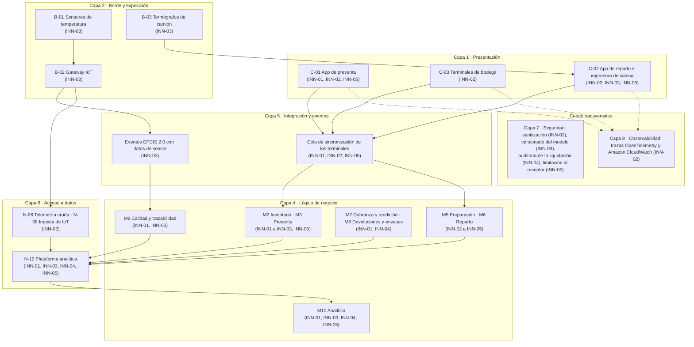
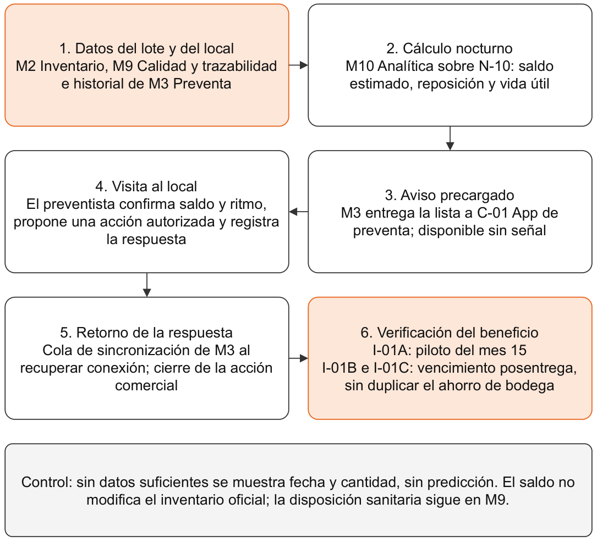
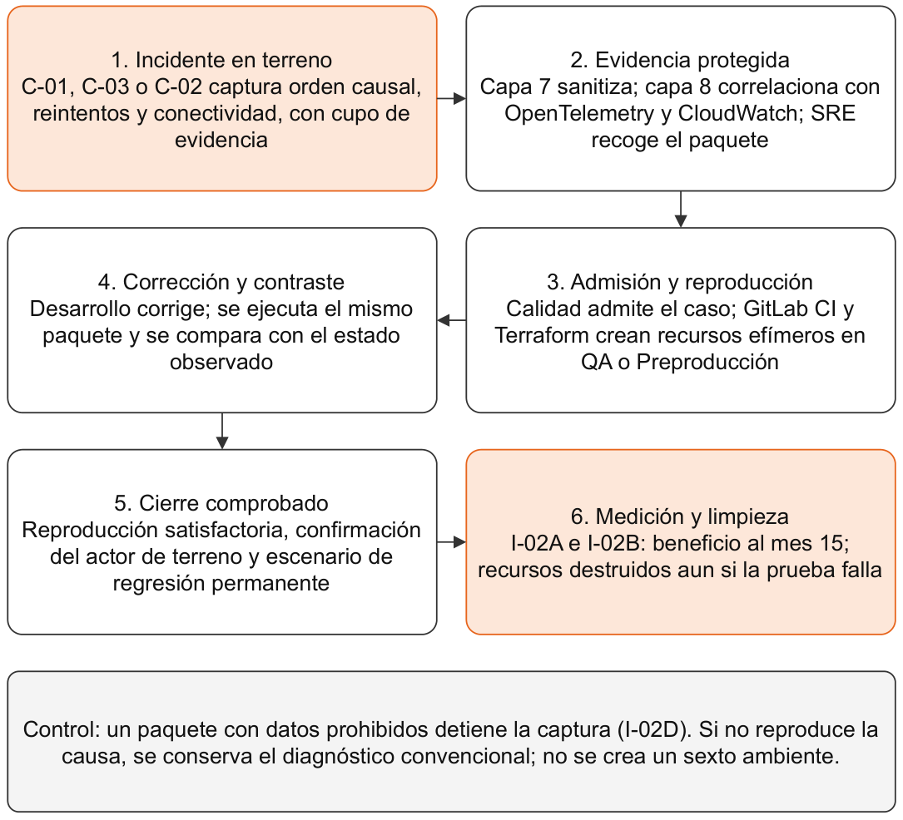
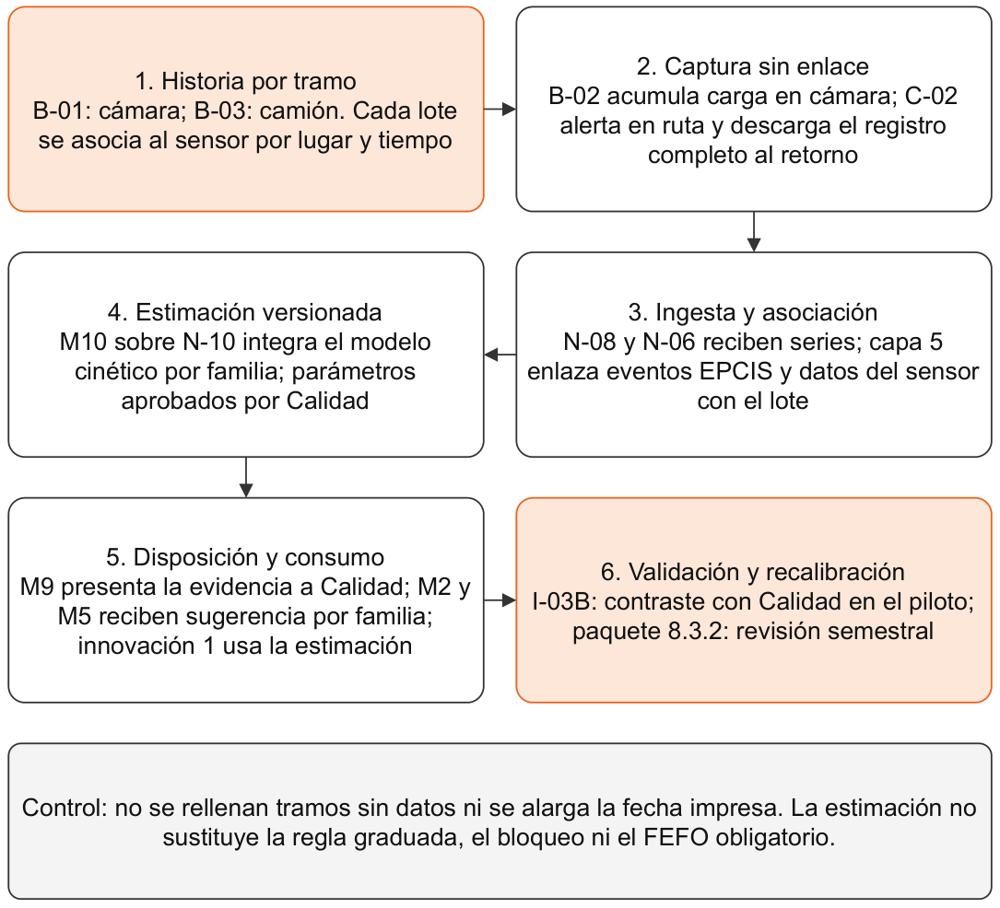
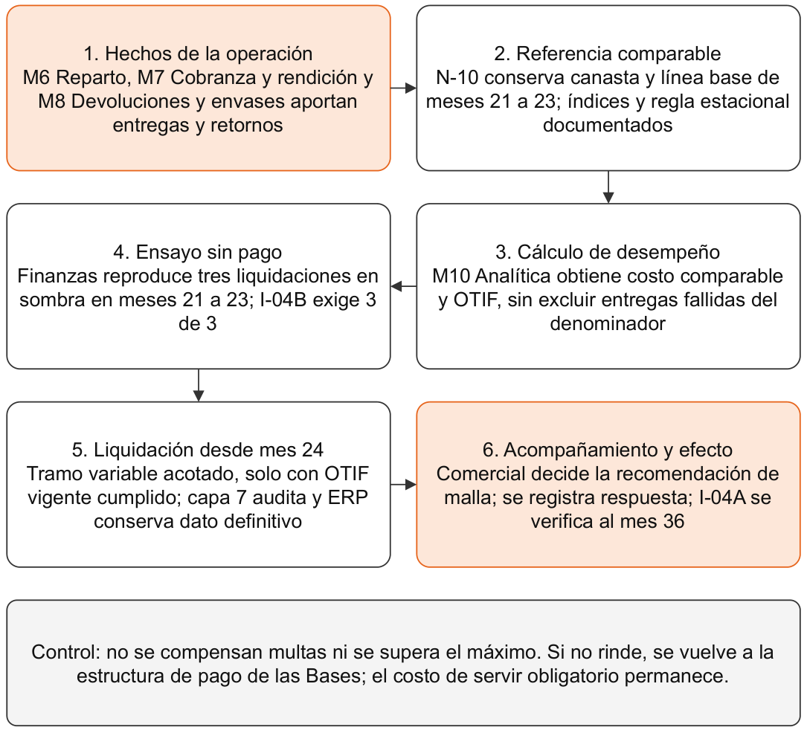
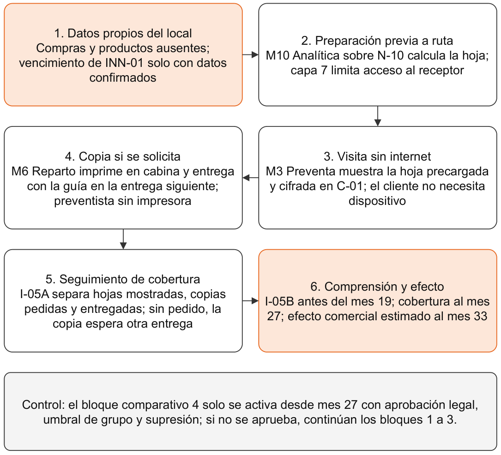

# LafroX — Subdocumento 13

## Índice

- [Introducción a las Innovaciones](#introducción-a-las-innovaciones)
- [13.1 Innovación 1](#131-innovación-1)
- [13.1.1 Problema u oportunidad](#1311-problema-u-oportunidad)
- [13.1.2 Tecnología, práctica o modelo](#1312-tecnología-práctica-o-modelo)
- [13.1.3 Nivel de madurez](#1313-nivel-de-madurez)
- [13.1.4 Diseño de la incorporación](#1314-diseño-de-la-incorporación)
- [13.1.5 Impacto económico](#1315-impacto-económico)
- [13.1.6 Indicador de verificación](#1316-indicador-de-verificación)
- [13.1.7 Riesgo de adopción](#1317-riesgo-de-adopción)
- [13.2 Innovación 2](#132-innovación-2)
- [13.2.1 Problema u oportunidad](#1321-problema-u-oportunidad)
- [13.2.2 Tecnología, práctica o modelo](#1322-tecnología-práctica-o-modelo)
- [13.2.3 Nivel de madurez](#1323-nivel-de-madurez)
- [13.2.4 Diseño de la incorporación](#1324-diseño-de-la-incorporación)
- [13.2.5 Impacto económico](#1325-impacto-económico)
- [13.2.6 Indicador de verificación](#1326-indicador-de-verificación)
- [13.2.7 Riesgo de adopción](#1327-riesgo-de-adopción)
- [13.3 Innovación 3](#133-innovación-3)
- [13.3.1 Problema u oportunidad](#1331-problema-u-oportunidad)
- [13.3.2 Tecnología, práctica o modelo](#1332-tecnología-práctica-o-modelo)
- [13.3.3 Nivel de madurez](#1333-nivel-de-madurez)
- [13.3.4 Diseño de la incorporación](#1334-diseño-de-la-incorporación)
- [13.3.5 Impacto económico](#1335-impacto-económico)
- [13.3.6 Indicador de verificación](#1336-indicador-de-verificación)
- [13.3.7 Riesgo de adopción](#1337-riesgo-de-adopción)
- [13.4 Innovación 4](#134-innovación-4)
- [13.4.1 Problema u oportunidad](#1341-problema-u-oportunidad)
- [13.4.2 Tecnología, práctica o modelo](#1342-tecnología-práctica-o-modelo)
- [13.4.3 Nivel de madurez](#1343-nivel-de-madurez)
- [13.4.4 Diseño de la incorporación](#1344-diseño-de-la-incorporación)
- [13.4.5 Impacto económico](#1345-impacto-económico)
- [13.4.6 Indicador de verificación](#1346-indicador-de-verificación)
- [13.4.7 Riesgo de adopción](#1347-riesgo-de-adopción)
- [13.5 Innovación 5](#135-innovación-5)
- [13.5.1 Problema u oportunidad](#1351-problema-u-oportunidad)
- [13.5.2 Tecnología, práctica o modelo](#1352-tecnología-práctica-o-modelo)
- [13.5.3 Nivel de madurez](#1353-nivel-de-madurez)
- [13.5.4 Diseño de la incorporación](#1354-diseño-de-la-incorporación)
- [13.5.5 Impacto económico](#1355-impacto-económico)
- [13.5.6 Indicador de verificación](#1356-indicador-de-verificación)
- [13.5.7 Riesgo de adopción](#1357-riesgo-de-adopción)
- [Referencias](#referencias)
- [Declaración de uso de IA](#declaración-de-uso-de-ia)

# Introducción a las Innovaciones

**Subdocumento 13 del T-7: Innovaciones**

Este capítulo presenta las cinco innovaciones que LafroX compromete para Distribuidora Puelche, una por cada tipo obligatorio del Artículo 28° de las Bases Administrativas (Distribuidora Puelche S.A., 2026a, Art. 28°, p. 19). La innovación N corresponde al tipo N (Distribuidora Puelche S.A., 2026d, §8). Cada una desarrolla los siete elementos del Artículo 29° (Bases Administrativas, pp. 19–20): el problema del caso con su evidencia, la tecnología o práctica que la sustenta, su nivel de madurez con fuentes, el diseño de su incorporación, su impacto económico, su indicador de verificación y su riesgo de adopción.

Las cinco se eligieron por su pertinencia al caso y no por su novedad, como pide el Art. 30.2 de las Bases Administrativas (p. 20). Cada una parte de un problema que el caso documenta con un dato o una entrevista. Cada una declara además qué parte de su ámbito ya es alcance obligatorio de las Bases o del Capítulo 3, para mostrar que lo ofertado como innovación es un agregado y no una funcionalidad exigida presentada con otro nombre (Distribuidora Puelche S.A., 2026a, Art. 30°, p. 20).

El capítulo se conecta con el resto de la oferta de la siguiente forma:

- **Arquitectura.** Cada innovación declara en este capítulo qué capas, componentes y módulos utiliza, como exige el RT-26.01 (Bases Técnicas Transversales, cap. 26, p. 44). Esos elementos son los que definen el Capítulo 4 (capas en la sección 4.1.3, módulos en la sección 4.1.4 y emplazamiento en la sección 4.2.2) y que el Capítulo 3 resume en la sección 3.4.2. Las innovaciones reutilizan los componentes ofertados y agregan las responsabilidades funcionales y los contratos descritos en este capítulo, sin incorporar hardware adicional al Formulario T-11. El Anexo 13.B identifica los componentes utilizados. El procesamiento que agregan las innovaciones corre sobre los servicios elásticos de la plataforma analítica N-10 (S3, Glue y Redshift Serverless; Formulario T-11) y sobre recursos efímeros de QA y Preproducción, por lo que se refleja como costo operacional en el flujo de caja de cada innovación y no como capacidad fija adicional. En el borde, la innovación 3 solo acumula la carga térmica sobre las lecturas que el gateway B-02 ya recibe, sin agregar ingesta.
- **EDT y cronograma.** Sus paquetes están en la cuenta de control 3.10 «Innovaciones», en el paquete 5.4.3 y en la cuenta 8.3 «Innovaciones en operación» del Formulario T-14, con los meses del Anexo 7.D (Bases Técnicas Transversales, cap. 26, RT-26.02, p. 44).
- **Riesgos.** Su riesgo de adopción está registrado en las fichas R8-25 a R8-29 del Anexo 8.A y en el Formulario T-16, con la escala ordinal del Capítulo 8, sección 8.1.3 (Bases Técnicas Transversales, cap. 26, RT-26.04, p. 44).
- **Flujo de caja.** El impacto económico se expresa por rubro, clase y mes, sin montos, porque la Oferta Técnica no puede contener cifras que permitan inferir el precio (Distribuidora Puelche S.A., 2026a, Art. 50.2, p. 29). La valorización se desarrolla para el Informe 3 y se incorpora al Entregable 2 de la Oferta Económica, ítem 2.7 (Bases Administrativas, Formulario E-21, p. 71); no se presentan costos ni precios de la oferta en este capítulo.
- **Inteligencia artificial.** Ninguna innovación incorpora un modelo aprendido. Por eso no se les aplica el Capítulo 18 de las Bases Técnicas (Bases Técnicas Transversales, cap. 26, RT-26.06, p. 44).

El detalle está en el archivo de anexos y en un formulario. El Anexo 13.A define los contratos de datos de cada innovación. El Anexo 13.B presenta la matriz de trazabilidad con la arquitectura, la EDT, los riesgos y el flujo de caja, y el alcance refinado de cada innovación con la investigación adicional que requiere. El Anexo 13.C reúne los indicadores y los riesgos en una sola vista. El Anexo 13.D responde las observaciones de la instancia anterior. Las cinco fichas formales del Artículo 29° están en el Formulario T-19 (Bases Administrativas, pp. 19–20 y 64).

La Tabla 13.1 resume la cartera.

**Tabla 13.1. Cartera de innovaciones de LafroX. Fuente: elaboración propia a partir de las Bases Administrativas, Art. 28°, p. 19, del Caso Logística y del Anexo 7.D.**

| N.º | Tipo (Art. 28°) | Innovación | Problema del caso que resuelve | Se materializa |
| --- | --- | --- | --- | --- |
| 1 | Producto o servicio | Seguimiento de vencimiento posentrega en el local | Merma por vencimiento detectada en la góndola del cliente | Mes 16 |
| 2 | Proceso | Reproducción de incidentes de terreno | Pedidos perdidos o duplicados sin señal, «semanalmente, sin medición» | Mes 5 (circuito); mes 15 (beneficio medido) |
| 3 | Tecnológica o de arquitectura | Vida útil remanente por historia térmica del lote | Excursiones de temperatura sin consecuencia conocida sobre el lote | Mes 16 |
| 4 | Modelo de negocio o de contratación | Tramo variable de la Operación ligado al costo de servir | Costo de servir prorrateado con un criterio de 2016 | Mes 21 (acompañamiento); mes 24 (primera liquidación) |
| 5 | Experiencia de usuario o impacto social | Hoja de negocio del almacenero | Cliente sin internet que no recibe la información de sus compras | Mes 21 |

La innovación 2 permite medir la reducción del tiempo de diagnóstico antes del mes 16 mediante I-02A. Con ese beneficio LafroX oferta el RT-26.08 (Distribuidora Puelche S.A., 2026b, RT-26.08, cap. 26, p. 45). Las innovaciones 1 y 3 verifican durante la marcha blanca sus condiciones de habilitación; sus beneficios posteriores se evalúan en los momentos definidos para cada indicador. Una condición de habilitación no se contabiliza como ahorro ya demostrado. Las innovaciones 4 y 5 dependen del costo de servir y de los canales de la Etapa 2, por lo que se materializan desde el mes 21.

La Figura 13.1 ubica las cinco innovaciones sobre las capas de la arquitectura del Capítulo 4. Cada caja es un componente o módulo ya ofertado, y entre paréntesis se indican las innovaciones que lo usan.

**Figura 13.1. Ubicación de las cinco innovaciones en la arquitectura. Fuente: elaboración propia a partir del Capítulo 4, secciones 4.1.3, 4.1.4 y 4.2.2, y del Formulario T-11.**

La figura muestra que las cinco innovaciones se apoyan en los mismos componentes ya ofertados. Cuatro de ellas pasan por M10 Analítica y tres por la cola de sincronización de los terminales, que es la pieza que permite trabajar sin señal. Ninguna crea un sistema paralelo: cada una agrega una regla, un contrato de datos o un circuito de trabajo sobre la plataforma del Capítulo 4. La matriz completa está en el Anexo 13.B.

## 13.1 Innovación 1

**Tipo 1, producto o servicio: Seguimiento de vencimiento posentrega en el local (INN-01).** Es un servicio que sigue los lotes de Puelche después de entregarlos. Avisa al preventista qué lotes de un local no alcanzarán a venderse antes de vencer y con qué acción autorizada puede evitarse la pérdida.

### 13.1.1 Problema u oportunidad

La merma por vencimiento equivale al 1,7 % del valor del inventario al año, y se detecta en el conteo, en la preparación o en la góndola del cliente (Distribuidora Puelche S.A., 2026c, cap. 4.8). La preventista de la zona Curicó lo confirma: ve producto vencido de Puelche en la góndola y no lo anota en ninguna parte porque no hay dónde (Distribuidora Puelche S.A., 2026c, cap. 8, entrevista a Sandra Riffo). El rechazo por vencimiento próximo es además causa habitual de devolución.

La solución obligatoria mide y controla la merma dentro de la bodega, pero la pérdida que ocurre después de la entrega, en el local, no tiene medición propia ni un momento en que se pueda evitar. Esa es la oportunidad que toma esta innovación.

### 13.1.2 Tecnología, práctica o modelo

La Tabla 13.2 separa lo que ya es alcance obligatorio de lo que esta innovación agrega.

**Tabla 13.2. Alcance obligatorio en el ámbito de la innovación 1. Fuente: elaboración propia a partir del Formulario T-12, del Anexo 3.G y del Capítulo 2, Tabla 2.1.**

| Ya es alcance obligatorio | Dónde está |
| --- | --- |
| FEFO estricto en la asignación del picking | RF-05.05 (M5), RF-02.09 (M2) y RNG-10 |
| Alerta cuando un producto en stock alcanza un umbral de vida útil remanente, en bodega | RF-02.09 |
| Picking dirigido con causa de faltante, incluido «producto vencido» | RF-02.08 |
| Registro de la merma ya detectada, incluida la de la góndola | RF-08.05 (M8) |
| Sugerencia de productos por historial de compra | RF-03.14 (M3) |
| Ciclo de vida del lote hasta el cliente | RF-02.10 y RF-01.03 |
| Merma ≤ 1,0 % del inventario a 12 meses de operación | Capítulo 2, Tabla 2.1 |

Todo el alcance obligatorio actúa dentro de la bodega o después de que la merma ya existe. La innovación agrega el seguimiento en el local y antes de la pérdida, con una acción comercial y su cierre. Para no apropiarse de la meta de merma del Capítulo 2, la innovación no se mide con la merma de inventario, sino con el vencimiento posentrega (indicador I-01B).

La regla de cobertura compara, para cada par lote–local, la cobertura en días con la vida útil remanente del lote. La cobertura es el saldo estimado dividido por el ritmo de reposición. Sus insumos son los siguientes:

- **Saldo estimado:** se calcula con las entregas por lote y las devoluciones, y el preventista lo confirma en la visita.
- **Ritmo de reposición:** se estima con el historial de compra por cliente y producto que M3 Preventa ya mantiene para sus sugerencias (RF-03.14). Mide reposición y no venta al consumidor; por eso se confirma en la visita.
- **Vida útil remanente:** cuando el lote es refrigerado o congelado y tiene estimación de la innovación 3, se usa esa estimación; en los demás casos, la fecha impresa del lote (RF-01.03).
- **Datos insuficientes:** el aviso muestra fecha y cantidad, sin simular una predicción.

El saldo estimado nunca entra al inventario oficial ni bloquea una venta, y la disposición sanitaria sigue siendo de M9 Calidad y trazabilidad. Cada aviso trae una acción tomada de un catálogo aprobado por Comercial y Calidad del CLIENTE, como canje, rotación en la góndola o retiro, y el preventista registra la respuesta del local.

### 13.1.3 Nivel de madurez

La madurez se declara con la escala TRL de la Comisión Europea (European Commission, 2016). El cálculo de cobertura es aritmética conocida. Lo que decide la calidad del aviso es estimar el ritmo de reposición por local en el canal tradicional, donde las compras son irregulares.

Riesenegger et al. (2023) revisan las prácticas contra la merma de alimentos en la operación del comercio minorista: pedido, exhibición, precio y retiro de producto por vencer. Es el mismo punto de la cadena donde actúa esta innovación. Esas prácticas las ejecuta el propio comercio con sus sistemas. Lo propio de esta innovación es que el distribuidor las lleve a un almacén que no tiene sistema, a través de la visita del preventista. Por eso el servicio integrado parte en TRL 2, con dos objetivos: TRL 4 al mes 10 (H4, con datos sintéticos) y TRL 6 al mes 15 (piloto en la marcha blanca).

**Investigación adicional declarada.** Falta establecer con qué precisión se estima el ritmo de reposición por local en el canal tradicional. Se investiga en el paquete 3.10.1.2 (meses 9 y 10) con datos sintéticos y se valida en el paquete 3.10.1.4 (meses 11 a 15: certificación del H5 en los meses 11 y 12, y piloto en la marcha blanca de los meses 13 a 15) con el indicador I-01A. La ventana de los meses 11 a 15 que el Anexo 8.A asigna al piloto (ficha R8-25) es la del paquete completo; el piloto con locales reales ocurre solo en la marcha blanca.

### 13.1.4 Diseño de la incorporación

M10 Analítica calcula la lista de avisos cada noche con datos de M2 Inventario, de M9 Calidad y trazabilidad y del historial de compra de M3 Preventa; sus datos residen en N-10 (capa 6). M8 Devoluciones y envases aporta las devoluciones por lote y su causal, que alimentan el saldo estimado y el indicador I-01C. M3 Preventa entrega la lista en la aplicación de preventa C-01 (capa 1). La lista viaja en el terminal y funciona sin señal (Capítulo 4, sección 4.1.15), y la respuesta de la visita vuelve por la cola de sincronización de M3 (capa 5). La innovación no abre una interfaz pública; su contrato de datos está en el Anexo 13.A.

La Figura 13.2 recorre el servicio desde los datos de origen hasta la verificación del beneficio en el local.

**Figura 13.2. Seguimiento posentrega: del dato del lote al cierre de la visita. Fuente: elaboración propia a partir de la sección 13.1.4 y del contrato de datos del Anexo 13.A.**

El recorrido distingue el cálculo nocturno de la confirmación en terreno. La precarga permite consultar el aviso sin señal y la cola devuelve la respuesta cuando vuelve la conexión. El cierre comercial no altera el inventario oficial ni reemplaza la decisión sanitaria de Calidad; por eso el beneficio se contrasta con vencimiento posentrega y no con la merma de bodega.

El piloto se hace en 120 locales de 12 rutas, con al menos 100 avisos evaluables. El tamaño es una decisión de diseño que permite evaluar el indicador I-01A, no una muestra representativa del canal. La Tabla 13.3 presenta los paquetes de la EDT que ejecutan la innovación.

**Tabla 13.3. Paquetes de la EDT de la innovación 1. Fuente: Formulario T-14 y Anexo 7.D.**

| Paquete | EDT | Meses | Entregable |
| --- | --- | --- | --- |
| INN-01.P1 | 3.10.1.1 | 7 a 9 | Catálogo de acciones autorizadas y protocolo del piloto |
| INN-01.P2 | 3.10.1.2 | 9 y 10 | Estimador de saldo y ritmo de reposición (H4) |
| INN-01.P3 | 3.10.1.3 | 9 y 10 | Lista sin conexión y respuesta de visita en M3 (H4) |
| INN-01.P4 | 3.10.1.4 | 11 a 15 | Certificación del H5, piloto en marcha blanca e informe de habilitación |

La innovación se materializa en el mes 16, con el paso a producción de la Etapa 1. La dirige el Líder de Datos, Leandro Chamorro, y Comercial y Calidad del CLIENTE validan el catálogo. En los meses 16 a 20 la innovación queda cubierta por la estabilización de la Etapa 1 (paquete 4.2.2). Desde el mes 21, su regla y su catálogo se mantienen dentro del mantenimiento correctivo y evolutivo (paquete 8.2.1); desde el mes 22, ese mantenimiento queda en el frente de Operación que dirige el Líder de Operación / SRE, Guillermo Castillo, porque la dedicación del Líder de Datos termina en el mes 21 (Capítulo 1, Tabla 1.6). La respuesta al riesgo de adopción R8-25 la conduce el Líder de Implantación y Gestión del Cambio, Patricio Henríquez, porque depende de la adopción en terreno (Anexo 8.A, ficha R8-25).

### 13.1.5 Impacto económico

La innovación no requiere hardware ni licencias: usa la aplicación de preventa C-01 y la plataforma analítica ya ofertados. La Tabla 13.4 ubica sus rubros en el flujo de caja.

**Tabla 13.4. Ubicación de la innovación 1 en el flujo de caja. Fuente: elaboración propia; la valorización está en la Oferta Económica, Entregable 2, ítem 2.7.**

| Rubro | Clase | Meses |
| --- | --- | --- |
| Horas de datos, desarrollo móvil y diseño del catálogo | Inversión / recursos humanos | 7 a 15 |
| Acompañamiento del piloto en terreno | Inversión / recursos humanos | 13 a 15 |
| Cálculo nocturno y almacenamiento en nube | Costo operacional | 16 a 56 |
| Mantención de la regla y del catálogo | Costo operacional / recursos humanos | 16 a 56 |
| Unidades vencidas evitadas en el local, netas de canjes y descuentos | Beneficio | Desde el mes 16; primera medición en el mes 28 |

El beneficio se calcula como unidades vencidas evitadas en el local por su costo unitario, menos los canjes y descuentos que la acción comercial otorgue. No se suma al beneficio de la meta de merma del Capítulo 2 ni al de la innovación 3, para no contar dos veces el mismo ahorro.

### 13.1.6 Indicador de verificación

La Tabla 13.5 define los indicadores, con su línea base, su meta y su momento de medición.

Las reducciones de I-01B e I-01C son metas propuestas de diseño, no mediciones obtenidas ni ahorros garantizados. El mecanismo esperado es detectar el riesgo antes del vencimiento y cerrar una acción autorizada en el local. La línea base se levanta durante la marcha blanca, en rutas de control que no reciben avisos, y el contraste del mes 28 determina el efecto observado; sin ese contraste no se atribuye ahorro a la innovación.

**Tabla 13.5. Indicadores de la innovación 1. Fuente: elaboración propia a partir del Caso Logística, cap. 4.8, y del paquete 3.10.1.4 del Formulario T-14.**

| Id | Indicador | Línea base | Meta | Momento |
| --- | --- | --- | --- | --- |
| I-01A | Avisos con riesgo confirmado en la visita / avisos evaluables | Sin medición (el servicio no existe) | ≥ 70 %, con ≥ 100 avisos | Mes 15 |
| I-01B | Unidades vencidas en el local / unidades entregadas, en las rutas de control | Rutas de control sin avisos, meses 13 a 15 | −25 % relativo | Mes 28 |
| I-01C | Devoluciones con causal «vencimiento próximo» / devoluciones, en las rutas de control | Rutas de control sin avisos, meses 13 a 15 | −20 % relativo | Mes 28 |

I-01A es la condición para liberar el servicio al resto de las rutas: mide si el aviso acierta antes de medir si ahorra. I-01B e I-01C toman su línea base en la marcha blanca, porque el caso no desagrega el vencimiento posentrega ni la causal de devolución, y por eso la meta se expresa como reducción relativa y no como un valor absoluto. La base se mide en rutas de control, comparables en zona y canal con las rutas del piloto, que no reciben avisos durante los meses 13 a 15; así, la base no incluye el efecto de la innovación. El contraste del mes 28 se hace en esas mismas rutas, que reciben el servicio cuando se libera al resto de las rutas tras cumplir I-01A. Las reducciones del 25 % y del 20 % son metas propuestas de diseño: no provienen de una medición previa y no se cuentan como ahorro antes de su medición en el mes 28.

### 13.1.7 Riesgo de adopción

El riesgo de adopción está registrado como R8-25 en el Anexo 8.A, con probabilidad 4 e impacto 3 en la escala del Capítulo 8, sección 8.1.3 (exposición 12, nivel alto). La Tabla 13.6 resume sus dos causas.

**Tabla 13.6. Riesgo de adopción de la innovación 1. Fuente: Anexo 8.A, ficha R8-25, y Formulario T-16.**

| Causa | P × I (SD8) | Mitigación | Contingencia |
| --- | --- | --- | --- |
| Avisos falsos por compras irregulares del canal tradicional | 4 × 3 (R8-25) | No liberar sin cumplir I-01A; mostrar la confianza de cada aviso; confirmar el saldo en la visita | Degradar a aviso solo por vida útil remanente del lote, sin estimar el ritmo |
| Aviso sin acción posible por falta de catálogo | Incluida en R8-25 | El catálogo del paquete 3.10.1.1 es condición de activación | Mantener solo el aviso informativo y escalar a Comercial |

Si la innovación no rinde, la trazabilidad de lote hasta la entrega y la alerta de vida útil en bodega siguen operando, porque son alcance obligatorio y no dependen de ella.

## 13.2 Innovación 2

**Tipo 2, proceso: Reproducción de incidentes de terreno (INN-02).** Cambia cómo se atiende un fallo de terreno. El incidente real se convierte en un escenario reproducible, la corrección se valida contra ese escenario y solo entonces se cierra el incidente.

### 13.2.1 Problema u oportunidad

Los pedidos se pierden o se duplican por falta de señal «semanalmente, sin medición» (Distribuidora Puelche S.A., 2026c, cap. 18, criterio 6). La preventista cuenta que a veces el pedido no se mandó y otras se mandó dos veces (Distribuidora Puelche S.A., 2026c, cap. 8, entrevista a Sandra Riffo).

Estos fallos ocurren donde no se programa: en las rutas de Empedrado, Chanco, Cauquenes, Pinto y Alto Biobío, con tramos sin señal de hasta dos horas continuas (Distribuidora Puelche S.A., 2026c, cap. 6), en la cámara de congelados, en la ventana de despacho de 05:30 a 07:00 y en el peak de septiembre. Llegan a la mesa de ayuda como un relato que no se puede reproducir en un escritorio, y por eso se corrigen a ciegas y reaparecen.

### 13.2.2 Tecnología, práctica o modelo

La Tabla 13.7 separa lo que ya es alcance obligatorio de lo que esta innovación agrega.

**Tabla 13.7. Alcance obligatorio en el ámbito de la innovación 2. Fuente: elaboración propia a partir de las Bases Técnicas Transversales, del Formulario T-12 y del Capítulo 4, sección 4.1.9.**

| Ya es alcance obligatorio | Dónde está |
| --- | --- |
| Inyección controlada de fallas antes de cada paso a producción y semestral en operación | RT-10.07 (Bases Técnicas Transversales, cap. 10, p. 22); RNF-20.04 |
| Pruebas de integración, regresión, idempotencia y fallas de enlace en QA, con datos controlados | Capítulo 4, sección 4.1.9 |
| Preproducción con topología equivalente para aceptación, carga y resiliencia | Capítulo 4, sección 4.1.9 |
| Revisión por pares, pruebas de contrato, PHPUnit, PHPStan y análisis de secretos como bloqueo | RT-04.03 a RT-04.05 (Bases Técnicas Transversales, cap. 4, p. 10); Capítulo 6 y Formulario T-10 |
| Reconciliación determinista y bitácora | RT-03.12 (Bases Técnicas Transversales, cap. 3, p. 9) |
| Análisis de causa raíz de todo incidente crítico, con informe en cinco días hábiles | RT-14.06 (Bases Técnicas Transversales, cap. 14, p. 27; RF-16.04) |

Todo lo anterior prueba fallas que el equipo imagina. La innovación agrega el circuito para fallas que ocurrieron en la calle, en cuatro pasos:

1. El terminal arma un paquete sanitizado con la secuencia causal del incidente.
2. Calidad lo admite y lo reproduce en QA.
3. La corrección se valida contra ese mismo paquete.
4. El escenario queda como prueba de regresión permanente.

El incidente no se cierra sin reproducción satisfactoria y sin la confirmación del actor de terreno que lo reportó.

**Por qué no es práctica estándar.** Las herramientas corrientes de reporte de fallos móviles registran las caídas de la aplicación y los pasos previos. El defecto típico de Puelche no es una caída: la aplicación sigue funcionando y el pedido se pierde o se duplica porque la cola local y el servidor procesaron los eventos en otro orden durante la reconexión. Ese defecto no deja rastro en un reporte de fallos. Solo se reproduce con el orden causal de la cola local, los reintentos y el estado de conectividad, que es lo que contiene el paquete de esta innovación.

**Lo que agrega frente al RT-14.06.** El RT-14.06 exige explicar por escrito la causa de los incidentes críticos (Distribuidora Puelche S.A., 2026b, RT-14.06, cap. 14, p. 27). Esta innovación cubre también los incidentes no críticos de terreno, que son los frecuentes, y cambia el criterio de cierre: no basta un informe de causa, porque el incidente se cierra cuando la corrección pasa la reproducción del caso real. El informe del RT-14.06 se alimenta del mismo paquete, sin duplicar el trabajo.

La tecnología se compone de las siguientes piezas:

- **Contrato de evidencia:** correlación seudonimizada, versión de la aplicación Kotlin, transiciones de estado, cola local, reintentos, orden causal y estado de conectividad. Excluye nombres, credenciales, firmas, fotos y contenido comercial. El detalle está en el Anexo 13.A.
- **Reproducción:** con recursos efímeros creados con Terraform dentro de QA o de Preproducción. No es un sexto ambiente: se respetan los cinco ambientes del RT-04.01 (Bases Técnicas Transversales, cap. 4, p. 10; Capítulo 4 de la oferta, sección 4.1.9).
- **Integración:** la reproducción se engancha a la cadena de GitLab CI como un trabajo más (Capítulo 6 y Formulario T-10).
- **Correlación:** la traza viaja con OpenTelemetry hacia la capa 8 de observabilidad, en Amazon CloudWatch.
- **Límites:** el frío, los guantes y la batería no se simulan; requieren prueba física con el dispositivo.

Cada ejecución de reproducción vinculada a una incidencia creará automáticamente sus recursos mediante Terraform desde GitLab CI y los destruirá al finalizar, incluso si la prueba falla (Distribuidora Puelche S.A., 2026b, RT-04.14, cap. 4, p. 11). La ejecución se realizará dentro de QA o Preproducción, de lunes a viernes de 08:00 a 20:00, salvo ventanas de prueba programadas por el CLIENTE y la activación prevista para correcciones críticas, conforme al supuesto S-43 (LafroX, 2026, Subdocumento 3, Anexo 3.C).

La práctica se apoya en la entrega continua (Shahin et al., 2017). Las métricas de tasa de fallo de cambio y de tiempo de recuperación del informe DORA (2024) se usan como referencia para comparar el diagnóstico antes y después.

### 13.2.3 Nivel de madurez

Las piezas por separado, la integración y la entrega continuas, los entornos efímeros y las trazas distribuidas, están en TRL 9: son prácticas de uso industrial documentadas (Shahin et al., 2017). El circuito completo incidente → paquete → reproducción → cierre, aplicado a terminales que trabajan sin señal, parte en TRL 2 en la escala de la Comisión Europea (European Commission, 2016). Sus objetivos son TRL 4 al mes 5, con el circuito mínimo de pérdida y retorno de red, y TRL 6 al mes 15, en la marcha blanca con incidentes reales.

**Investigación adicional declarada.** Falta demostrar que el paquete de evidencia reproduce los reordenamientos de la cola durante la reconexión sin competir con la sincronización de pedidos. Se investiga en el paquete 3.10.2.2 (meses 3 a 5) y se valida con incidentes reales en el paquete 3.10.2.4 (meses 11 a 15) con los indicadores I-02A e I-02B.

### 13.2.4 Diseño de la incorporación

La aplicación de preventa C-01 (M3 Preventa), los terminales de bodega C-03 (M5 Preparación) y la aplicación de reparto C-02 (M6 Reparto), en la capa 1, emiten la evidencia con un cupo de tamaño y frecuencia para no competir con la sincronización de pedidos. La evidencia incluye el estado de los módulos M3, M5 y M6 (capa 4) y el orden causal de la cola de sincronización de los terminales (capa 5). La capa 8 correlaciona las trazas, y la capa 7 sanitiza y controla el acceso a los paquetes. Como la innovación modifica el tratamiento de datos de la capa de seguridad, el Encargado de Seguridad de la Información, Álvaro Catalán, aprueba la sanitización con su propio modelado de amenazas (Bases Técnicas Transversales, cap. 26, RT-26.07, p. 45).

La Figura 13.3 muestra cómo un incidente real se transforma en un escenario reproducible y una prueba de regresión.

**Figura 13.3. Incidente de terreno: evidencia, reproducción y cierre comprobado. Fuente: elaboración propia a partir de la sección 13.2.4 y del contrato de datos del Anexo 13.A.**

La secuencia separa la captura por el terminal, la protección de la evidencia, la admisión por Calidad y la corrección por Desarrollo. El cierre depende de reproducir satisfactoriamente el caso y de la confirmación del actor de terreno, no solo de redactar una causa. Los recursos efímeros se destruyen al terminar incluso ante una falla; el diagnóstico convencional permanece como contingencia.

El flujo de responsabilidades es el siguiente: Operación/SRE recoge la evidencia, Calidad admite el paquete y Desarrollo corrige. La Tabla 13.8 presenta los paquetes de la EDT.

**Tabla 13.8. Paquetes de la EDT de la innovación 2. Fuente: Formulario T-14 y Anexo 7.D.**

| Paquete | EDT | Meses | Entregable |
| --- | --- | --- | --- |
| INN-02.P1 | 3.10.2.1 | 2 y 3 | Medición inicial de incidentes y contrato de evidencia sanitizado |
| INN-02.P2 | 3.10.2.2 | 3 a 5 | Circuito mínimo: pérdida y retorno de red en M3 |
| INN-02.P3 | 3.10.2.3 | 5 a 10 | Captura de evidencia en M3, M5 y M6 (antes del H4) |
| INN-02.P4 | 3.10.2.4 y 8.3.1 | 11 a 15 y 21 a 56 | Validación comparada en la marcha blanca; mantenimiento de escenarios en operación |

El circuito inicial se materializa en el mes 5 y su beneficio se mide en el mes 15. Los responsables son el Líder de Calidad y Pruebas, Maximiliano Miño, y el Líder de Operación / SRE, Guillermo Castillo, ambos con dedicación hasta el mes 56. Las correcciones las hace el equipo del Líder de Desarrollo, Tomás Pérez, hasta el mes 21, y desde el mes 22 el mantenimiento correctivo de la fase de Operación (paquete 8.2.1). En los meses 16 a 20 los incidentes de terreno se atienden dentro de la estabilización de la Etapa 1 (paquete 4.2.2), con el mismo circuito.

### 13.2.5 Impacto económico

La inversión instrumenta los terminales y construye el circuito; no duplica el presupuesto de las pruebas obligatorias, que siguen en la cuenta 3.8. La Tabla 13.9 ubica sus rubros en el flujo de caja.

**Tabla 13.9. Ubicación de la innovación 2 en el flujo de caja. Fuente: elaboración propia; la valorización está en la Oferta Económica, Entregable 2, ítem 2.7.**

| Rubro | Clase | Meses |
| --- | --- | --- |
| Instrumentación de los terminales y sanitización | Inversión / recursos humanos | 2 a 5 |
| Cobertura de M3, M5 y M6 | Inversión / recursos humanos | 5 a 10 |
| Validación comparada en la marcha blanca (paquete 3.10.2.4) | Inversión / recursos humanos | 11 a 15 |
| Cómputo efímero por corrida en QA y Preproducción | Costo operacional | 5 a 56 |
| Mantención de los escenarios de regresión | Costo operacional / recursos humanos | 21 a 56 |
| Horas de diagnóstico y regresiones repetidas evitadas | Beneficio | Desde el mes 13; primera medición en el mes 15 |

El beneficio son horas de diagnóstico y regresiones repetidas evitadas. «Cero pedidos perdidos o duplicados» es el criterio de aceptación 6 del caso y no se cuenta como beneficio de la innovación.

### 13.2.6 Indicador de verificación

La Tabla 13.10 define los indicadores de la innovación 2.

La reducción del 30 % de I-02A es una meta propuesta de diseño. Se espera reducir el tiempo dedicado a reconstruir manualmente la secuencia del incidente mediante su paquete causal. La comparación de al menos veinte pares equivalentes permite evaluar la meta; no demuestra anticipadamente que esa magnitud se alcanzará ni autoriza a descontar esfuerzo del plan.

**Tabla 13.10. Indicadores de la innovación 2. Fuente: elaboración propia a partir del Caso Logística, cap. 18, criterio 6, y de los paquetes 3.10.2.1 a 3.10.2.4 y 8.3.1 del Formulario T-14.**

| Id | Indicador | Línea base | Meta | Momento |
| --- | --- | --- | --- | --- |
| I-02A | Mediana de horas desde la admisión del incidente hasta la causa reproducida | Incidentes de prueba de los meses 5 a 10 en QA, diagnosticados sin el paquete | −30 % relativo, con ≥ 20 pares comparables | Mes 15 |
| I-02B | Incidentes de terreno admitidos cuyo paquete reproduce la causa / admitidos | Sin medición (el circuito no existe) | ≥ 80 % | Mes 15; trimestral después |
| I-02C | Incidentes reabiertos por la misma causa después del cierre | Sin medición | 0 | Mensual desde el mes 21 |
| I-02D | Paquetes con datos prohibidos | Cero por diseño | 0 | En cada liberación |

La línea base de I-02A se forma en QA con incidentes de prueba de los meses 5 a 10: fallas de enlace y de reconexión inyectadas con los escenarios del RT-10.07, que se diagnostican del modo convencional y sin abrir el paquete de evidencia, aunque el circuito ya exista desde el mes 5. No se usan incidentes de terreno, porque antes de la marcha blanca no hay operación en terreno. En el mes 15, cada incidente de la marcha blanca diagnosticado con su paquete se compara con un incidente de la línea base del mismo tipo de falla y del mismo módulo, hasta reunir al menos veinte pares. Un par se forma cuando ambos incidentes comparten tipo de falla (pérdida de enlace, reconexión con reordenamiento de la cola o reintento duplicado) y módulo (M3, M5 o M6). Calidad asigna cada par antes de conocer el tiempo de diagnóstico del incidente de la marcha blanca, y un incidente sin par no se cuenta en la comparación. La comparación es conservadora: un incidente real de terreno es más difícil de diagnosticar a ciegas que una falla inyectada en QA, por lo que la base tiende a subestimar el tiempo del diagnóstico convencional. I-02D es una condición de seguridad y no de beneficio: un solo paquete con datos prohibidos detiene la captura.

### 13.2.7 Riesgo de adopción

El riesgo de adopción está registrado como R8-26 (probabilidad 3, impacto 4, exposición 12), y el riesgo de seguridad asociado como R8-24 (probabilidad 3, impacto 5, exposición 15), ambos en el Anexo 8.A. La Tabla 13.11 los resume.

**Tabla 13.11. Riesgos de adopción de la innovación 2. Fuente: Anexo 8.A, fichas R8-24 y R8-26, y Formulario T-16.**

| Causa | P × I (SD8) | Mitigación | Contingencia |
| --- | --- | --- | --- |
| Reproducción artificial que no explica el incidente | 3 × 4 (R8-26) | Comparar con el estado observado; revisión de muestras por Calidad | Conservar diagnóstico y regresión base con trazas protegidas (R8-26); reproducción semiautomática con un paquete armado por soporte |
| Consumo de batería o de datos del terminal | Incluida en R8-26 | Cupo y frecuencia de captura | Captura solo a solicitud de soporte |
| Datos personales en los paquetes | 3 × 5 (R8-24) | Sanitización por reglas fijas; modelado de amenazas (Bases Técnicas Transversales, cap. 26, RT-26.07, p. 45) | Suspender el conjunto afectado y producir una muestra protegida |

Si el circuito no rinde, el diagnóstico convencional y las pruebas obligatorias de resiliencia siguen vigentes, y no se descuentan horas del plan por el ahorro esperado (Anexo 8.F, oportunidad O8-01).

## 13.3 Innovación 3

**Tipo 3, tecnológica o de arquitectura: Vida útil remanente por historia térmica del lote (INN-03).** Cada lote refrigerado o congelado acumula su historia de temperatura desde la recepción hasta la entrega. Con un modelo cinético por familia de producto, la solución estima cuánta vida útil le queda realmente al lote, no solo la que dice la etiqueta.

El registro continuo de temperatura en cámaras y vehículos es alcance obligatorio (criterio 3 del caso) y no es la innovación. La innovación es lo que se construye sobre ese registro: asociar cada serie de temperatura al lote que estuvo expuesto a ella y convertirla en una vida útil remanente por lote.

### 13.3.1 Problema u oportunidad

Puelche maneja mil cien productos refrigerados y congelados, y hoy no existe registro continuo ni automático de temperatura en ningún punto de la cadena (Distribuidora Puelche S.A., 2026c, cap. 4.9). La flota con equipo de frío suma 28 camiones: 18 propios y 10 de transportistas (Distribuidora Puelche S.A., 2026c, cap. 2.3). El año pasado un cliente de food service rechazó un camión completo por sospecha de ruptura de la cadena de frío, y Puelche no pudo demostrar lo contrario (Distribuidora Puelche S.A., 2026c, cap. 4.9).

La jefa de Calidad lo plantea como pregunta: si dos grados por diez minutos es una excursión, y qué pasa con cuarenta minutos (Distribuidora Puelche S.A., 2026c, cap. 8, entrevista a Katherine Ñanco). La solución obligatoria ya define cuándo hay excursión: 2 °C de desviación sostenida por 15 minutos, parametrizable por tipo de producto (RF-09.05 y RF-09.10). La regla graduada del Capítulo 3 (RNG-04) deja la disposición final a Calidad. Lo que nadie define es qué consecuencia tuvo esa excursión sobre la vida útil del lote. Con ese dato Calidad decidiría entre liberar, acortar la vida útil o descartar; hoy esa decisión se toma sin él, y la fecha impresa supone una cadena de frío perfecta que nadie puede acreditar.

La pertinencia es directa: el proveedor de lácteos excluyó a Puelche de su lista de distribuidores «hasta que acredite capacidad de trazabilidad» (Distribuidora Puelche S.A., 2026c, cap. 1), y esa suspensión venció en septiembre de 2026 (Distribuidora Puelche S.A., 2026c, cap. 13.2). La trazabilidad por lote que exige ese proveedor ya es alcance obligatorio; INN-03 agrega sobre ella la evidencia del efecto de la cadena de frío en la vida útil de cada lote.

### 13.3.2 Tecnología, práctica o modelo

La Tabla 13.12 separa lo que ya es alcance obligatorio de lo que esta innovación agrega.

**Tabla 13.12. Alcance obligatorio en el ámbito de la innovación 3. Fuente: elaboración propia a partir del Caso Logística, cap. 18, del Formulario T-12, del Anexo 3.G y del Capítulo 4.**

| Ya es alcance obligatorio | Dónde está |
| --- | --- |
| Registro continuo de temperatura en cámaras y vehículos | Criterio 3 del caso; RF-09.03 y RF-09.04 (M9) |
| Serie sin brechas: un intervalo sin lectura se registra como evento | RNF-09.05 |
| Alerta en tiempo real de excursión, parametrizable por tipo de producto | RF-09.05 y RF-09.10 |
| Respuesta graduada con disposición de Calidad | RF-09.06 y RNG-04 (Capítulo 3, sección 3.2.4) |
| Rechazo por sospecha de ruptura y evidencia de la cadena de frío ante la autoridad y el cliente | RF-09.07 y RF-09.09 |
| Bloqueo en el borde en menos de 5 segundos y 24 horas sin enlace | Capítulo 4, sección 4.2, componente B-02 |
| Trazabilidad por eventos GS1 EPCIS; FEFO y alerta de vida útil remanente calculadas desde la fecha impresa | Capítulo 4, sección 4.1; RF-05.05, RF-02.09 y RNG-10 |

La innovación agrega una medida continua por lote, la vida útil remanente estimada, derivada de su historia térmica real. A diferencia de la vida útil remanente del RF-02.09, que se calcula desde la fecha impresa y supone una cadena de frío perfecta, esta medida descuenta la exposición térmica que el lote tuvo realmente. Para Calidad, la regla graduada y el bloqueo no cambian: la medida le da evidencia cuantitativa para disponer en la zona gris. Para la bodega, M2 Inventario y M5 Preparación reciben un orden de salida sugerido por vida útil remanente real, que Calidad habilita familia por familia; es una sugerencia y no reemplaza el FEFO del RF-05.05. Para la innovación 1, entrega una vida útil más realista.

La tecnología tiene cuatro componentes:

1. **EPCIS 2.0 con datos de sensor.** La versión 2.0 del estándar agregó la lista de elementos de sensor (`sensorElementList`) para adjuntar lecturas o resúmenes de sensor a un evento de negocio (GS1 AISBL, 2022). Cada movimiento del lote (recepción, ubicación en cámara, carga del SSCC al camión y entrega) lleva el resumen térmico del tramo: mínimo, máximo, minutos fuera de rango y carga térmica acumulada.
2. **Asociación lote–sensor por lugar y tiempo.** En cámara, el lote toma la serie del punto B-01 de su zona (21 puntos en total); en ruta, la del termógrafo B-03 de su camión (28 en total). Un tramo sin dato queda marcado como tal y nunca se rellena. El modelo de datos ya contiene esta asociación temporal entre sensor y lote (Capítulo 5, sección 5.1.7).
3. **Modelo cinético por familia** (lácteos, cecinas, congelados y otras). Usa la dependencia de la velocidad de deterioro con la temperatura (Arrhenius o Q10), integrada sobre la historia real del lote. Es el principio del sistema SMAS de gestión de la seguridad de alimentos refrigerados (Koutsoumanis et al., 2005) y del FEFO dinámico en la logística de alimentos (Jedermann et al., 2014). El modelo es determinista: los parámetros vienen de la literatura y de la ficha del proveedor, y los aprueban el Líder de Calidad y Pruebas, Maximiliano Miño, y Calidad del CLIENTE. No es aprendizaje automático.
4. **Cálculo distribuido.** En el borde, el gateway B-02 (AWS IoT Greengrass, en los centros de distribución de Talca y Concepción) acumula la carga térmica de los lotes en cámara aunque el centro esté 24 horas sin enlace. En ruta, el termógrafo B-03 registra todo el trayecto y difunde la temperatura por Bluetooth, y la aplicación de reparto C-02 alerta cuando detecta una excursión; al volver el camión, el terminal descarga el registro completo (Capítulo 4, sección 4.2) y N-10 calcula la carga térmica del tramo de ruta. Durante la ruta, el lote conserva su última estimación y la alerta llega a Calidad por la red celular, de inmediato con cobertura o cuando el terminal la recupera. La estimación es una proyección derivada de los eventos: se puede reconstruir con otra versión del modelo para auditoría.

El contrato de datos de la historia térmica del lote se especifica en el Anexo 13.A.

**Modelo analítico y alcance propio de la incorporación.** El RT-05.30 valora una capacidad analítica con modelo, variables, métrica de desempeño y plan de reentrenamiento documentados (Distribuidora Puelche S.A., 2026b, RT-05.30, cap. 5, p. 13). El modelo cinético sustenta esa capacidad y no se presenta como una invención de LafroX. La incorporación propuesta integra la historia térmica de cada lote con el cálculo en cámara sin enlace, la reconstrucción central y su uso por Calidad y por los módulos consumidores. Su aporte se argumenta por ese recorrido operativo, no por renombrar el registro de temperatura ni por atribuir novedad a Arrhenius o Q10. Los cuatro elementos del modelo se especifican a continuación.

**Modelo.** La cinética de deterioro por familia, mediante Arrhenius o Q10, se integra sobre la historia térmica del lote. El cálculo es determinista y conserva la versión de los parámetros aprobados por Maximiliano Miño y Calidad del CLIENTE.

**Variables.** Se utilizan la serie de temperatura y el tiempo de cada tramo, la familia del producto, la vida útil nominal informada por el proveedor y los parámetros cinéticos aprobados. Los tramos sin dato se identifican expresamente y no se completan por inferencia.

**Métrica de desempeño.** I-03B mide la proporción de lotes cuya estimación difiere de la evaluación de Calidad en no más del 15 % de la vida nominal. La habilitación se decide por familia con la muestra y el umbral definidos en la sección 13.3.6; no se confunde esta precisión con el ahorro posterior de I-03D.

**Recalibración.** Al no ser un modelo aprendido, se revisan los parámetros y no se reentrena un algoritmo de aprendizaje. El paquete 8.3.2 ejecuta la revisión semestral con los lotes evaluados del período, en los meses 26, 32, 38, 44, 50 y 56. Estos meses siguen la numeración del proyecto que usa todo el cronograma, y no un conteo desde el inicio de la Operación: caen dentro de la fase de Operación, que va del mes 21 al mes 56 (Distribuidora Puelche S.A., 2026a, Art. 17°, pp. 12–13), y dentro de la ventana del paquete 8.3.2 en el Formulario T-15 (meses 21 a 56). A efectos del seguimiento operacional, se considera señal de deriva del desempeño que I-03B sea inferior al 80 % en dos cortes consecutivos para una misma familia. Este umbral activa la recalibración extraordinaria de sus parámetros; no constituye por sí solo un diagnóstico de la causa de la degradación.

Al no ser un modelo aprendido, no se le aplica el Capítulo 18 de las Bases Técnicas (RT-26.06). Aun así declara línea base, métrica de desempeño y detección de deriva, como pediría el RT-18.08 a un modelo predictivo.

### 13.3.3 Nivel de madurez

EPCIS 2.0 es un estándar publicado (GS1 AISBL, 2022). Los modelos cinéticos de vida útil están validados experimentalmente para alimentos refrigerados (Koutsoumanis et al., 2005), y Jedermann et al. (2014) documentan el FEFO dinámico en logística refrigerada. Con la escala de la Comisión Europea (European Commission, 2016), la integración propuesta, con cálculo en el borde sin enlace, asociación por eventos y uso por Calidad en la operación de Puelche, parte en TRL 2. Sus objetivos son TRL 4 al mes 10 (H4, con series y eventos sintéticos) y TRL 6 al mes 15 (marcha blanca con lotes reales).

**Investigación adicional declarada.** Faltan los parámetros cinéticos de cada familia para los productos que distribuye Puelche, porque la literatura entrega rangos generales. Se definen en el paquete 3.10.3.1 (meses 3 a 5) con las fichas de los proveedores y se validan con lotes reales en el paquete 3.10.3.4 (meses 11 a 15) con el indicador I-03B, con un laboratorio externo si Calidad lo requiere.

### 13.3.4 Diseño de la incorporación

La innovación usa componentes que la arquitectura ya contiene. Los sensores B-01 y los termógrafos B-03 son la fuente de las series; el gateway B-02 acumula la carga térmica sin enlace; la aplicación de reparto C-02 trae el registro de ruta. N-08 Ingesta de IoT y N-06 Telemetría cruda reciben las series y reutilizan los 10.920 mensajes diarios ya dimensionados (21 puntos × 288 lecturas más 28 termógrafos × 174 lecturas; Capítulo 4, sección 4.2), sin agregar ingesta. La capa 5 transporta los eventos EPCIS con datos de sensor. M9 Calidad y trazabilidad muestra la historia y la estimación, y en ella Calidad del CLIENTE dispone y, junto con Maximiliano Miño, aprueba los parámetros. M2 Inventario y M5 Preparación reciben el orden de salida sugerido, habilitado por familia. M10 Analítica, sobre N-10, ejecuta el modelo, recalcula y publica, y conserva las series cinco años. La capa 7 versiona y aprueba el modelo y sus parámetros.

La Figura 13.4 distingue la captura en cámara y en ruta, la asociación al lote y el uso posterior de la estimación.

**Figura 13.4. Historia térmica: del sensor a la decisión de Calidad. Fuente: elaboración propia a partir de la sección 13.3.4 y del contrato de datos del Anexo 13.A.**

El recorrido no supone cálculo continuo en el camión: C-02 alerta durante la ruta y el registro completo se descarga al retorno. En cámara, B-02 acumula carga térmica sin enlace. Después, la asociación temporal y el modelo versionado producen una estimación que Calidad contrasta antes de habilitar su uso por familia. La sugerencia no sustituye el FEFO ni autoriza alargar la fecha impresa.

La Tabla 13.13 presenta los paquetes de la EDT.

**Tabla 13.13. Paquetes de la EDT de la innovación 3. Fuente: Formulario T-14 y Anexo 7.D.**

| Paquete | EDT | Meses | Entregable |
| --- | --- | --- | --- |
| INN-03.P1 | 3.10.3.1 | 3 a 5 | Familias priorizadas, parámetros aprobados por Maximiliano Miño y Calidad del CLIENTE, y protocolo de validación |
| INN-03.P2 | 3.10.3.2 | 5 a 9 | Asociación lote–sensor en el borde y en el camión, por eventos EPCIS |
| INN-03.P3 | 3.10.3.3 | 9 y 10 | Vista en M9, publicación en N-10 y orden sugerido a M2 y M5 (H4) |
| INN-03.P4 | 3.10.3.4 | 11 a 15 | Certificación del H5 y validación en marcha blanca contra la evaluación de Calidad |
| INN-03.P5 | 8.3.2 | 26, 32, 38, 44, 50 y 56 | Revisión semestral de parámetros y extensión a nuevas familias |

Los lácteos son la primera familia priorizada, por la relación con su proveedor descrita en la sección 13.3.1. La innovación se materializa en el mes 16, como apoyo a la decisión de Calidad; el orden de salida sugerido se activa por familia cuando esa familia cumple el indicador I-03B. Los responsables son el Líder de Datos, Leandro Chamorro, y el Arquitecto de Solución, Bastián Trejo, con la validación del Líder de Calidad y Pruebas, Maximiliano Miño, y de la jefa de Calidad del CLIENTE. Desde el mes 22, las revisiones semestrales del paquete 8.3.2 se ejecutan en el frente de Operación que dirige Guillermo Castillo, y Maximiliano Miño y Calidad del CLIENTE aprueban sus parámetros, porque la dedicación del Líder de Datos termina en el mes 21 (Capítulo 1, Tabla 1.6). Las horas del paquete se mantienen en la familia de esfuerzo DAT del Formulario T-15, ejecutadas por el equipo de Operación, como declara el Anexo 8.A (ficha R8-27). Con el inicio supuesto en febrero de 2027 (Anexo 7.A), las revisiones de los meses 32, 44 y 56 caen en septiembre. En esos meses la recalibración se analiza sin intervenir producción, y los parámetros aprobados se activan después del día 25. En todas las revisiones, la activación evita además los tres primeros días hábiles del mes, por el cierre comercial y contable; ambas ventanas forman parte del congelamiento operacional (Distribuidora Puelche S.A., 2026c, cap. 10, restricción 8).

### 13.3.5 Impacto económico

La innovación no agrega hardware ni ingesta. Si la validación con lotes reales requiere un laboratorio externo, se contrata como servicio de terceros dentro del paquete 3.10.3.4. La Tabla 13.14 ubica sus rubros en el flujo de caja.

**Tabla 13.14. Ubicación de la innovación 3 en el flujo de caja. Fuente: elaboración propia; la valorización está en la Oferta Económica, Entregable 2, ítem 2.7.**

| Rubro | Clase | Meses |
| --- | --- | --- |
| Familias, parámetros y protocolo (datos y Calidad) | Inversión / recursos humanos | 3 a 5 |
| Cálculo en el borde, eventos y vista en M9 | Inversión / recursos humanos | 5 a 10 |
| Validación con lotes reales en la marcha blanca (horas de datos y Calidad, paquete 3.10.3.4) | Inversión / recursos humanos | 11 a 15 |
| Validación con lotes reales (laboratorio externo, si se contrata) | Inversión / proveedores | 11 a 15 |
| Cómputo en el borde y en N-10 | Costo operacional | 16 a 56 |
| Recalibración semestral de parámetros | Costo operacional / recursos humanos | 26 a 56, cada seis meses |
| Retenciones, descartes y rechazos por fecha próxima evitados | Beneficio | Desde el mes 16; primera medición en el mes 28 |

El beneficio llega por tres vías: menos lotes retenidos o descartados sin justificación térmica real; menos rechazos por fecha próxima, porque sale primero lo que tiene menos vida real; y, ante un rechazo como el del camión de food service, el dato de cuánta vida útil consumió el evento en cada lote, que define si el lote se reubica en otro cliente o se descarta. La evidencia de temperatura ya la entrega el RF-09.09 y no se cuenta como beneficio de la innovación. El beneficio no se suma a la meta de merma del Capítulo 2 ni al de la innovación 1.

### 13.3.6 Indicador de verificación

La Tabla 13.15 define los indicadores de la innovación 3.

La reducción del 20 % de I-03D es una meta propuesta de diseño, no un resultado de los modelos citados ni una garantía de ahorro. Su mecanismo esperado es aportar a Calidad evidencia del deterioro para disponer cada lote y habilitar sugerencias por familia. El contraste del mes 28 se efectúa con la línea base de los meses 13 a 15, sin sumar otra vez beneficios atribuidos a merma de inventario o a INN-01.

**Tabla 13.15. Indicadores de la innovación 3. Fuente: elaboración propia a partir del Caso Logística, cap. 4.9, y de los paquetes 3.10.3.1 a 3.10.3.4 y 8.3.2 del Formulario T-14.**

| Id | Indicador | Línea base | Meta | Momento |
| --- | --- | --- | --- | --- |
| I-03A | Lotes de familias priorizadas con historia térmica completa / lotes de esas familias | 0 (no hay registro continuo) | ≥ 95 %; los tramos sin dato se informan con causa | Mes 15 y mensual |
| I-03B | Lotes evaluados con estimación dentro de ±15 % de la vida nominal respecto de Calidad / lotes evaluados | Sin medición histórica; referencia inicial por familia en la validación de los meses 11 a 15 | ≥ 80 %, con ≥ 60 lotes por familia | Mes 15, por familia; luego, cada trimestre |
| I-03C | Excursiones dispuestas por Calidad con la vida útil consumida registrada / excursiones alertadas | 0 | 100 % | Mensual desde el mes 16 |
| I-03D | Lotes de familias habilitadas retenidos o descartados en bodega por vencimiento / lotes recibidos | Medición de los meses 13 a 15 | −20 % relativo | Mes 28 |

La validación inicial de los meses 11 a 15 documentará el valor observado de I-03B por familia, con al menos 60 lotes evaluados, el período de evaluación y la versión de parámetros utilizada. Ese resultado constituirá la referencia inicial para el seguimiento posterior; el 80 % es el umbral de aceptación, no la línea base.

Después de habilitar cada familia, I-03B se sigue en cortes trimestrales, con al menos 30 lotes evaluados por familia en cada corte; si una familia no reúne 30 lotes en el trimestre, el corte se acumula con el siguiente. Calidad del CLIENTE puede acortar la periodicidad de una familia, sin reducir la muestra mínima. Los 60 lotes de la validación inicial no se trasladan a cada corte operacional.

I-03A e I-03B se miden antes del mes 16 y son la condición para habilitar cada familia. I-03D toma su línea base en la marcha blanca, cuando ya existe registro continuo, porque antes no hay con qué medirlo.

### 13.3.7 Riesgo de adopción

El riesgo de adopción está registrado como R8-27 en el Anexo 8.A, con probabilidad 4 e impacto 5 (exposición 20, nivel crítico). La asociación entre sensor y lote está cubierta además por R8-23. La Tabla 13.16 resume las causas.

**Tabla 13.16. Riesgos de adopción de la innovación 3. Fuente: Anexo 8.A, fichas R8-23 y R8-27, y Formulario T-16.**

| Causa | P × I (SD8) | Mitigación | Contingencia |
| --- | --- | --- | --- |
| Parámetros que no representan los productos de Puelche | 4 × 5 (R8-27) | Validación por familia (I-03B) antes de habilitar el orden sugerido; nunca extender el vencimiento por inferencia | La familia queda con historia visible y FEFO por fecha impresa |
| Que Operaciones lea la estimación como permiso para relajar RNG-04 | Incluida en R8-27 | La regla graduada y el bloqueo de B-02 no cambian; la estimación solo informa a Calidad | Mostrar la estimación solo en M9, no en M5 |
| Lote movido sin evento (asociación errónea) | 4 × 5 (R8-23) | Tramos sin dato explícitos; control de los eventos de ubicación en M2 | Lote marcado «historia incompleta», sin estimación |

La regla de diseño que acota el riesgo es que la estimación puede acortar la vida útil de un lote, pero nunca alargarla más allá de la fecha impresa.

## 13.4 Innovación 4

**Tipo 4, modelo de negocio o de contratación: Tramo variable de la Operación ligado al costo de servir (INN-04).** Durante la Operación, una parte acotada del pago mensual se liga a una mejora verificable del costo por entrega de Puelche. El tramo no se paga si las entregas completas y a tiempo (OTIF) están bajo su meta.

### 13.4.1 Problema u oportunidad

El costo logístico se prorratea por zona con un criterio de 2016, y el gerente de Administración y Finanzas no sabe cuánto cuesta atender a un almacén de Empedrado que hace compras pequeñas cada dos semanas (Distribuidora Puelche S.A., 2026c, cap. 1). El Capítulo 2 identifica la opacidad del costo de servir como uno de los tres problemas centrales de Puelche.

Conocer el costo de servir y generar sugerencias de frecuencia de visita o compra mínima son alcance obligatorio del criterio 11 y del RF-11.08. La decisión comercial de aplicar esas sugerencias permanece en el CLIENTE. Además, el área de TI de Puelche son cuatro personas, y toda función que requiera un especialista que la compañía no tiene debe ofrecerse como servicio y estar costeada (Distribuidora Puelche S.A., 2026c, cap. 10, restricción 9). INN-04 no presenta la segmentación ni sus sugerencias como funcionalidades nuevas: agrega el mecanismo contractual que vincula una parte del pago a la reducción comparable del costo por entrega, con canasta estable, atribución documentada y protección del OTIF. El acompañamiento gestionado permite revisar los resultados y registrar las decisiones del CLIENTE, sin sustituir el alcance analítico obligatorio.

### 13.4.2 Tecnología, práctica o modelo

La Tabla 13.17 separa lo que ya es alcance obligatorio de lo que esta innovación agrega.

**Tabla 13.17. Alcance obligatorio en el ámbito de la innovación 4. Fuente: elaboración propia a partir de las Bases Administrativas, del Caso Logística, del Capítulo 3 y del Anexo 3.C.**

| Ya es alcance obligatorio | Dónde está |
| --- | --- |
| Costo de servir por cliente y por entrega, construido desde el hecho | Criterio 11; familia F-14 «Analítica de Costo de Servir», Etapa 2 (RF-11.01, RF-11.02, RF-11.08, RF-04.08, RF-08.07 y RF-14.04) |
| Segmentación por rentabilidad neta con sugerencia de frecuencia y pedido mínimo | RF-11.08 |
| OTIF único con metas de 90 % (mes 15), 93 % (mes 19) y 95 % (mes 32) | Criterio 4; Capítulo 3, sección 3.2.5, criterio R18-04 |
| Pago de la Operación con componentes fijos y variables | Bases Administrativas, Formulario E-25, p. 74, y Formulario E-21, 1.2, p. 70 |
| Multas por incumplimiento de nivel de servicio | Bases Administrativas, Formulario E-25, p. 74 |

Las Bases prevén el componente variable, pero ligado a métricas de servicio del proveedor. Esta innovación lo liga a una métrica de negocio del CLIENTE, la reducción comparable del costo por entrega, con dos protecciones: el OTIF debe estar en su meta y una canasta congelada impide bajar costos dejando de atender a clientes caros. El Capítulo 2 ya declara que los clientes no rentables no se eliminan en forma automática (Anexo 2.2, S-07); la canasta congelada es la forma contractual de respetarlo.

El modelo de pago tiene los siguientes elementos:

- **Estructura:** tarifa fija, que es la mayor parte del pago, más un tramo variable con techo. Los valores se fijan solo en la Oferta Económica.
- **Línea base:** se forma con los hechos de los meses 21 a 23, cuando la Etapa 2 ya está en producción. La canasta se congela por zona, canal, distancia y condición térmica, con pesos fijos.
- **Ajustes:** el combustible, el cambio de mezcla de productos y el peak de septiembre se ajustan con índices documentados antes de liquidar.
- **Puntuación:** la reducción comparable dividida por 5 %, acotada entre 0 y 1. El tramo se paga solo si el OTIF del período alcanza la meta del Capítulo 3 vigente para ese mes.
- **Acompañamiento:** LafroX entrega la segmentación y las sugerencias exigidas por RF-11.08 como alcance base. En el circuito contractual de INN-04 se documentan su revisión con el CLIENTE, la decisión del gerente Comercial y el efecto observado; lo propio no es la sugerencia, sino su seguimiento dentro de la atribución y la liquidación condicionada.
- **Lo que no cambia:** no se compensan multas, no se excluyen entregas fallidas del denominador y no se supera el precio máximo.

### 13.4.3 Nivel de madurez

La madurez se declara con la escala TRL de la Comisión Europea (European Commission, 2016), aplicada a la práctica contractual y no a un componente tecnológico. Por separado, los contratos con pago ligado al nivel de servicio son práctica corriente en los servicios de tecnología (TRL 9). Ligar el variable a una métrica del negocio del cliente, el costo de servir, no lo es, y por eso el conjunto parte en TRL 2.

FitzGerald et al. (2023) analizan la relación entre la especificación de resultados y el pago en contratos por resultados. En esta propuesta, la canasta, los índices y la protección del OTIF se fijan antes de la primera liquidación para que el resultado y su atribución sean comprobables. La Tabla 13.18 traduce cada nivel a un hito verificable del contrato.

**Tabla 13.18. Niveles de madurez de la innovación 4. Fuente: elaboración propia a partir de European Commission (2016).**

| Nivel | Significado en esta innovación | Mes |
| --- | --- | --- |
| TRL 2 | Modelo de pago y regla de atribución formulados | Oferta |
| TRL 4 | Fórmula simulada con casos y aprobada por Finanzas del CLIENTE (paquete 5.4.3) | 20 |
| TRL 6 | Tres liquidaciones en sombra reproducidas sin diferencia (paquete 8.3.3) | 23 |
| TRL 7 | Liquidación con efecto de pago aceptada en operación real (paquete 8.3.4) | 24 |

Cada nivel tiene un entregable que Finanzas del CLIENTE puede revisar, por lo que el avance de madurez no depende de una apreciación del proponente.

**Investigación adicional declarada.** Falta definir la canasta, los índices de ajuste y la regla estacional con datos reales de costo de servir, que solo existen cuando la Etapa 2 opera con locales reales. Se diseñan en el paquete 5.4.3 (meses 17 a 20) con los datos de la marcha blanca de la Etapa 2, en los meses 19 y 20 (Distribuidora Puelche S.A., 2026a, Art. 17°, pp. 12–13); se calibran con los datos de producción de los meses 21 a 23 y se prueban en las tres liquidaciones en sombra del paquete 8.3.3 (meses 21 a 23) con el indicador I-04B. Con el inicio supuesto en febrero de 2027 (Anexo 7.A), esa ventana va de octubre a diciembre de 2028: incluye el peak de diciembre, pero ningún septiembre. La regla del peak de septiembre se fija, por tanto, sin haber observado un septiembre con el sistema nuevo, y la liquidación del mes 32, el primer septiembre en producción, se revisa con Finanzas del CLIENTE antes de aplicar su efecto de pago.

### 13.4.4 Diseño de la incorporación

M6 Reparto y M7 Cobranza y rendición aportan los hechos de cada entrega, y M8 Devoluciones y envases aporta los retornos. M10 Analítica calcula el costo comparable y el OTIF sobre N-10 (capa 6). La capa 6 versiona la línea base y la canasta, y la capa 7 audita la cifra liquidada. El dato contable definitivo vive en el ERP. La Tabla 13.19 presenta los paquetes de la EDT.

La Figura 13.5 recorre la formación de la referencia comparable, el ensayo en sombra y la liquidación con efecto de pago.

**Figura 13.5. Costo de servir: de los hechos a la liquidación auditable. Fuente: elaboración propia a partir de la sección 13.4.4 y del contrato de datos del Anexo 13.A.**

La referencia de los meses 21 a 23 precede a cualquier pago variable por este mecanismo. Finanzas debe reproducir las tres liquidaciones en sombra, y desde el mes 24 el cálculo sigue condicionado por la meta OTIF vigente. La canasta evita que una reducción aparente de costo provenga de excluir entregas; la decisión sobre la malla de atención sigue en Comercial del CLIENTE.

**Tabla 13.19. Paquetes de la EDT de la innovación 4. Fuente: Formulario T-14 y Anexo 7.D.**

| Paquete | EDT | Meses | Entregable |
| --- | --- | --- | --- |
| INN-04.P1 | 5.4.3 | 17 a 20 | Reglas de atribución, canasta, índices y traducción a la Oferta Económica |
| INN-04.P2 | 8.3.3 | 21 a 23 | Línea base y tres liquidaciones en sombra, sin efecto de pago |
| INN-04.P3 | 8.3.4 | 24 a 56 | Liquidación mensual y acompañamiento comercial |

El primer paquete está en la fase 5 de la EDT porque es un acuerdo con el CLIENTE y no un desarrollo. El acompañamiento se materializa en el mes 21 y la primera liquidación en el mes 24. El responsable es el Jefe de Proyecto, Alex Aravena, que dirige el contrato durante la Operación, junto con Finanzas y la Contraparte Técnica del CLIENTE.

### 13.4.5 Impacto económico

Al ser una innovación de contratación, su impacto se separa en lo que es costo de LafroX, lo que es ingreso de LafroX y lo que es beneficio del CLIENTE. El tramo vale cero en los meses 21 a 23; desde el mes 24 se paga la puntuación por el tramo máximo, a mes vencido, como establece el Formulario E-25. Para Puelche, el modelo significa pagar menos si la solución no rinde y nunca más que el máximo; para LafroX, el tramo es un ingreso contingente. La Tabla 13.20 ubica los rubros.

**Tabla 13.20. Ubicación de la innovación 4 en el flujo de caja. Fuente: elaboración propia; la valorización está en la Oferta Económica, Entregable 2, ítem 2.7.**

| Rubro | Clase | Meses |
| --- | --- | --- |
| Diseño de la atribución, la canasta y los índices | Inversión / recursos humanos | 17 a 20 |
| Ensayo en sombra | Inversión / recursos humanos | 21 a 23 |
| Acompañamiento comercial (restricción 9) | Costo operacional / recursos humanos | 21 a 56 |
| Conciliación mensual con Finanzas | Costo operacional / gasto administrativo | 24 a 56 |
| Pago fijo de la Operación | Ingreso | 21 a 56 |
| Tramo variable | Ingreso contingente; vale cero en los meses 21 a 23 | 24 a 56, a mes vencido |
| Reducción del costo por entrega de Puelche | Beneficio | Desde el mes 24; meta en el mes 36 |

El beneficio del CLIENTE es el ahorro operacional verificable, sin sumar lo ya atribuido a las innovaciones 1, 3 o 5.

### 13.4.6 Indicador de verificación

La Tabla 13.21 define los indicadores de la innovación 4.

El 5 % de I-04A es una meta propuesta y una referencia de puntuación contractual; la fórmula no demuestra por sí sola que el ahorro sea alcanzable. El mecanismo esperado combina recomendaciones de atención con comparación sobre una canasta estable y protección del OTIF. La referencia de los meses 21 a 23 y el seguimiento posterior permiten comprobar el efecto, separándolo de cambios de combustible, mezcla y estacionalidad.

**Tabla 13.21. Indicadores de la innovación 4. Fuente: elaboración propia a partir del Capítulo 3, sección 3.2.5 (criterio R18-04), y de los paquetes 5.4.3, 8.3.3 y 8.3.4 del Formulario T-14.**

| Id | Indicador | Línea base | Meta | Momento |
| --- | --- | --- | --- | --- |
| I-04A | 1 − costo comparable del período / costo de referencia de la canasta | Canasta de los meses 21 a 23 | ≥ 5 %, con OTIF ≥ 95 % | Mes 36; mensual desde el mes 24 |
| I-04B | Liquidaciones reproducidas por Finanzas sin diferencia / liquidaciones en sombra | Sin modelo | 3 de 3 | Meses 21 a 23 |
| I-04C | Recomendaciones con respuesta y efecto registrados / recomendaciones | Sin registro | 100 % | Mensual desde el mes 21 |

La meta de I-04A se exige con OTIF de 95 % porque en el mes 36 ya rige el tramo final de OTIF del criterio R18-04, que se alcanza en el mes 32. I-04B es la condición para pasar del ensayo en sombra a la liquidación con efecto de pago.

### 13.4.7 Riesgo de adopción

El riesgo de adopción está registrado como R8-28 en el Anexo 8.A, con probabilidad 3 e impacto 4 (exposición 12, nivel alto). La Tabla 13.22 resume sus causas.

**Tabla 13.22. Riesgo de adopción de la innovación 4. Fuente: Anexo 8.A, ficha R8-28, y Formulario T-16.**

| Causa | P × I (SD8) | Mitigación | Contingencia |
| --- | --- | --- | --- |
| Variación del costo por causas externas (combustible, cambio de malla, septiembre) | 3 × 4 (R8-28) | Canasta, índices y regla estacional fijados en el paquete 5.4.3, antes de la primera liquidación | Mecanismo contractual de resolución y corrección, sin modificar SLA ni inventar tarifa (R8-28); acotar el tramo al cumplimiento del OTIF, que es atribuible, y mantener el acompañamiento en la tarifa fija |
| Bajar el costo degradando el servicio o excluyendo clientes | Incluida en R8-28 | Protección del OTIF; denominador sin exclusiones; reproducción por Finanzas | Suspender el devengo del período en disputa según el mecanismo del contrato |

Si el modelo no rinde, el contrato vuelve a la estructura de las Bases, con pago fijo y componentes variables de servicio, y el costo de servir sigue disponible como alcance obligatorio de la Etapa 2.

## 13.5 Innovación 5

**Tipo 5, experiencia de usuario, sostenibilidad o impacto social: Hoja de negocio del almacenero (INN-05).** Es una hoja por local, entregada en la visita del preventista, que devuelve al cliente del canal tradicional la información que Puelche ya tiene sobre sus compras, sin exigirle dispositivo, conexión ni registro.

### 13.5.1 Problema u oportunidad

Puelche atiende 11.600 almacenes y minimarkets (Distribuidora Puelche S.A., 2026c, cap. 2.2). No se puede exigir al cliente del canal tradicional que tenga internet, dispositivo propio ni medio de pago electrónico (Distribuidora Puelche S.A., 2026c, cap. 10, restricción 5), y el 38 % de las ventas del canal se cobra en efectivo contra entrega (Distribuidora Puelche S.A., 2026c, cap. 4.7). Mientras tanto, un competidor ofrece una aplicación donde el almacenero hace su pedido solo (Distribuidora Puelche S.A., 2026c, cap. 1).

Puelche sabe qué compra cada local, qué dejó de pedir y qué tiene por vencer, pero no se lo devuelve. La información de gestión queda hoy reservada a los clientes grandes, que tienen sistemas propios o acceso al portal.

### 13.5.2 Tecnología, práctica o modelo

La Tabla 13.23 separa lo que ya es alcance obligatorio de lo que esta innovación agrega.

**Tabla 13.23. Alcance obligatorio en el ámbito de la innovación 5. Fuente: elaboración propia a partir de las Bases Administrativas, de las Bases Técnicas Transversales, del Caso Logística y del Formulario T-12.**

| Ya es alcance obligatorio | Dónde está |
| --- | --- |
| Segmentación por rentabilidad, construida para Comercial y Finanzas | RF-11.08 (M10, Etapa 2) |
| Autoatención de las consultas más frecuentes | RT-16.32 (Bases Técnicas Transversales, cap. 16, p. 31) |
| Portal web con estado de cuenta, saldo, entregas y documentos, con usuario, clave e internet | RF-07.07 y RF-12.15 a RF-12.18 |
| Atención a personas usuarias con baja alfabetización digital | Bases Administrativas, Art. 26°, p. 18; Bases Técnicas Transversales, cap. 13, RT-13.07, p. 26 |
| Comprobante de entrega | Criterio 8 del caso |

Lo obligatorio se construye para Puelche o exige internet. La innovación agrega una lectura del propio negocio del almacenero con Puelche, entregada por el canal que el cliente ya usa, la visita, con el costo de acceso a cargo de Puelche.

La hoja tiene cuatro bloques:

1. Qué compró, por categoría, comparado con su período anterior.
2. Qué dejó de pedir: productos habituales ausentes hace dos o tres ciclos.
3. Qué tiene por vencer, tomado de la innovación 1. El bloque se omite si no hay datos confirmados.
4. Opcional y condicionado: cómo le va frente al agregado de locales comparables de su zona. Nunca muestra un local identificable; aplica un umbral mínimo de locales por grupo y supresión de celdas, según el control de divulgación estadística (Hundepool et al., 2024) y la k-anonimidad (Sweeney, 2002). Se activa solo después de una revisión legal bajo la Ley 21.719 de protección de datos personales (Ley N.º 21.719, 2024).

La hoja se entrega por dos vías:

- **En pantalla:** M3 Preventa la muestra en la aplicación de preventa C-01, en el terminal del preventista. Se calcula antes de la ruta y viaja cifrada en el terminal, así que funciona sin señal.
- **Impresa, si el cliente la pide:** M6 Reparto la imprime con la impresora de cabina del camión (Zebra ZQ620 Plus, una por camión; Formulario T-11) y se entrega con la guía en la entrega siguiente. El preventista no lleva impresora.

Si esa semana el local no hace pedido, no hay entrega y la copia impresa no llega; queda en espera para la próxima entrega a ese local, y la hoja en pantalla sí se mostró en la visita. El indicador I-05A mide por separado las copias pedidas y las entregadas, para que esa brecha quede visible.

### 13.5.3 Nivel de madurez

El informe sobre datos propios y el control de divulgación estadística son prácticas maduras, en TRL 9 (Hundepool et al., 2024; Sweeney, 2002). Su utilidad para el micro-comercio sin conectividad no está probada, por lo que el conjunto parte en TRL 2 de la escala de la Comisión Europea (European Commission, 2016). Sus objetivos son TRL 4 con la prueba de comprensión de los meses 13 y 14, y TRL 6 en la marcha blanca de la Etapa 2, en los meses 19 y 20.

**Investigación adicional declarada.** Falta comprobar que el almacenero entiende la hoja y obtener el dictamen legal del bloque 4 bajo la Ley 21.719. La comprensión se investiga con 24 almaceneros en el paquete 3.10.4.1 (meses 13 y 14), con el indicador I-05B, y la revisión legal se hace en el paquete 8.3.6 (meses 24 a 27).

### 13.5.4 Diseño de la incorporación

M10 Analítica calcula los bloques sobre N-10 (capa 6). La precarga llega al terminal por la cola de sincronización de los terminales (capa 5). M3 Preventa los muestra en la aplicación de preventa C-01 (capa 1), y M6 Reparto imprime la copia con la impresora de cabina del camión. La capa 7 limita la hoja a su receptor y audita el tratamiento en el registro de actividades de tratamiento. La Tabla 13.24 presenta los paquetes de la EDT.

La Figura 13.6 muestra las dos vías de entrega de la hoja y el control de su cobertura efectiva.

**Figura 13.6. Hoja de negocio: preparación, visita sin señal y copia solicitada. Fuente: elaboración propia a partir de la sección 13.5.4 y del contrato de datos del Anexo 13.A.**

La información se prepara antes de la ruta y se muestra en el terminal del preventista, sin exigir conexión ni dispositivo al almacenero. La impresión es una vía posterior y opcional: si no hay pedido, no hay entrega inmediata de la copia. Por eso I-05A separa las hojas mostradas de las copias pedidas y entregadas. El bloque comparativo permanece condicionado a la aprobación legal y no impide utilizar los bloques de datos propios.

**Tabla 13.24. Paquetes de la EDT de la innovación 5. Fuente: Formulario T-14 y Anexo 7.D.**

| Paquete | EDT | Meses | Entregable |
| --- | --- | --- | --- |
| INN-05.P1 | 3.10.4.1 | 13 y 14 | Prototipo en papel y pantalla; prueba de comprensión con 24 almaceneros |
| INN-05.P2 | 3.10.4.2 | 14 y 15 | Privacidad (Ley 21.719), verificación del receptor, retención e impresión en cabina |
| INN-05.P3 | 3.10.4.3 | 15 a 17 | Cálculo, precarga y bloques 1 a 3 (H9) |
| INN-05.P4 | 3.10.4.4 y 8.3.5 | 18 a 21 y 22 a 26 | Certificación del H10, marcha blanca, producción en el mes 21 y despliegue gradual por rutas |
| INN-05.P5 | 8.3.6 | 24 a 27 | Bloque 4: revisión legal, parámetros de agrupación y activación condicionada |

La cuenta 3.10.4 de la EDT corresponde a la innovación 5, porque la innovación 4 no tiene paquetes de construcción. Los bloques 1 a 3 se materializan en el mes 21; el bloque 4, desde el mes 27 y solo si la revisión legal lo aprueba. Hasta el mes 21 la innovación la dirige el Líder de Implantación y Gestión del Cambio, Patricio Henríquez, con el Encargado de Seguridad de la Información, Álvaro Catalán, a cargo de la privacidad. Desde el mes 22, el despliegue por rutas y el bloque 4 se ejecutan en el frente de Operación que dirige Guillermo Castillo, y Álvaro Catalán aprueba la activación del bloque 4, porque la dedicación del Líder de Implantación termina en el mes 21 (Capítulo 1, Tabla 1.6). Las horas de los paquetes 8.3.5 y 8.3.6 se mantienen en la familia de esfuerzo IMP del Formulario T-15, ejecutadas por el equipo de Operación, como declara el Anexo 8.A (ficha R8-29). Con el inicio supuesto en febrero de 2027 (Anexo 7.A), el despliegue de los meses 22 a 26 va de noviembre de 2028 a marzo de 2029. En el mes 23, diciembre, no se activan rutas, y en los demás meses ninguna activación ocurre en los tres primeros días hábiles, por el congelamiento operacional (Distribuidora Puelche S.A., 2026c, cap. 10, restricción 8).

### 13.5.5 Impacto económico

La impresora de cabina ya está ofertada, por lo que la innovación no agrega hardware. La Tabla 13.25 ubica sus rubros en el flujo de caja.

**Tabla 13.25. Ubicación de la innovación 5 en el flujo de caja. Fuente: elaboración propia; la valorización está en la Oferta Económica, Entregable 2, ítem 2.7.**

| Rubro | Clase | Meses |
| --- | --- | --- |
| Investigación con usuarios y prueba de comprensión | Inversión / recursos humanos | 13 y 14 |
| Privacidad, cálculo, precarga e impresión en cabina | Inversión / recursos humanos | 14 a 18 |
| Certificación del H10 y marcha blanca (paquete 3.10.4.4) | Inversión / recursos humanos | 18 a 21 |
| Despliegue gradual por rutas (paquete 8.3.5) | Inversión / recursos humanos | 22 a 26 |
| Revisión legal del bloque 4 | Inversión / proveedores | 24 a 27 |
| Cálculo mensual y papel térmico de las copias pedidas | Costo operacional | 21 a 56 |
| Minutos de explicación en la visita | Costo operacional (tiempo de preventa) | 21 a 56 |
| Efecto en la frecuencia y el tamaño del pedido, si se demuestra | Beneficio | Desde el mes 33 |

El beneficio comercial es la frecuencia y el tamaño del pedido en los locales que reciben la hoja, y la retención frente al competidor con aplicación; se valoriza solo si se demuestra al mes 33. El beneficio social es que la información de gestión deja de ser privilegio del cliente grande, sin exigir al almacenero conexión ni dispositivo.

### 13.5.6 Indicador de verificación

La Tabla 13.26 define los indicadores de la innovación 5.

**Tabla 13.26. Indicadores de la innovación 5. Fuente: elaboración propia a partir del Caso Logística, cap. 2.2, y de los paquetes 3.10.4.1 a 3.10.4.4, 8.3.5 y 8.3.6 del Formulario T-14.**

| Id | Indicador | Línea base | Meta | Momento |
| --- | --- | --- | --- | --- |
| I-05A | Locales con hoja mostrada / locales elegibles que la aceptan; copias impresas entregadas / copias pedidas | 0 (la hoja no existe) | ≥ 90 % de hojas mostradas; ≥ 85 % de copias entregadas dentro de dos visitas | Mes 27 |
| I-05B | Participantes que interpretan bien las tres preguntas / participantes | Sin medición (la hoja no existe) | ≥ 80 %: al menos 20 de 24 participantes | Mes 14 |
| I-05C | Frecuencia y tamaño de compra: durante el despliegue, rutas con hoja frente a rutas aún sin hoja; después, cada ruta frente a su período previo | Período previo por ruta | Estimar el efecto; no se promete un alza | Meses 22 a 26 y mes 33 |
| I-05D | Emisiones del bloque 4 con todos los grupos sobre el umbral / emisiones del bloque 4 | No aplica antes de activar | 100 % | Cada emisión |

En I-05B, 19 de 24 participantes equivalen al 79,17 % y no cumplen; 20 de 24 equivalen al 83,33 % y sí cumplen. Cada participante contabilizado debe interpretar correctamente las tres preguntas. La prueba se aplica en los meses 13 y 14 sobre el prototipo (paquete 3.10.4.1), y su resultado se informa en el mes 14, antes de la marcha blanca de la Etapa 2.

I-05A también se informa sobre el total de 11.600 locales, para mostrar la cobertura real del canal. I-05C usa el despliegue gradual por rutas como comparación: durante los meses 22 a 26, las rutas que aún no reciben la hoja sirven de referencia para las que ya la reciben. Desde el mes 27 todas las rutas tienen la hoja, por lo que el contraste del mes 33 compara cada ruta con su período previo y se interpreta junto con la estimación del despliegue. Por eso la meta es estimar el efecto y no prometer un alza que hoy no tiene evidencia.

### 13.5.7 Riesgo de adopción

El riesgo de adopción está registrado como R8-29 en el Anexo 8.A, con probabilidad 4 e impacto 3 (exposición 12, nivel alto). La Tabla 13.27 resume sus causas.

**Tabla 13.27. Riesgos de adopción de la innovación 5. Fuente: Anexo 8.A, ficha R8-29, y Formulario T-16.**

| Causa | P × I (SD8) | Mitigación | Contingencia |
| --- | --- | --- | --- |
| Que el almacenero no la lea o no la entienda | 4 × 3 (R8-29) | Prueba de comprensión (I-05B) y co-diseño con almaceneros | Versión de un bloque, explicada de palabra en la visita |
| Inferir las cifras de un vecino a partir del bloque 4 | Incluida en R8-29 | Umbral y supresión verificados en cada emisión; revisión legal previa | No activar el bloque 4; los bloques 1 a 3 son datos propios del local |

Si la innovación no rinde, la visita del preventista, el pago en efectivo y los canales obligatorios siguen operando sin cambios, porque la hoja es un agregado opcional.

## Referencias

Las citas a las Bases Administrativas y a las Bases Técnicas Transversales identifican el artículo o capítulo y la página impresa del PDF original, además del código RT cuando corresponde. Las referencias al caso se localizan por capítulo, sección o entrevista, sin exigir paginación. Las Aclaraciones se identifican por sección en la fuente disponible.

- DORA. (2024). *Accelerate state of DevOps report 2024*. Google Cloud. https://dora.dev/research/2024/dora-report/
- Distribuidora Puelche S.A. (2026a). *Bases Administrativas de Licitación N.º TFEP-01/2026: Contratación de Solución Integral de Software y Servicios de Operación*, artículos 17, 26, 28, 29, 30 y 50.2, y Formularios E-21, E-25 y T-19.
- Distribuidora Puelche S.A. (2026b). *Bases Técnicas Transversales de Licitación N.º TFEP-01/2026*, RT-03.12, RT-04.01, RT-04.03 a RT-04.05, RT-04.14, RT-05.30, RT-10.07, RT-13.07, RT-14.06, RT-16.32, RT-18.08 y capítulo 26.
- Distribuidora Puelche S.A. (2026c). *Caso: Logística. Especificaciones del problema y operación de Distribuidora Puelche S.A.*, capítulos 1, 2, 4, 6, 8, 10, 13 y 18.
- Distribuidora Puelche S.A. (2026d). *Aclaraciones de la Licitación N.º TFEP-01/2026*, secciones 7.2 y 8.
- European Commission. (2016). Technology readiness levels (TRL). En *Horizon 2020 work programme 2016–2017: General annexes* (Anexo G). https://ec.europa.eu/research/participants/data/ref/h2020/other/wp/2016_2017/annexes/h2020-wp1617-annex-g-trl_en.pdf
- FitzGerald, C., Tan, S., Carter, E., & Airoldi, M. (2023). Contractual acrobatics: A configurational analysis of outcome specifications and payment in outcome-based contracts. *Public Management Review, 25*(9), 1796–1814. https://doi.org/10.1080/14719037.2023.2244501
- GS1 AISBL. (2022). *EPC Information Services (EPCIS) standard* (versión 2.0). https://ref.gs1.org/standards/epcis/2.0.0/
- Hundepool, A., Domingo-Ferrer, J., Franconi, L., Giessing, S., Lenz, R., Naylor, J., Schulte Nordholt, E., Seri, G., De Wolf, P.-P., Tent, R., Młodak, A., Gussenbauer, J., & Wilak, K. (2024). *Handbook on statistical disclosure control* (2.ª ed.). STACE project. https://sdctools.github.io/HandbookSDC/
- Jedermann, R., Nicometo, M., Uysal, I., & Lang, W. (2014). Reducing food losses by intelligent food logistics. *Philosophical Transactions of the Royal Society A, 372*(2017), 20130302. https://doi.org/10.1098/rsta.2013.0302
- Koutsoumanis, K., Taoukis, P. S., & Nychas, G.-J. E. (2005). Development of a Safety Monitoring and Assurance System for chilled food products. *International Journal of Food Microbiology, 100*(1–3), 253–260. https://doi.org/10.1016/j.ijfoodmicro.2004.10.024
- LafroX. (2026). *Subdocumento 3: Esquema de solución y alcance*, Anexo 3.C.
- Ley N.º 21.719. (2024). Regula la protección y el tratamiento de los datos personales y crea la Agencia de Protección de Datos Personales. Diario Oficial, 13 de diciembre de 2024. https://www.bcn.cl/leychile/navegar?idNorma=1209272
- Riesenegger, L., Santos, M. J., Ostermeier, M., Martins, S., Amorim, P., & Hübner, A. (2023). Minimizing food waste in grocery store operations: Literature review and research agenda. *Sustainability Analytics and Modeling, 3*, 100023. https://doi.org/10.1016/j.samod.2023.100023
- Shahin, M., Babar, M. A., & Zhu, L. (2017). Continuous integration, delivery and deployment: A systematic review on approaches, tools, challenges and practices. *IEEE Access, 5*, 3909–3943. https://doi.org/10.1109/ACCESS.2017.2685629
- Sweeney, L. (2002). k-anonymity: A model for protecting privacy. *International Journal of Uncertainty, Fuzziness and Knowledge-Based Systems, 10*(5), 557–570. https://doi.org/10.1142/S0218488502001648

## Declaración de uso de IA

En cumplimiento de la sección 7.2 de las Aclaraciones de la licitación, la tabla siguiente declara el uso de herramientas de inteligencia artificial en este subdocumento, con la revisión humana de cada parte. La declaración se consolida en el Formulario A-6. La revisión humana aún no está acreditada: la tabla no atribuye verificaciones a personas que no las han confirmado. La Tabla 13.28 presenta el registro.

**Tabla 13.28. Declaración de uso de IA. Fuente: registro del equipo.**

| Sección | Herramienta | Finalidad del uso | Nivel en texto | Nivel en diagramas | Revisión humana (quién y qué verificó) |
| --- | --- | --- | --- | --- | --- |
| Introducción | Claude Code; OpenAI Codex | Síntesis, citas y mapa general | Alto | Alto (Figura 13.1) | No acreditada |
| 13.1 | Claude Code; OpenAI Codex | Contenido y recorrido INN-01 | Medio | Alto (Figura 13.2) | No acreditada |
| 13.2 | Claude Code; OpenAI Codex | Contenido y recorrido INN-02 | Medio | Alto (Figura 13.3) | No acreditada |
| 13.3 | Claude Code; OpenAI Codex | Contenido y recorrido INN-03 | Medio | Alto (Figura 13.4) | No acreditada |
| 13.4 | Claude Code; OpenAI Codex | Contenido y recorrido INN-04 | Medio | Alto (Figura 13.5) | No acreditada |
| 13.5 | Claude Code; OpenAI Codex | Contenido y recorrido INN-05 | Medio | Alto (Figura 13.6) | No acreditada |
| Anexo 13.A | Claude Code | Contratos de datos | Alto | Ninguno | No acreditada |
| Anexo 13.B | Claude Code | Trazabilidad y alcance | Alto | Ninguno | No acreditada |
| Anexo 13.C | Claude Code; OpenAI Codex | Indicadores y riesgos | Alto | Ninguno | No acreditada |
| Anexo 13.D | Claude Code; OpenAI Codex | Observaciones y respuestas; matriz de trazabilidad contra la revisión del Informe 1 | Alto | Ninguno | No acreditada |
| T-19 | Claude Code; OpenAI Codex | Fichas de las cinco innovaciones | Alto | Ninguno | No acreditada |
