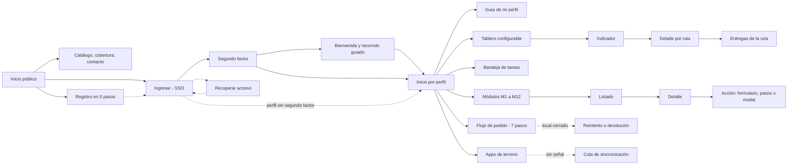

# Arquitectura de información del prototipo

Entregable del RT-25.09 (Bases Técnicas Transversales, cap. 25.5). Describe las 49 pantallas navegables del prototipo de Distribuidora Puelche: mapa del sitio, diagrama de navegación, taxonomía y nomenclatura, estructura de menús y jerarquía de la información.

Los datos salen del registro de rutas del prototipo (`js/router.js` y las vistas en `js/views/`), el mismo que arma el menú. Si cambia una ruta, este documento debe actualizarse.

## Resumen

| Elemento | Valor |
|---|---|
| Pantallas navegables | 49 (8 públicas y 41 con sesión) |
| Grupos del menú principal | 7 |
| Perfiles de demostración | 16 (15 actores de SD3 y uno de evaluación) |
| Niveles de profundidad | 5 (sitio público, inicio, módulo, detalle, acción) |
| Máximo de interacciones hasta una función principal | 3 (RT-25.01) |

---

## 1. Mapa del sitio

### 1.1 Sitio público (sin sesión)

| Pantalla | Ruta | Bloque 25.2 |
|---|---|---|
| Inicio público | `/` | Portal principal |
| Catálogo | `/catalogo` | Portal principal |
| Cobertura | `/cobertura` | Portal principal |
| Contacto | `/contacto` | Portal principal |
| Ingresar (inicio de sesión unificado) | `/ingresar` | Autenticación e incorporación |
| Verificación en dos pasos | `/verificacion` | Autenticación e incorporación |
| Recuperar acceso | `/recuperar` | Autenticación e incorporación |
| Registro de cliente (5 pasos) | `/registro` | Autenticación e incorporación |

### 1.2 Aplicación (con sesión)

Agrupada como en el menú principal. Las pantallas de detalle y de acción cuelgan de su listado.

```
Inicio
├── Inicio por perfil ..................... /inicio
│   ├── Bienvenida y recorrido guiado ..... /bienvenida   (primer ingreso)
│   ├── Notificaciones .................... /notificaciones
│   └── Mi perfil y preferencias .......... /perfil
├── Guía de mi perfil ..................... /guia
├── Tablero ............................... /tablero
└── Bandeja de tareas ..................... /bandeja

Operación
├── Pedidos (M3) .......................... /pedidos
│   ├── Detalle de pedido ................. /pedidos/:id
│   └── Flujo de pedido (M3–M7) ........... /flujo
├── Rutas (M4) ............................ /rutas
│   └── Detalle de ruta ................... /rutas/:id
├── Preparación (M5) ...................... /preparacion
├── Reparto en terreno (M6) ............... /terreno
├── Preventa en terreno (M3) .............. /terreno/preventa
└── Cobranza y rendición (M7) ............. /rendicion

Bodega
├── Recepción (M1) ........................ /recepcion
│   └── Registrar recepción ............... /recepcion/nueva
├── Inventario (M2) ....................... /inventario
└── Devoluciones y envases (M8) ........... /devoluciones
    ├── Registrar devolución .............. /devoluciones/nueva
    └── Detalle de devolución ............. /devoluciones/:id

Calidad y flota
├── Calidad y trazabilidad (M9) ........... /calidad
│   ├── Detalle de lote ................... /calidad/lotes/:id
│   └── Simulacro de retiro sanitario ..... /calidad/retiro
└── Telemetría y frío (M12) ............... /telemetria

Clientes y canales
├── Clientes .............................. /clientes
│   └── Ficha de cliente .................. /clientes/:id
├── Canal moderno EDI (M11) ............... /canal-moderno
├── Hacer un pedido (portal) .............. /portal/pedido
├── Mis entregas (portal) ................. /portal/entregas
├── Estado de cuenta (portal) ............. /portal/cuenta
├── Portal de transportistas .............. /portal/transportista
└── Portal de proveedores ................. /portal/proveedor

Analítica
└── Tablero analítico (M10) ............... /analitica
    └── Detalle del indicador ............. /analitica/:kpi
        └── Entregas de la ruta ........... /analitica/:kpi/ruta/:id

Administración
├── Personas usuarias ..................... /admin/usuarios
├── Roles y permisos ...................... /admin/roles
├── Parámetros ............................ /admin/parametros
└── Auditoría ............................. /admin/auditoria
```

Además existe una página de «no encontrado» para cualquier ruta inexistente, con enlace de regreso al inicio.

### 1.3 Utilidades globales (disponibles en todas las pantallas con sesión)

| Utilidad | Dónde | Acceso |
|---|---|---|
| Búsqueda global | Barra superior | Clic o tecla `/` |
| Acciones rápidas («Nuevo») | Barra superior | Clic |
| Indicador de conexión | Barra superior | Visible siempre |
| Avisos y notificaciones | Barra superior | Clic o `g` luego `n` |
| Tema claro u oscuro | Barra superior | Clic |
| Menú de usuario (perfil, cambiar perfil, atajos, cerrar sesión) | Barra superior | Clic |
| Plegar o desplegar el menú lateral | Botón junto al logo, dentro del menú. En escritorio lo pliega a un riel de íconos (con el nombre de cada pantalla al pasar el mouse) y lo despliega desde el mismo lugar; en tableta y teléfono el menú se abre con el botón de la barra superior y se cierra con el del menú | Clic |
| Atajos de teclado | Global | `?` muestra la lista |

---

## 2. Diagrama de navegación

Flechas continuas: camino principal. Flechas discontinuas: desvíos y excepciones.



---

## 3. Taxonomía y nomenclatura

### 3.1 Identificadores visibles

| Prefijo | Objeto | Ejemplo |
|---|---|---|
| `PV-` | Pedido de venta | PV-264822 |
| `R-` | Ruta de reparto | R-01 |
| `M-` | Misión de preparación | M-3302 |
| `DV-` | Devolución | DV-5527 |
| `L` | Lote del proveedor | L2611-47 |
| `OC-` | Orden de compra | OC-88412 |
| `EDI-` | Mensaje del canal moderno | EDI-77121 |
| `CL-` | Cliente | CL-10021 |
| `U-` | Persona usuaria | U-1001 |
| `AU-` | Evento de auditoría | AU-90412 |
| `SSCC` | Unidad logística GS1 | (00) 0780… |
| `GDE` | Guía de despacho electrónica | GDE 884133 |

### 3.2 Estados del pedido (proceso principal)

Capturado sin conexión → Pendiente de validación → Confirmado o Retenido (crédito) → Planificado → En picking → Cargado → En ruta → Entregado, Parcial o Fallido (local cerrado) → Reprogramado (si falló) → Rendido.

Cada estado usa siempre el mismo color: éxito en verde, advertencia en ámbar, error en rojo y en curso en naranja.

### 3.3 Términos del dominio (glosario de SD3, Anexo 3.A.14)

| Término | Significado en la interfaz |
|---|---|
| OTIF | Pedidos completos y a tiempo sobre comprometidos (RNG-09) |
| Fill rate | Unidades entregadas sobre unidades pedidas |
| FEFO | Primero en vencer, primero en salir |
| POD | Prueba de entrega: firma, código QR o fotografía |
| Costo de servir | Costo logístico por entrega y por cliente |
| Local cerrado | Excepción más frecuente de la entrega (RNG-05) |
| Retenido | Pedido o lote bloqueado hasta una decisión autorizada |
| Cross-docking | Transferencia directa sin almacenamiento |

### 3.4 Convenciones de nombres

- Los menús usan sustantivos del negocio («Pedidos», «Rutas»).
- Los botones usan un verbo en infinitivo («Registrar devolución», «Aprobar plan»).
- Las rutas van en minúscula, en español y sin tildes: `/devoluciones/nueva`, `/clientes/:id`.
- Cada entrada del menú muestra el código del módulo de SD4 (M1 a M12) cuando corresponde.

---

## 4. Estructura de menús

### 4.1 Menú principal (lateral)

| Grupo | Entradas |
|---|---|
| Inicio | Inicio · Guía de mi perfil · Tablero · Bandeja de tareas |
| Operación | Pedidos · Flujo de pedido · Rutas · Preparación · Reparto en terreno · Preventa en terreno · Cobranza y rendición |
| Bodega | Recepción · Inventario · Devoluciones y envases |
| Calidad y flota | Calidad y trazabilidad · Telemetría y frío |
| Clientes y canales | Clientes · Canal moderno EDI · Hacer un pedido · Mis entregas · Estado de cuenta · Portal de transportistas · Portal de proveedores |
| Analítica | Tablero analítico |
| Administración | Personas usuarias · Roles y permisos · Parámetros · Auditoría |

En escritorio el menú se pliega hacia la izquierda y recuerda la preferencia. En tableta y teléfono se abre como panel lateral desde el botón de menú.

### 4.2 Menús secundarios

- **Barra superior:** búsqueda, conexión, «Nuevo», avisos, tema y menú de usuario.
- **Menú contextual de filas:** clic derecho, tecla de menú o botón «⋯» en tablas de pedidos, devoluciones y otros listados.
- **Pestañas** dentro de fichas y portales (por ejemplo, transportistas: rutas, documentación y conductores).
- **Rastro de navegación** bajo la barra superior en todas las pantallas con sesión.

### 4.3 Menú visible por perfil

Cada perfil ve solo lo que su rol permite (RF-15.04). Todos tienen además Inicio y Guía de mi perfil.

| Perfil | Interfaz | Entradas del menú |
|---|---|---|
| Comisión evaluadora | Todas las interfaces | Todas |
| Gerente de Operaciones | Consola operacional | Tablero, Bandeja, Pedidos, Flujo, Rutas, Preparación, Reparto, Rendición, Inventario, Recepción, Devoluciones, Clientes, Analítica, Calidad, Telemetría |
| Planificador de Rutas | Consola de planificación | Tablero, Bandeja, Rutas, Pedidos, Flujo, Telemetría, Clientes, Analítica |
| Preventista | App de preventa | Preventa en terreno, Pedidos, Clientes, Bandeja |
| Conductor propio | App de reparto | Reparto en terreno, Devoluciones, Rendición, Bandeja |
| Conductor externo | App de reparto con credencial de turno | Reparto en terreno, Devoluciones, Rendición, Bandeja |
| Preparador | App de bodega | Preparación, Recepción, Bandeja |
| Jefa de Bodega | Consola de bodega | Tablero, Bandeja, Recepción, Inventario, Preparación, Devoluciones, Flujo, Analítica |
| Jefa de Calidad | Consola de Calidad | Tablero, Bandeja, Calidad, Telemetría, Inventario, Devoluciones, Analítica |
| Gerente Comercial | Consola comercial | Tablero, Bandeja, Clientes, Pedidos, Canal moderno, Analítica |
| Gerente de Finanzas | Consola financiera | Tablero, Bandeja, Rendición, Clientes, Devoluciones, Analítica |
| Jefe de TI | Consola de administración | Tablero, Bandeja, Personas usuarias, Roles, Parámetros, Auditoría, Analítica |
| Cliente del canal tradicional | Portal de clientes | Hacer un pedido, Mis entregas, Estado de cuenta, Bandeja |
| Cliente del canal moderno | Portal de clientes y EDI | Hacer un pedido, Mis entregas, Estado de cuenta, Bandeja |
| Empresa transportista | Portal de transportistas | Portal de transportistas, Bandeja |
| Proveedor | Portal de proveedores | Portal de proveedores, Bandeja |

---

## 5. Jerarquía de la información

### 5.1 Niveles de navegación

| Nivel | Contenido |
|---|---|
| 0 · Sitio público | Inicio público, catálogo, cobertura, contacto, ingreso y registro |
| 1 · Inicio por perfil | Accesos principales, tablero configurable y tareas |
| 2 · Módulo | Listado con indicadores, filtros, búsqueda y acciones masivas |
| 3 · Detalle | Ficha, línea de tiempo, pestañas y acciones del registro |
| 4 · Acción | Formulario, flujo de pasos, modal o confirmación |

### 5.2 Orden dentro de cada pantalla

1. Rastro de navegación (dónde estoy).
2. Título, contexto y acciones principales de la página.
3. Alertas que exigen una decisión.
4. Indicadores resumen.
5. Filtros y búsqueda.
6. Contenido principal: tabla, ficha o flujo.
7. Panel lateral: estado, línea de tiempo y bitácora.

---

## 6. Regla de tres interacciones (RT-25.01)

Camino más corto desde el inicio de cada perfil hasta su función principal.

| Perfil | Función principal | Camino | Interacciones |
|---|---|---|---|
| Preventista | Tomar un pedido sin señal | Inicio → «Tomar un pedido» → «Guardar sin conexión» | 2 |
| Conductor | Registrar local cerrado | Inicio → «Iniciar mi ruta» → parada → «Local cerrado» | 3 |
| Planificador | Aprobar el plan de mañana | Inicio → «Revisar ruta propuesta» → «Aprobar plan» | 3 |
| Jefa de Calidad | Iniciar retiro sanitario | Inicio → «Simulacro de retiro» → «Iniciar retiro» | 2 |
| Jefa de Bodega | Registrar recepción | «Nuevo» → «Registrar recepción» | 2 |
| Gerencia | Ver OTIF por ruta | Inicio → tarjeta OTIF | 1 |
| Finanzas | Tipificar descuadre | Menú → Rendición → «⋯» de la fila | 3 |
| Jefe de TI | Invitar persona usuaria | «Nuevo» → «Invitar persona usuaria» | 2 |
| Cliente | Hacer un pedido | Inicio → «Hacer un pedido» | 1 |
| Empresa transportista | Confirmar conductor y vehículo | Inicio → «Asignar conductor y vehículo» → «Asignar» → «Confirmar» | 3 |
| Proveedor | Ver la recepción de una orden | Inicio → «Órdenes y recepciones» → pestaña «Recepciones» | 2 |
| Todos | Encontrar cualquier registro | `/` → escribir → Enter | 2 |
